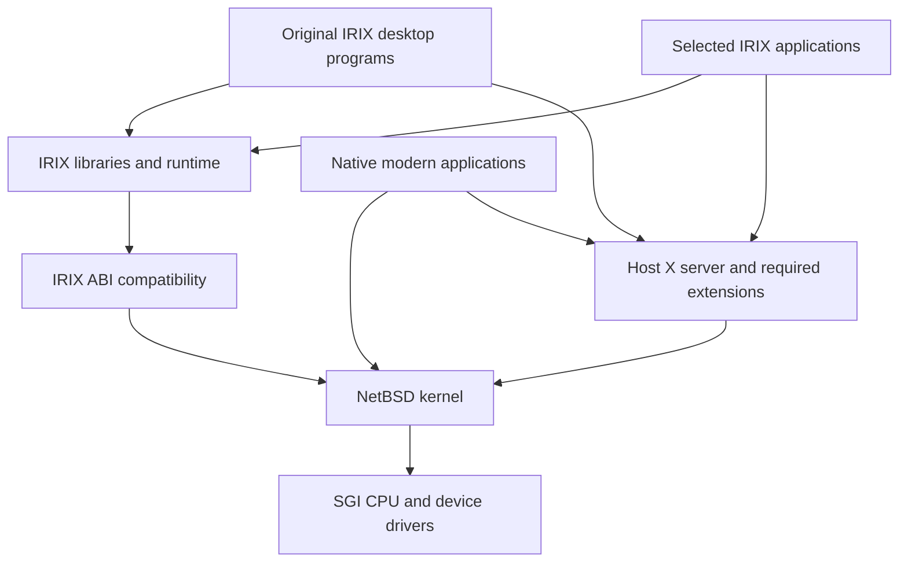

# Xiri proposed architecture

Status: architectural target agreed on 2026-10-14; emulator-first development added on 2026-10-15. Marked static o32 writable data/BSS, arguments, file I/O, and private memory mappings are validated as a bounded subset in emulation; general compatibility and the desktop remain unvalidated. The [execution roadmap](ROADMAP.md) defines the remaining experiments.

Xiri will use NetBSD as its underlying OS, execute selected IRIX binaries on the workstation's MIPS CPU through an IRIX personality, and preserve the existing IRIX desktop. Applications built natively for NetBSD should share that desktop with the compatible programs.

## Execution paths

The diagram describes logical interfaces, not completed components. The IRIX libraries and desktop would initially come from the user's installation. On physical SGI hardware, ordinary MIPS code can run directly when the selected CPU supports its instruction set.

Initial development runs the complete NetBSD/sgimips system inside an Indy emulator on a modern host. The emulator supplies the MIPS CPU and SGI devices; Xiri still implements the IRIX OS interfaces inside NetBSD. This is the same guest architecture intended for the physical Indy. A separate user-mode IRIX runner on a native x86 or ARM OS would require additional CPU translation and integration, and remains a later objective. See the [emulation plan](EMULATION.md).

## Host kernel and drivers

Use the host's scheduler, virtual memory, networking, filesystems, and device framework. Keep machine support and IRIX application compatibility separable so that driver improvements can benefit the upstream OS.

Bring up serial console, memory, interrupts, storage, Ethernet, input, and display independently. Validate DMA and cache behavior under sustained I/O before describing a board as supported. Treat SMP as a separate capability from successful single-CPU boot.

Use a host-native filesystem for the first installation and an explicit import path for IRIX files. Booting from, or writing to, existing IRIX filesystems is a separate requirement rather than a prerequisite for binary compatibility.

## Reverse-engineering workflow

Reverse engineering is an explicit part of Xiri's development approach, especially for graphics drivers and other proprietary or undocumented interfaces needed by the desktop and applications. Combine available documentation and open-source drivers with analysis of original IRIX binaries, firmware and observed behavior. [REA](FEASIBILITY.md#rea-reverse-engineering-tools) is a candidate tool for organizing native-binary investigations; its suitability for SGI artifacts remains to be qualified.

For each missing behavior:

1. Define a narrow question and a reproducible operation, such as display initialization, a rectangle fill, buffer transfer or completion interrupt.
2. Record the machine and graphics-board revision, IRIX version, artifact hashes and relevant existing driver references.
3. Inspect code and collect traces to identify register accesses, command formats, memory layouts, DMA, synchronization and error handling. Separate direct observations from inferred explanations.
4. Test the hypothesis with a small probe. Use emulator instrumentation where the device is modeled and compare against original IRIX on physical hardware; an emulator may share the same incomplete assumptions.
5. Implement the required behavior in the NetBSD driver or compatibility adapter and retain a regression case with the supporting evidence.

Store interface notes, trace interpretations, probes and implementation decisions in the repository. Keep original proprietary binaries outside Git. Establish basic display and input behavior before expanding into acceleration; an inferred command stream alone does not establish correct cache, DMA or interrupt handling.

## IRIX binary compatibility

The compatibility layer must implement the selected application's ABI: its executable format, calling conventions, system-call behavior, and data layouts. Matching MIPS instruction sets or POSIX APIs alone is insufficient.

The [historical source audit](results/2026-10-30-irix-compat-audit.md) identifies ELF recognition bugs, removed SVR4 dependencies, and current kernel interface gaps. Reuse verified ABI definitions selectively. The [first implementation](results/2026-10-30-irix-o32-execution.md) now executes an explicitly marked synthetic static o32 program using `write` and `exit`, with native and rejection checks in both emulator modes. The test marker is not an IRIX branding standard, and the accepted image layout is deliberately narrow. n32 is a confirmed requirement: the supplied [IRIX 6.5.22m desktop binaries](results/2026-10-30-irix-vendor-baseline.md) use it.

The [static interface extension](results/2026-10-30-irix-o32-basics.md) adds argc/argv/envp with static `AT_NULL`, translated open flags, read/close, and private mmap/munmap/mprotect. All 44 cases pass in both modes, including partial transfers, file effects, copy-on-write, and protection faults. That initial subset used the native guest namespace; mapping placement still uses native VM policy. The [data/BSS extension](results/2026-10-30-irix-o32-segments.md) admits a separate RW segment after RX text, with 89 cases passing in both modes. It validates file/virtual ranges and permissions before using native ELF VM commands for private data and zero-fill. The [runtime extension](results/2026-10-30-irix-o32-runtime.md) loads bounded o32 executables and libc interpreters at linked addresses, supplies dynamic auxiliary data, and uses NetBSD’s `/emul/irix` lookup with native-path fallback. The [query extension](results/2026-10-30-irix-o32-queries.md) supplies page size, an explicit traditional-superuser capability mode, empty IRIX capability sets, and native real/effective identities. NetBSD credentials and authorization remain authoritative. The [ELF-map extension](results/2026-10-30-irix-o32-elfmap.md) maps two bounded segments at linked addresses using native exec VM helpers. Fixed insertions preserve existing mappings; rollback removes only ranges created by the request, under an explicit single-LWP, unshared-vmspace restriction. Private data and BSS, protection faults, collision cleanup, and native file/mount checks are tested. Original IRIX’s relocation and wider layout acceptance remain outside this subset. The [dispatch extension](results/2026-10-30-irix-o32-dispatch.md) handles one checked level of syscall(number, ...), marshals o32 register/stack arguments, returns the native page size through sysmp, and accepts non-fixed mmap hints without replacing existing mappings. Unmodified asa now completes its filter through the original libc and rld, with output compared against original IRIX. Optional unsupported runtime queries remain explicit errors; general relocation, signals, process sharing, and terminal semantics are outside this qualification. n32 echo requests `/lib32/libc.so.1`. The separate [LP64 native baseline](results/2026-10-30-netbsd64-native.md) now qualifies GENERIC64_IP2x with COMPAT_NETBSD32, 8 KiB pages, installed o32 userland and native n32/n64 probes. It needs an ARCS o32 firmware bridge and an emulator TLB tag fix. The [dual-ABI extension](results/2026-10-30-irix-lp64.md) now enables the bounded foreign personality on a separate LP64 kernel. It uses explicit 32-bit wire types, checked o32 spills, n32 register arguments, netbsd32 stack/address handling, and explicit ELF32 auxiliary-data layouts. Matching main/interpreter ABIs and native-page alignment are validated before selection. Native heap operations back break(1017) with foreign bounds checks. Unmodified n32 echo and o32 asa run through their original libc/rld as root and an ordinary user, with paired original-IRIX probes and both-mode regressions. This qualifies only the present 32-bit syscall argument/return forms; wide foreign calls, general relocation, caught foreign signals and shared address spaces remain separate work.

| Area | Initial requirement |
| --- | --- |
| Executable loading | Correct ELF recognition, stack, auxiliary data, interpreter handling, and address layout |
| ABI coverage | Start with a small o32 probe; inventory desktop binaries immediately to determine required n32 coverage; scope n64 from actual applications |
| System calls | Translate arguments, structures, flags, return values, and error numbers |
| Processes and signals | Correct fork, exec, wait, signal delivery, restart behavior, and context restoration |
| Memory and synchronization | Investigate mmap semantics, shared memory, IRIX process-sharing primitives, and synchronization used by the selected runtime |
| Files and devices | Implement required paths, metadata layouts, directory entries, and terminal or device ioctls |
| Libraries | Use a versioned IRIX runtime tree initially, with an explicit lookup policy |

An initial static probe can avoid dynamic-loader dependencies, but real desktop programs cannot. Establish a dynamically linked test early. A successful command-line executable is evidence for that executable only.

Kernel integration through NetBSD's executable and emulation facilities is the leading approach for native execution. A userspace tracer may help observe behavior, but is not assumed to implement all signal, threading, and VM semantics.

## Original desktop preservation

The preservation strategy is to retain original desktop executables where feasible and provide the services needed to run them on the host OS. SGI's [desktop documentation](https://tech-pubs.net/SGI_EndUser/books/Desktop_UG/sgi_html/ch13.html) provides the behavior reference; the chosen IRIX installation supplies the version-specific baseline.

The full desktop is intended to run on NetBSD and X.org. Once IRIX X applications
work, use the supplied [IRIX Interactive Desktop User Interface Guidelines,
007-2167-006](https://techpubs.jurassic.nl/library/manuals/2000/007-2167-006/sgi_html/)
to guide the [desktop acceptance cases](ROADMAP.md#milestone-3-original-desktop-proof).
Check component interactions and session behavior against the selected IRIX
installation as well as the documented interface.

Inventory `4Dwm`, Toolchest, the file manager, desktop/session components, their shared libraries, fonts, resources, and invoked helpers. Measure which components need ordinary X11, particular visuals, SGI extensions, or graphics APIs. Do not assume every desktop component uses only standard Motif and X11.

The [desktop startup audit](results/2026-10-30-irix-desktop-startup.md) resolves 4Dwm’s 25-library static closure and Toolchest’s eight-library closure against native IRIX ldd. The [initial TCP client subset](results/2026-10-30-irix-tcp.md) now translates socket types, IPv4 addresses, two integer options and retry timing. The [getsockname wrapper](results/2026-10-31-irix-sockname.md) now translates the local address and follows measured IRIX output-length and copyout-error rules. The [getpeername wrapper](results/2026-10-31-irix-peername.md) shares the IPv4 conversion while preserving the separately measured descriptor/length/connection-state ordering. The [X-client startup wrappers](results/2026-10-31-irix-xconnect.md) add the measured hostname, descriptor-control, legacy sendmsg and shutdown subset. Toolchest now completes X setup and sends requests processed by native Xvfb.

The [legacy recvmsg wrapper](results/2026-10-31-irix-recvmsg.md) now receives a 32-byte X reply. It explicitly marshals the 24-byte header and 8-byte vectors, consumes data before ordinary receive copyout, preserves queued data for peeking, and follows IRIX’s measured partial-fault and ignored header-length-copyout rules. The [session diagnosis](results/2026-10-31-irix-toolchest-session.md) isolates its later SIGSEGV to `strcpy(..., getenv("HOME"))` with an empty environment. A native wrapper now supplies an explicit environment without changing the historical runner or kernel. The [select adapter](results/2026-10-31-irix-select.md) reuses the native scan/wait protocol on owned kernel masks, while supplying explicit 32-bit fields, distinct-descriptor counting, final-word preservation and continued copyout after an earlier output fault. Its 1024-descriptor cap and stricter invalid-descriptor behavior are explicit differences from the original IRIX oracle. Version-2 `xstat` still prevents the menu configuration check even when the supplied menu, app-defaults and locale indexes are installed. That interface needs a paired ABI contract before window and event-loop qualification. 4Dwm additionally needs support for two 4 KiB data-load boundaries and overlapping linked library ranges. These require explicit mapping/relocation contracts. XDM session scripts also invoke fm, resource/visual helpers and cleanup services, so loading either binary is only one part of desktop preservation.

The [irix-work research reference](FEASIBILITY.md#irix-work-desktop-reverse-engineering) supplies additional leads for desktop dependencies, X11 bridging, file monitoring and session integration. Compare its reported fixes and failure cases with the selected original-IRIX installation; its Linux/x86-64 runners require a separate assessment before any behavior or implementation is reused in Xiri's NetBSD/MIPS environment.

Use [IRIX-Simulator](FEASIBILITY.md#irix-simulator-desktop-appearance-and-interaction) only as a supplementary reference for desktop look and feel and interaction mechanics: window decoration, menus, focus, icons, desks and preferences. Derive acceptance criteria from the selected original-IRIX installation and SGI documentation, checking the simulator's interpretations against those sources.

Two experiments isolate different failure modes:

1. Run selected original desktop clients on IRIX against a separate modern X server. This probes display compatibility while retaining the original kernel and libraries. Use a dedicated test display so a window-manager experiment does not replace an existing session.
2. Run the same clients through Xiri compatibility against that display. Differences then help identify missing ABI or host-service behavior.

Perform the first reference and compatibility experiments in the emulated Indy environment. These experiments are development tools. The intended result is local execution and display on the SGI workstation, with physical validation before a hardware release.

Desktop acceptance includes reliable window management, menus, file navigation, application launch, preferences, and session restart. Validate file changes made by native applications appearing in the desktop, and the ability to launch a host-native program from it.

Provide explicit adapters for system integration. An IRIX control panel that changes networking, accounts, storage, or power state cannot be assumed to control the new host correctly. Implement and test the relevant operation against host services before enabling it.

## Shared files and application launch

Keep the IRIX runtime in a distinct tree while making selected user files available consistently to native and compatible processes. The path policy must cover absolute library paths, executable lookup, temporary files, user identities, and desktop configuration.

A compatibility launcher should select the appropriate runtime for IRIX programs and dispatch host-native programs without routing them through IRIX libraries. Define environment and argument handling explicitly. This is needed for a native editor or network client to become a useful part of the preserved desktop.

Keep original system binaries, libraries, and desktop assets outside the source repository. Store dependency manifests, import tooling, source references, and tests. Determine packaging terms for any third-party files before distributing a bundled runtime.

## Graphics boundaries

The host X server and host graphics driver own the physical display. Original IRIX X client libraries may be reusable once their ABI dependencies work; original X server and kernel graphics components are separate compatibility problems.

Start with 2D functionality on one supported graphics configuration. Test legacy OpenGL through a defined library or protocol boundary and a known renderer before attempting acceleration. Record required extensions and visuals per application. IRIS GL requires its own investigation; OpenGL support does not imply IRIS GL compatibility.

Supporting IMPACT or VPro acceleration would involve command submission, memory and synchronization behavior, and the host rendering stack. [OpenBSD's Impact](https://man.openbsd.org/OpenBSD-6.9/sgi/impact.4) and [VPro](https://man.openbsd.org/OpenBSD-6.9/sgi/odyssey.4) console drivers are starting references, not substitutes for that work.

## Validation and maintenance

Develop small behavioral probes that run on original IRIX and the proposed host. Compare results for loading, memory, signals, files, process behavior, and desktop protocols. Preserve the input program, expected behavior, and exact environment with each result.

Use Indy emulation as the default implementation and regression environment. Qualify current NetBSD boot and I/O before depending on an emulator; IRIS is the preferred harness and MAME the independent comparison/fallback. Cross-build kernels and probes on the modern host. Cold-boot changed kernels and reserve snapshots for tests of an unchanged guest build. The [emulation plan](EMULATION.md) records debugger, automation, and fidelity constraints.

Repeat key milestones on the physical Indy before claiming hardware support. Physical machines remain necessary for driver, cache, DMA, timing, and graphics qualification; emulator success does not establish Indigo2 or Octane support.

Publish support by machine configuration, desktop component, and application version. Keep the kernel changes small enough to rebase regularly, and pursue upstreamable driver fixes to reduce the project's maintenance burden.
