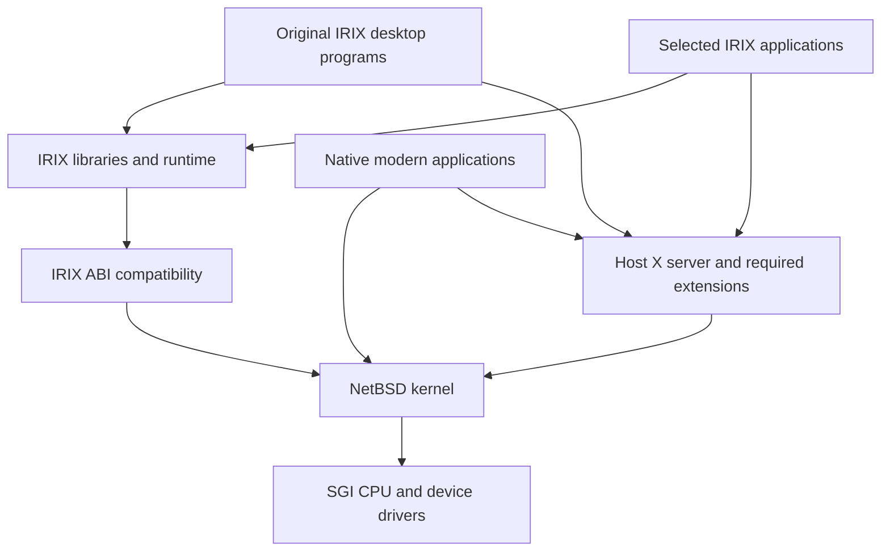

# Xiri proposed architecture

Status: updated 2026-11-05. The original IRIX 6.5.22m desktop runs on
native accelerated Newport Xorg, including winterm with a native shell,
catalog launches, running-icon feedback, backdrop and desktop icons. The
IRIX personality now boot-loads as a module on our NetBSD fork. Native
service and user-session integration lives in [`runtime/`](../runtime/README.md).
The candidate [terminal interfaces](results/2026-11-04-irix-terminal.md)
add Unix stream socket pairs and one-descriptor legacy transfers
inside the module, using native socket ownership and cleanup. PTY setup maps
the emulation slave directory directly to native ptyfs through `/../dev/pts`,
superseding the earlier nullfs view. The following
[termios adapter](results/2026-11-04-irix-termios.md) translates measured
terminal attributes and session/group queries through the native PTY line
discipline. A foreign session leader can acquire its native PTY slave on
open, subject to native ownership checks and `O_NOCTTY`. Serial hardware,
other line disciplines and general STREAMS support remain incomplete;
these changes require no new core-kernel hook.
The [Type1 finding](results/2026-11-05-type1-scaler.md) adds a native MIPS
FPU signal-return correction to the core kernel. It preserves supplied
floating-point state across lazy reload and repairs zero-size font requests
from native X servers. The IRIX module, fonts and X libraries are unchanged;
this platform correction cannot be supplied by the IRIX module alone.
The [execution roadmap](ROADMAP.md) tracks remaining application, desktop
and deployment work.

Xiri will use NetBSD as its underlying OS, execute selected IRIX binaries on the workstation's MIPS CPU through an IRIX personality, and preserve the existing IRIX desktop. Applications built natively for NetBSD should share that desktop with the compatible programs.

## Execution paths

The diagram describes logical interfaces, not completed components. The IRIX libraries and desktop would initially come from the user's installation. On physical SGI hardware, ordinary MIPS code can run directly when the selected CPU supports its instruction set.

The first application-import path now copies the installed image's binaries
and resources together with its existing Icon Catalog links and filetype
registration. The [import inventory](results/2026-11-01-irix-installed-desktop.md)
keeps system assets distinct from native account/session state. Original
`inst`/Software Manager support remains a later package-management path;
importing files does not establish an installation database or working
application behavior.

Initial development runs the complete NetBSD/sgimips system inside an Indy emulator on a modern host. The emulator supplies the MIPS CPU and SGI devices; Xiri still implements the IRIX OS interfaces inside NetBSD. This is the same guest architecture intended for the physical Indy. A separate user-mode IRIX runner on a native x86 or ARM OS would require additional CPU translation and integration, and remains a later objective. See the [emulation plan](EMULATION.md).

## Components and deployment

Xiri is a NetBSD-based compatibility environment with kernel and user-space
parts. It currently requires a kernel built with our compatibility changes;
installing a background service on an unmodified NetBSD system is insufficient.

| Component | Responsibility | Current implementation |
| --- | --- | --- |
| IRIX kernel personality | Recognize/load foreign ELF images; translate system calls, layouts, errors and process/VM behavior | Boot-loaded `compat_irix_o32.kmod` on our NetBSD fork; both o32 and n32 are supported despite the name; a built-in configuration remains available |
| Original IRIX runtime and desktop | rld/libc and other libraries, 4Dwm, Toolchest, winterm, file/icon clients, fonts and defaults | Selected files imported from the reference image; runtime lookup under `/emul/irix` with native fallback |
| Native NetBSD platform | Scheduler, memory, storage, networking, devices, X server and native applications | Native Xorg drives the emulated Newport display at 1280×1024; Xvfb remains available for controlled tests. Physical display acceptance is separate |
| Native display manager (opt-in) | Authenticate a native account, own the X server and X authority, return to the greeter on session exit | NetBSD xdm/PAM and its standard Xsession launch the selected user's `.xsession`, which enters `xiri-session`; original IRIX clogin remains separate work |
| Session and service integration | Environment, launch order, native shell handoff, application launching and host-service adapters | Maintained rc.d services own native FAM v1 and PTY setup; native rpcbind retains its service lifecycle. The unprivileged client session owns its descendants. FAM supplies file notifications and process-execution polling for opened icons. The session starts `fm -b` and initializes Desktop; session restoration and broader desktop services remain open |
| Development lab | Boot/reference automation, probes, traces, comparisons and reproducible artifacts | This repository plus the IRIS emulator fork; the emulator is not intended to be required on a supported physical MIPS workstation |

The [selected xdm CHD](results/2026-11-03-xiri-xdm-image.md) packages the
maintained runtime and native login manager. System services
start before LOGIN; `xiri-session` runs as the native account, retaining HOME,
supplementary groups and X authority on an existing X display. Its
`EVFILT_PROC`/`NOTE_TRACK` supervisor follows descendants, including daemonized
children, without terminating unrelated processes of the same user. The
manual `xiri-desktop` wrapper starts an authenticated X server, enters the
configured account with `su -l`, and stops only its own X server after logout.

The 2026-11-03 deployment request prioritizes a boot-loaded personality,
configured native services and then normal xiritest login through xdm.
Original IRIX clogin follows later. The [module cycle](results/2026-11-03-irix-module.md)
implements the kernel boundary on our fork. The [service/session qualification](results/2026-11-03-xiri-session.md) passes
four desktops, independent shell survival, inherited groups/X authority and
service restart. Its prerequisites are in the [runtime guide](../runtime/README.md).
The [xdm integration](results/2026-11-03-xiri-xdm.md) reuses that boundary
through the native login manager; the [replacement image](results/2026-11-03-xiri-xdm-image.md)
passes direct-disk boot and both IRIX/native login paths. Newport and
other native platform drivers remain separate from the foreign personality.
See the [packaging phase](ROADMAP.md#next-packaging-phase).

Supporting daemons are packaged as ordinary NetBSD services, while the
desktop can be selected as an X login session. Those are user-space
deployment choices; they do not replace the kernel's executable and system-call
handling. A loadable module still executes in the kernel. **A loadable module
modeled after `compat_linux` is the desired final delivery target**, agreed on
2026-11-01 and tracked in the
[release roadmap](ROADMAP.md#milestone-4-usable-first-release). The current
manual image [boot-loads the personality](results/2026-11-03-xiri-xdm-image.md)
from `compat_irix_o32.kmod` at normal securelevel. The
[loadable-module build](../lab/irix-module/README.md) targets the Xiri fork;
standalone module loading on a stock kernel has not been established.

The [FAM integration](results/2026-11-02-desktop-services.md) is native
userspace code. Its filesystem watches require a shared native alias for
the imported desktop resource tree; the kernel's foreign pathname lookup
does not apply to the native daemon. The current service maps loopback
clients to the dedicated test account and is explicitly a single-user
development configuration, pending broader account/session design.

The [desktop usability work](results/2026-11-02-desktop-usability.md) routes
Toolchest and 4Dwm logout through a native request-file helper. That interface
is retained by the descendant supervisor. Its per-session 4Dwm configuration
changes the logout command while preserving the imported vendor file. This
supplies session exit without implementing IRIX saved-session restoration.
Graphical console login and the diagnostic serial getty remain ordinary
NetBSD configuration.

The code already has [module registration and initialization/finalization
hooks](https://github.com/salvogendut/NetBSD-xiri/blob/c11c9f16fad11837a169a3cd566582bebea2c029/sys/compat/irix_o32/irix_o32.c#L131):
`MODULE_CLASS_EXEC`, `exec_add` and `exec_remove`. Dependencies are `exec_elf32`
and, on LP64, `compat_netbsd32`. `sys/modules/compat_irix_o32` now builds a
module for `mips64eb`; NetBSD’s MIPS object loader currently requires N64.
The module supports both foreign o32 and n32 programs. The kernel retains
`exec_elf32` and `compat_netbsd32` as built-in dependencies. The audited
module has 147 imports, all supplied by the module-test kernel. One is our
`selcommon_kern` helper in `sys/kern/sys_select.c`, used by foreign select;
the inspected upstream tree does not provide it. Stock-kernel deployment
still requires upstreaming or replacing this helper.

The pthread-initialization work adds another core dependency: an optional
`emul.e_sigmask` callback in `lwp_userret` to refresh a user-managed signal hold
before pending-signal delivery. This hook also needs upstream integration or
an equivalent supported interface for deployment on a standard kernel.

The [child-state cycle](../lab/irix-job-control/README.md) adds an opt-in
`EMUL_NOCLDSTOP_CONT` flag in the existing `emul.e_flags` field. IRIX's
`SA_NOCLDSTOP` suppresses continued-child notifications as well as stopped-child
notifications. The core applies that policy before queuing SIGCHLD; dropping
it at delivery would still interrupt a wait and could replace a pending exit
notification. Native NetBSD keeps its existing behavior. This is a third core
interface to upstream or replace for stock-kernel deployment, and requires
the matching core/module pair. Sleep and foreign wait translation stay in
the loadable IRIX module.

The same cycle found a separate native wait-accounting bug: consuming a
continuation subtracted from the stopped/zombie count a second time, and a
scan shortcut skipped continuations behind live siblings. The shared fix is
covered by [native before/after tests](results/2026-11-05-native-wait.json).
It adds no module interface; native and foreign parents use the corrected
common wait machinery.

The [paging investigation](results/2026-11-05-native-paging.md) concerns shared
native UVM code as well: software-encrypted pageout can monopolize the CPU
on this non-preemptible MIPS kernel. Its candidate adds bounded scan pauses
after the free-memory target is covered and fixes the big-endian boolean
sysctl used to control swap encryption. The IRIX module remains byte-identical;
these changes add no personality interface. Full deployment qualification
is recorded separately from the native timing and sysctl controls.

The [native stability cycle](results/2026-11-04-system-stability.md) also fixes
CD9660 mount translation for native NetBSD o32 programs in `compat_netbsd32`.
It translates ownership and permission masks in modern mount arguments and
preserves the legacy layout, defaults and update behavior. This is a general
native compatibility correction, separate from the IRIX personality and its
core hooks; the IRIX module is byte-identical. The corrected core is now in
the [selected image](results/2026-11-04-xorg-scheduling.md). The first candidate
was held after reproducing a native XTest timeout. Alarm-time state identifies
Xorg 1.10.6 client-priority starvation after the delayed release has woken.
The runtime selects `-dumbSched` in both Xorg launch commands, retaining XAA
and the original XTest delays. This is a native server configuration workaround;
it adds no kernel or IRIX-personality dependency. Cold-image input, query-loop,
application, both-user session and clean-shutdown gates pass. Reassess the
option with a newer server; unrelated older native stalls remain open.

The [traditional-signal adapter](results/2026-11-01-irix-signal.md) adds
explicit foreign frame conversion around native signal, machine-context and
PCU interfaces, without another core-kernel hook. Its measured o32/n32
delivery/return and wait-any subset passes; nested signals, alternate stacks,
restart and general multi-LWP behavior remain separate qualification work.

NetBSD's [current module framework](https://man.netbsd.org/module.7) supports
execution interpreters and uses [modload](https://man.netbsd.org/modload.8).
The module cycle uses the existing modules rc.d service and
[modules.conf](https://man.netbsd.org/modules.conf.5) to load before multiuser
startup. Direct PROM boot requires `COPY_SYMTAB=1` to embed kernel symbols.
Interactive lifecycle tests use single-user securelevel 0; normal startup
retains securelevel 1 and its restrictions on module administration.

[NetBSD's Linux compatibility](https://man.netbsd.org/compat_linux.8) is the
chosen architectural model: `compat_linux` is available as a kernel module, while
the foreign runtime and libraries live under `/emul/linux` (or `/emul/linux32`
for the corresponding ABI). Follow its module structure, registration,
dependency handling and load/unload lifecycle, with the IRIX runtime under
`/emul/irix` and desktop/session services packaged separately. IRIX ABI behavior
still comes from IRIX reference measurements; the Linux module supplies the
integration model. The module milestone qualifies these dependencies on the Xiri fork;
a stock-kernel build remains a separate target.

The intended packaging combines the loadable personality, an importer/runtime
tree, and session/service packages. Upstreaming or removing required core
changes could make a custom kernel unnecessary on a compatible NetBSD/MIPS
installation. On x86 or ARM, CPU translation would also be necessary because
the original applications contain MIPS instructions.

Repository ownership follows this division: `NetBSD-xiri` contains kernel and
machine changes; `iris` supplies the emulated Indy used for development; this
`xiri` repository holds the native service/session runtime, integration lab,
import tools, tests and documentation.

## Host kernel and drivers

Use the host's scheduler, virtual memory, networking, filesystems, and device framework. Keep machine support and IRIX application compatibility separable so that driver improvements can benefit the upstream OS.

Bring up serial console, memory, interrupts, storage, Ethernet, input, and display independently. Validate DMA and cache behavior under sustained I/O before describing a board as supported. Treat SMP as a separate capability from successful single-CPU boot.

Use a host-native filesystem for the first installation and an explicit import path for IRIX files. Booting from, or writing to, existing IRIX filesystems is a separate requirement rather than a prerequisite for binary compatibility.

## Reverse-engineering workflow

Reverse engineering is an explicit part of Xiri's development approach, especially for graphics drivers and other proprietary or undocumented interfaces needed by the desktop and applications. Combine available documentation and open-source drivers with analysis of original IRIX binaries, firmware and observed behavior. [REA](FEASIBILITY.md#rea-reverse-engineering-tools) is a candidate tool for organizing native-binary investigations; its suitability for SGI artifacts remains to be qualified.

For each missing behavior:

1. Define a narrow question and a reproducible operation, such as display initialization, a rectangle fill, buffer transfer or completion interrupt.
2. Record the machine and graphics-board revision, IRIX version, artifact hashes and relevant existing driver references.
3. Inspect code and collect traces to identify register accesses, command formats, memory layouts, DMA, synchronization and error handling. Separate direct observations from inferred explanations.
4. Test the hypothesis with a small probe. Use emulator instrumentation where the device is modeled and compare against original IRIX on physical hardware; an emulator may share the same incomplete assumptions.
5. Implement the required behavior in the NetBSD driver or compatibility adapter and retain a regression case with the supporting evidence.

Store interface notes, trace interpretations, probes and implementation decisions in the repository. Keep original proprietary binaries outside Git. Establish basic display and input behavior before expanding into acceleration; an inferred command stream alone does not establish correct cache, DMA or interrupt handling.

## IRIX binary compatibility

The compatibility layer must implement the selected application's ABI: its executable format, calling conventions, system-call behavior, and data layouts. Matching MIPS instruction sets or POSIX APIs alone is insufficient.

The [historical source audit](results/2026-10-30-irix-compat-audit.md) identifies ELF recognition bugs, removed SVR4 dependencies, and current kernel interface gaps. Reuse verified ABI definitions selectively. The [first implementation](results/2026-10-30-irix-o32-execution.md) now executes an explicitly marked synthetic static o32 program using `write` and `exit`, with native and rejection checks in both emulator modes. The test marker is not an IRIX branding standard, and the accepted image layout is deliberately narrow. n32 is a confirmed requirement: the supplied [IRIX 6.5.22m desktop binaries](results/2026-10-30-irix-vendor-baseline.md) use it.

The [static interface extension](results/2026-10-30-irix-o32-basics.md) adds argc/argv/envp with static `AT_NULL`, translated open flags, read/close, and private mmap/munmap/mprotect. All 44 cases pass in both modes, including partial transfers, file effects, copy-on-write, and protection faults. That initial subset used the native guest namespace; mapping placement still uses native VM policy. The [data/BSS extension](results/2026-10-30-irix-o32-segments.md) admits a separate RW segment after RX text, with 89 cases passing in both modes. It validates file/virtual ranges and permissions before using native ELF VM commands for private data and zero-fill. The [runtime extension](results/2026-10-30-irix-o32-runtime.md) loads bounded o32 executables and libc interpreters at linked addresses, supplies dynamic auxiliary data, and uses NetBSD’s `/emul/irix` lookup with native-path fallback. The [query extension](results/2026-10-30-irix-o32-queries.md) supplies page size, an explicit traditional-superuser capability mode, empty IRIX capability sets, and native real/effective identities. NetBSD credentials and authorization remain authoritative. The [ELF-map extension](results/2026-10-30-irix-o32-elfmap.md) maps two bounded segments at linked addresses using native exec VM helpers. Fixed insertions preserve existing mappings; rollback removes only ranges created by the request, under an explicit single-LWP, unshared-vmspace restriction. Private data and BSS, protection faults, collision cleanup, and native file/mount checks are tested. Original IRIX’s relocation and wider layout acceptance remain outside this subset. The [dispatch extension](results/2026-10-30-irix-o32-dispatch.md) handles one checked level of syscall(number, ...), marshals o32 register/stack arguments, returns the native page size through sysmp, and accepts non-fixed mmap hints without replacing existing mappings. Unmodified asa now completes its filter through the original libc and rld, with output compared against original IRIX. Optional unsupported runtime queries remain explicit errors; general relocation, signals, process sharing, and terminal semantics are outside this qualification. n32 echo requests `/lib32/libc.so.1`. The separate [LP64 native baseline](results/2026-10-30-netbsd64-native.md) now qualifies GENERIC64_IP2x with COMPAT_NETBSD32, 8 KiB pages, installed o32 userland and native n32/n64 probes. It needs an ARCS o32 firmware bridge and an emulator TLB tag fix. The [dual-ABI extension](results/2026-10-30-irix-lp64.md) now enables the bounded foreign personality on a separate LP64 kernel. It uses explicit 32-bit wire types, checked o32 spills, n32 register arguments, netbsd32 stack/address handling, and explicit ELF32 auxiliary-data layouts. Matching main/interpreter ABIs and native-page alignment are validated before selection. Native heap operations back break(1017) with foreign bounds checks. Unmodified n32 echo and o32 asa run through their original libc/rld as root and an ordinary user, with paired original-IRIX probes and both-mode regressions. This qualifies only the present 32-bit syscall argument/return forms; wide foreign calls, general relocation, caught foreign signals and shared address spaces remain separate work.

| Area | Initial requirement |
| --- | --- |
| Executable loading | Correct ELF recognition, stack, auxiliary data, interpreter handling, and address layout |
| ABI coverage | Start with a small o32 probe; inventory desktop binaries immediately to determine required n32 coverage; scope n64 from actual applications |
| System calls | Translate arguments, structures, flags, return values, and error numbers |
| Processes and signals | Correct fork, exec, wait, signal delivery, restart behavior, and context restoration |
| Memory and synchronization | Investigate mmap semantics, shared memory, IRIX process-sharing primitives, and synchronization used by the selected runtime |
| Files and devices | Implement required paths, metadata layouts, directory entries, and terminal or device ioctls |
| Libraries | Use a versioned IRIX runtime tree initially, with an explicit lookup policy |

An initial static probe can avoid dynamic-loader dependencies, but real desktop programs cannot. Establish a dynamically linked test early. A successful command-line executable is evidence for that executable only.

Kernel integration through NetBSD's executable and emulation facilities is now
implemented as the bounded `COMPAT_IRIX_O32` personality. A userspace tracer
may help observe behavior, but is not assumed to implement all signal,
threading and VM semantics. The [AUTORESRV result](results/2026-11-01-irix-mmap-autoresrv.md)
illustrates the boundary: the kernel performs native demand mappings for an
IRIX request. The subsequent [PR_INIT_THREADS adapter](results/2026-11-01-irix-init-threads.md)
maintains measured PRDA holds and synchronizes native signal masks; it does
not establish thread creation. The [mkdir adapter](results/2026-11-01-irix-mkdir.md)
now uses native VFS creation with measured pathname translation and explicit
native group-ownership policy. It adds no new core hook. The [pipe adapter](results/2026-11-01-irix-pipe.md)
similarly dispatches to native descriptor allocation with the measured V0/V1
return convention and no extra core hook. The [shared mmap adapter](results/2026-11-01-irix-mmap-shared.md)
also uses existing native facilities: UVM supplies shared anonymous mappings,
and AUTOGROW is bounded to the actual zero device. Regular-file fault-time
growth remains unsupported. Original inst now reaches `sproc` with shared VM
and parent-blocking flags. The [original sproc measurements](results/2026-11-01-irix-sproc-reference.md)
now establish private PRDA/LOCAL pages alongside shared data and newly created
mappings. Parent release depends on an explicit unblock or an armed
PR_UNBLKONEXEC followed by successful exec or exit; failed exec retains the
block. The subsequent bounded adapter tracks two-member share groups and
LOCAL intervals in personality-owned state. Separate vmspaces share their
non-LOCAL backing; group-aware guards reject unimplemented map changes.
Exec/exit hooks detach members and release owned stacks, with retained vmspace
references protecting peers during exec. It uses existing fork/UVM interfaces
and adds no core hook. General sharing, pthread creation and foreign signal
handlers remain separate. These adapters are now also built into the
[loadable personality](results/2026-11-03-irix-module.md), following the
compat_linux module model. The [F_DUPFD adapter](results/2026-11-01-irix-dupfd.md)
now adds the installer's descriptor allocation through native sys_fcntl, with
explicit signed-minimum translation and the allocated descriptor preserved.
Native allocation owns limits and references; no additional core hook is needed.
The [time adapter](results/2026-11-01-irix-time.md) similarly uses native microtime
and copyout. Raw time consumes no arguments; gettimeofday writes explicit
32-bit seconds/useconds to one destination, preserving measured fault behavior.
It adds no core hook and does not alter native clock setting.
The [desktop retry](results/2026-11-01-irix-desktop-mkdir.md)
reaches Icon Catalog's empty fallback window; wider waits and remaining client behavior
are still separate compatibility work.

## Original desktop preservation

The preservation strategy is to retain original desktop executables where feasible and provide the services needed to run them on the host OS. SGI's [desktop documentation](https://tech-pubs.net/SGI_EndUser/books/Desktop_UG/sgi_html/ch13.html) provides the behavior reference; the chosen IRIX installation supplies the version-specific baseline.

The full desktop is intended to run on NetBSD and X.org. Once IRIX X applications
work, use the supplied [IRIX Interactive Desktop User Interface Guidelines,
007-2167-006](https://techpubs.jurassic.nl/library/manuals/2000/007-2167-006/sgi_html/)
to guide the [desktop acceptance cases](ROADMAP.md#milestone-3-original-desktop-proof).
Check component interactions and session behavior against the selected IRIX
installation as well as the documented interface.

Inventory `4Dwm`, Toolchest, the file manager, desktop/session components, their shared libraries, fonts, resources, and invoked helpers. Measure which components need ordinary X11, particular visuals, SGI extensions, or graphics APIs. Do not assume every desktop component uses only standard Motif and X11.

The [desktop startup audit](results/2026-10-30-irix-desktop-startup.md) resolves 4Dwm’s 25-library static closure and Toolchest’s eight-library closure against native IRIX ldd. The [initial TCP client subset](results/2026-10-30-irix-tcp.md) now translates socket types, IPv4 addresses, two integer options and retry timing. The [getsockname wrapper](results/2026-10-31-irix-sockname.md) now translates the local address and follows measured IRIX output-length and copyout-error rules. The [getpeername wrapper](results/2026-10-31-irix-peername.md) shares the IPv4 conversion while preserving the separately measured descriptor/length/connection-state ordering. The [X-client startup wrappers](results/2026-10-31-irix-xconnect.md) add the measured hostname, descriptor-control, legacy sendmsg and shutdown subset. Toolchest now completes X setup and sends requests processed by native Xvfb.

The [legacy recvmsg wrapper](results/2026-10-31-irix-recvmsg.md) now receives a 32-byte X reply. It explicitly marshals the 24-byte header and 8-byte vectors, consumes data before ordinary receive copyout, preserves queued data for peeking, and follows IRIX’s measured partial-fault and ignored header-length-copyout rules. The [session diagnosis](results/2026-10-31-irix-toolchest-session.md) isolates its later SIGSEGV to `strcpy(..., getenv("HOME"))` with an empty environment. A native wrapper now supplies an explicit environment without changing the historical runner or kernel. The [select adapter](results/2026-10-31-irix-select.md) reuses the native scan/wait protocol on owned kernel masks, while supplying explicit 32-bit fields, distinct-descriptor counting, final-word preservation and continued copyout after an earlier output fault. Its 1024-descriptor cap and stricter invalid-descriptor behavior are explicit differences from the original IRIX oracle. The [xstat adapter](results/2026-10-31-irix-xstat.md) supplies the measured 136-byte o32 version-2 and 152-byte n32/version-3 layouts, path-before-version validation, size saturation and partial copyout. Native vnode metadata and credentials remain authoritative; filesystem type is explicitly `unknown` and project ID zero. The [fxstat adapter](results/2026-10-31-irix-fxstat.md) obtains native descriptor metadata before version/output validation and shares that serializer. Its independent native fstat observer checks file modes, descriptor reuse, inherited unreadable files and copyout faults; xstat is regressed after the extraction. Toolchest now requests the correct app-defaults size and reads the complete menu without the earlier allocator SIGSEGV. The [SIOCNREAD wrapper](results/2026-10-31-irix-siocnread.md) then removes the XIO exit: it takes a socket-locked native count/EOF snapshot into an owned integer, retains IRIX drained-EOF ECONNRESET and descriptor errors, and copies exactly four bytes. Other ioctl commands initially retained ENOSYS; the later PTY subset adds the exact UNLKPT request described below. Toolchest renders and redraws its menu. The [resource/input checkpoint](results/2026-10-31-irix-toolchest-input.md) adds original keysyms and numeric SGI colors for measured mouse/keyboard menu navigation; application launching and broader event handling remain separate work. The [resource checklist](IRIX-RESOURCES.md) distinguishes original system assets, server fonts, foreign locale data and native session state. The [xwsh fault capture](results/2026-10-31-irix-winterm-fault.md) locates a null `tuFont` object and unsupported `access` checks for staged locale/default files; the [access adapter](results/2026-10-31-irix-access.md) now supplies native real-credential checks without changing process credentials, retaining native vnode authorization and emulation-root lookup. Original xwsh reads C/XLC_LOCALE and XWsh defaults and passes the prior crash. The [PTY adapter](results/2026-10-31-irix-pty.md) now maps legacy nonblocking and NOCTTY flags, supplies native chmod/chown, translates actual PTY device identities and accepts the measured UNLKPT request. Native ptm/ptyfs provides allocation and ownership; nullfs shares the slave namespace under `/emul/irix`. The helper allocates and opens a slave, and the subsequent [process adapter](results/2026-11-01-irix-process.md) supplies native fork, getpid/getppid, mapped traditional signal masks and positive-child exit waits. Independent native snapshots check masks and identity inheritance. The [shell adapter](results/2026-11-01-irix-shell.md) supplies native dup/setsid, measured FDHI, native descriptor limits and explicit four-byte exec vectors. Native exec owns permissions, limits and the ABI transition. Original winterm/xwsh now runs native `/bin/sh` and accepts real keyboard commands. The native handoff verifies and reopens the same PTY through `/dev/pts` before controlling-terminal acquisition, avoiding the captured nullfs `layer_revoke` teardown panic. It sets a fixed 80x24 size; foreign signal handlers, resize and normal app exit remain open. The disposable-job supervisor drops all credentials to a reserved unused UID and checks complete descendant absence, including new sessions. This bounded allocator does not implement general STREAMS or IRIX slave-lock semantics. The [bounded relocation mapper](results/2026-10-31-irix-elfmap-relocation.md) now detects occupied load ranges under a VM-map read lock, finds a free complete-layout span, preserves both segment alignments with one displacement, changes only local headers and returns the actual first base. Existing mappings and rollback ownership are preserved; gaps stay unmapped. Its 576 focused checks include both ABIs, identities, ordinary/CI execution and limits. Original xclock now draws both styles; the later time checkpoint qualifies current UTC time, advancement and Expose redraw in bounded runs. The later subpage mapper qualifies 4Dwm's 4 KiB data boundaries; the fixed/local mapping extension now clears GL initialization, followed by the now-resolved libc `_usinit` PRDA read. The measured PRDA page initializes PID/ABI flags/CPU identity, refreshes the child PID through COW, and resets on exec; native exec removes it. Original 4Dwm now passes window reparenting, focus, real key delivery and dragging in the combined shell session. Original resource files must be readable; SG_manageSession and SG_autoSave are explicitly disabled pending their file/service dependencies. XDM session scripts also invoke fm, resource/visual helpers and cleanup services, so loading either binary is only one part of desktop preservation.

The [irix-work research reference](FEASIBILITY.md#irix-work-desktop-reverse-engineering) supplies additional leads for desktop dependencies, X11 bridging, file monitoring and session integration. Compare its reported fixes and failure cases with the selected original-IRIX installation; its Linux/x86-64 runners require a separate assessment before any behavior or implementation is reused in Xiri's NetBSD/MIPS environment.

Use [IRIX-Simulator](FEASIBILITY.md#irix-simulator-desktop-appearance-and-interaction) only as a supplementary reference for desktop look and feel and interaction mechanics: window decoration, menus, focus, icons, desks and preferences. Derive acceptance criteria from the selected original-IRIX installation and SGI documentation, checking the simulator's interpretations against those sources.

Two experiments isolate different failure modes:

1. Run selected original desktop clients on IRIX against a separate modern X server. This probes display compatibility while retaining the original kernel and libraries. Use a dedicated test display so a window-manager experiment does not replace an existing session.
2. Run the same clients through Xiri compatibility against that display. Differences then help identify missing ABI or host-service behavior.

Perform the first reference and compatibility experiments in the emulated Indy environment. These experiments are development tools. The intended result is local execution and display on the SGI workstation, with physical validation before a hardware release.

Desktop acceptance includes reliable window management, menus, file navigation, application launch, preferences, and session restart. Validate file changes made by native applications appearing in the desktop, and the ability to launch a host-native program from it.

Provide explicit adapters for system integration. An IRIX control panel that changes networking, accounts, storage, or power state cannot be assumed to control the new host correctly. Implement and test the relevant operation against host services before enabling it.

## Shared files and application launch

The [installer helper trace](results/2026-11-01-irix-installer-helpers.md)
separates native utility lookup from foreign child completion. Its embedded
script runs through native `/bin/sh`; four explicit native aliases let it
exit zero, but the IRIX parent left it a zombie at that checkpoint, with
SIGCHLD sigaction returning ENOSYS. The [signal implementation](results/2026-11-01-irix-signal.md)
now qualifies registration, both frame forms, sigreturn and the measured
waitsys selector7/options0x43 callback. The explicit ABI serializers retain
different GPR widths and FPU layouts: o32 and n32 ucontexts both start GPRs
at byte 40. Native signal/wait machinery owns process state; the personality
handles foreign trampoline inheritance, exec cleanup and frame conversion.
The tested invalid-context policy preserves native machine-state checks.
Actual installer callbacks and native `stat -qd` compatibility remain to
qualify when installer work resumes. The module/service split is unchanged.

The [winterm reliability work](results/2026-11-03-winterm-reliability.md)
adds two explicit eight-byte window-size ioctls for native PTY masters and
slaves. The native tty layer owns sizing and foreground SIGWINCH delivery;
the shell handoff preserves initialized dimensions while retaining its native
vnode/controlling-terminal setup. IRIX SIGCHLD's SA_NOCLDSTOP now maps to the
native flag, allowing xwsh's child-exit handler to register. The later
[child-state cycle](results/2026-11-05-irix-job-control.md) implements the
continued-child suppression policy and measured n32/o32 nanosleep behavior,
then qualifies foreground/background jobs in both shells.

Terminal font defaults belong to the native session resources. Both native
and IRIX Xlib observed Xorg's scalable IBM Courier face collapse to 12×2
metrics, while bitmap faces remain stable. The session now selects NetBSD's
100dpi Adobe Courier Bold bitmap explicitly (11×20 winterm cells), loading
`/etc/xiri/Xresources` below the login's existing resource values. The
[native FPU correction](results/2026-11-05-type1-scaler.md) repairs the
scalable face's signal-induced collapse without changing the foreign binary
or font libraries. The bitmap remains the default for its closer IRIX
appearance. No additional vendor font is imported.

The separate [Newport text correction](results/2026-11-05-newport-text.md)
belongs to the native Xorg userspace driver in NetBSD xsrc. `ShadowFBInit2`
below XAA synchronizes software fallbacks with hardware, restoring disabled
Toolchest labels and native Xft/Render glyphs. The pinned source and patch
live in `lab/newport-text`; the kernel, compatibility module and IRIS are
unchanged by this repair.

Keep the IRIX runtime in a distinct tree while making selected user files available consistently to native and compatible processes. The path policy must cover absolute library paths, executable lookup, temporary files, user identities, and desktop configuration.

A compatibility launcher should select the appropriate runtime for IRIX programs and dispatch host-native programs without routing them through IRIX libraries. Define environment and argument handling explicitly. This is needed for a native editor or network client to become a useful part of the preserved desktop.

Keep original system binaries, libraries, and desktop assets outside the source repository. Store dependency manifests, import tooling, source references, and tests. Determine packaging terms for any third-party files before distributing a bundled runtime.

Original IRIX `inst` and Software Manager are the intended application
installation path. Their package history, prerequisites, shell/helper calls,
alternate-root handling and catalog/type registration must be qualified.
The first selected package is xmahjongg with its own Freeware-page hooks;
see [software installation](IRIX-SOFTWARE.md).

Ordinary accounts use native `/usr/people/<username>` homes. Their original
IRIX desktop state belongs beneath that same HOME, with native ownership and
persistent storage. Original root sessions use `HOME=/`. The native account
helper does not relocate NetBSD's administrative account.

## Graphics boundaries

The host X server and host graphics driver own the physical display. Original IRIX X client libraries may be reusable once their ABI dependencies work; original X server and kernel graphics components are separate compatibility problems.

Start with 2D functionality on one supported graphics configuration. Test legacy OpenGL through a defined library or protocol boundary and a known renderer before attempting acceleration. Record required extensions and visuals per application. IRIS GL requires its own investigation; OpenGL support does not imply IRIS GL compatibility.

Supporting IMPACT or VPro acceleration would involve command submission, memory and synchronization behavior, and the host rendering stack. [OpenBSD's Impact](https://man.openbsd.org/OpenBSD-6.9/sgi/impact.4) and [VPro](https://man.openbsd.org/OpenBSD-6.9/sgi/odyssey.4) console drivers are starting references, not substitutes for that work.

## Validation and maintenance

Develop small behavioral probes that run on original IRIX and the proposed host. Compare results for loading, memory, signals, files, process behavior, and desktop protocols. Preserve the input program, expected behavior, and exact environment with each result.

Use Indy emulation as the default implementation and regression environment. Qualify current NetBSD boot and I/O before depending on an emulator; IRIS is the preferred harness and MAME the independent comparison/fallback. Cross-build kernels and probes on the modern host. Cold-boot changed kernels and reserve snapshots for tests of an unchanged guest build. The [emulation plan](EMULATION.md) records debugger, automation, and fidelity constraints.

Repeat key milestones on the physical Indy before claiming hardware support. Physical machines remain necessary for driver, cache, DMA, timing, and graphics qualification; emulator success does not establish Indigo2 or Octane support.

Publish support by machine configuration, desktop component, and application version. Keep the kernel changes small enough to rebase regularly, and pursue upstreamable driver fixes to reduce the project's maintenance burden.

The [4Dwm loader checkpoint](results/2026-11-01-irix-elfmap-subpage.md) now handles the two 4 KiB data boundaries and passes 750 mapping/limit checks. The [fixed/local mmap checkpoint](results/2026-11-01-irix-mmap-local.md) now also clears GL initialization, with 660 mapping cases and native page-zero controls. The [measured PRDA checkpoint](results/2026-11-01-irix-prda.md) now clears that libc fault, with 80 executions / 180 records plus fork and native-exec controls. The [4Dwm session](results/2026-11-01-irix-4dwm.md) now passes reparenting, pointer focus, key delivery and dragging alongside Toolchest and a working winterm shell. Session saving is explicitly disabled; desks, restoration and complete desktop services remain open.

The current development runtime is also packaged as a [reusable NetBSD CHD](XIRI-IMAGE.md).
It persists the compatibility tree, native font directory and session helpers.
Routine tests clone that image or its verified raw seed; payload extraction
is reserved for explicit updates. The [copy ledger](IRIX-IMPORT.md) separates
original resources from native generated state.

### Preference rename and legacy application layouts (2026-11-04)

The [rename adapter](results/2026-11-04-irix-preferences.md) copies both foreign
pathname strings before native lookup, preserves POSIX same-inode behavior,
normalizes measured trailing slashes and maps ENOTEMPTY to IRIX EEXIST. It
retains native permissions and emulation-root selection. Its 256 paired
records and sixteen namespace controls are separate from the three application
preference/save/relaunch checks. fchmod and unlink remain unsupported.

The legacy Acrobat loader extension accepts the measured MIPS-I CPIC flags,
4 KiB load alignment and zero PT_PHDR memory size with valid file metadata.
It retains native-page virtual alignment and all bounds/ABI/protection checks.
An ELF-mapped RW library segment with a half-native-page file offset uses
owned anonymous pages and a file read, followed by zero BSS, with the existing
rollback journal. It does not change the native core ELF loader. The complete
original Reader also requires its original resources and the runtime's
supported platform override; ELF admission alone is not an application pass.
