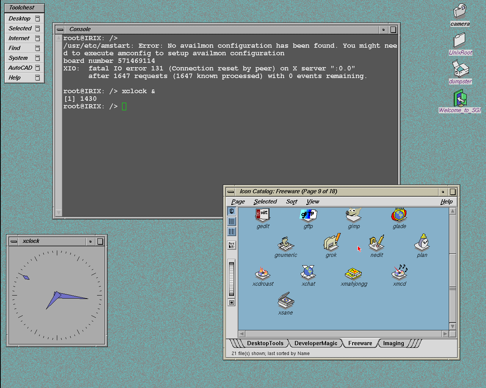

# Original IRIX desktop visual reference

The user supplied this Prismatic capture on 2026-11-01 as the normal IRIX
desktop with winterm, Toolchest, Icon Catalog and xclock running. The original
PPM is retained outside the repository; this PNG preserves every rendered
pixel at 1282x1024. The [provenance record](results/2026-11-01-irix-desktop-reference.json)
contains the source filename, SHA-256 and conversion verification.

The reference supplies concrete appearance and content targets for Xiri:

| Component | Visible reference | Qualification to add |
| --- | --- | --- |
| 4Dwm | SGI beveled frames, title bars and patterned desktop background | [Granite backdrop](results/2026-11-02-irix-desktop-behavior.md); additional background choices/preferences remain separate |
| Toolchest | Standard menus plus an installation-specific AutoCAD entry | Keep working menus and qualify actions for installed programs |
| Terminal | Console window, rendered text, shell prompt and command output | Retain native shell execution and resolve intermittent startup; compare resources and colors |
| Icon Catalog | Freeware page 9 of 18, page tabs, toolbar glyphs, labeled application icons | Install a pinned page for a known installed application and verify its action, then qualify broader catalogs |
| Desktop icons | camera, UnixRoot, dumpster and Welcome to SGI | [Filesystem/home/Dumpster icons and directory opening](results/2026-11-02-irix-desktop-behavior.md); other pictured icons and Dumpster operations remain separate |
| xclock | Analog face and colored hands | [Current UTC time, updates and redraw pass](results/2026-11-01-irix-time.md) in bounded runs; reference colors and a combined desktop session remain separate checks |

The populated catalog comes from this installation's application and page
data. The installed-image import now stages 166 catalog entries across 17 original
system pages, including Freeware. The older 20261102 image showed
`Blank`; the current image has 18 visible pages and application-specific
Freeware icons. Launching those applications remains a separate check from
page discovery and artwork rendering.
The reference does make the remaining resource work visible: page data,
filetype/action rules, icon and toolbar artwork, palettes and the background.
Not every application shown needs to be imported to establish desktop support.

Earlier Xiri captures showed a Trusted Path panel that is not visible here.
The measured MAC feature query now removes it. The desktop repair also restores
toolbar glyphs; the [icon repair](results/2026-11-02-desktop-icons.md) adds
Freeware application and FileManager folder/document artwork. This image is
a visual reference; behavior is qualified by the linked runtime experiments
and the [desktop acceptance plan](ROADMAP.md#milestone-3-original-desktop-proof).

The first selected application is [xmahjongg](IRIX-SOFTWARE.md), currently
imported with its existing **Freeware** registration. Original `inst` remains
the later installation target. Compare entry artwork and launch with this
reference; ordinary users should share persistent `/usr/people` homes with
native NetBSD programs.
