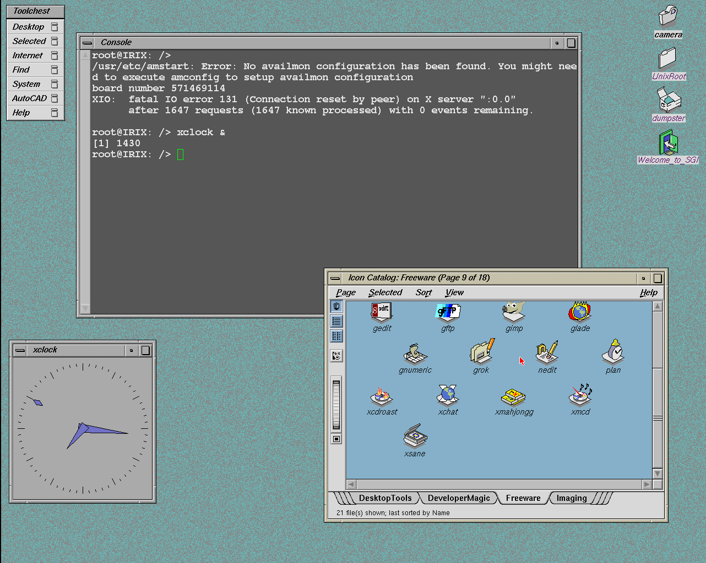

# Original IRIX desktop visual reference

The user supplied this Prismatic capture on 2026-11-01 as the normal IRIX
desktop with winterm, Toolchest, Icon Catalog and xclock running. The original
PPM is retained outside the repository; this PNG preserves every rendered
pixel at 1282x1024. The [provenance record](results/2026-11-01-irix-desktop-reference.json)
contains the source filename, SHA-256 and conversion verification.

The reference supplies concrete appearance and content targets for Xiri:

| Component | Visible reference | Qualification to add |
| --- | --- | --- |
| 4Dwm | SGI beveled frames, title bars and patterned desktop background | Preserve window interaction; qualify the original palette/backdrop separately |
| Toolchest | Standard menus plus an installation-specific AutoCAD entry | Keep working menus and qualify actions for installed programs |
| Terminal | Console window, rendered text, shell prompt and command output | Retain native shell execution and resolve intermittent startup; compare resources and colors |
| Icon Catalog | Freeware page 9 of 18, page tabs, toolbar glyphs, labeled application icons | Install a pinned page for a known installed application and verify its action, then qualify broader catalogs |
| Desktop icons | camera, UnixRoot, dumpster and Welcome to SGI | Qualify background/file-manager services, icon resources and assigned actions |
| xclock | Analog face and colored hands | Existing launch is established; time progression remains a separate functional check |

The populated catalog comes from this installation's application and page
data. Xiri currently stages only a selected runtime/application set and no
system catalog pages. Its empty `Blank` fallback is therefore consistent with
that reduced installation; it should not be judged solely by icon count.
The reference does make the remaining resource work visible: page data,
filetype/action rules, icon and toolbar artwork, palettes and the background.
Not every application shown needs to be imported to establish desktop support.

Current Xiri captures also show a Trusted Path panel that is not visible here.
The recorded SGI-AccessControl feature-query issue remains open. This image is
a visual reference; behavior is qualified by the linked runtime experiments
and the [desktop acceptance plan](ROADMAP.md#milestone-3-original-desktop-proof).

The first selected addition is now [xmahjongg through original inst](IRIX-SOFTWARE.md).
Its package registers the **Freeware** page itself. Compare the resulting
entry/artwork and launch with this reference after installer compatibility is
qualified; ordinary users should share persistent `/usr/people` homes with
native NetBSD programs.
