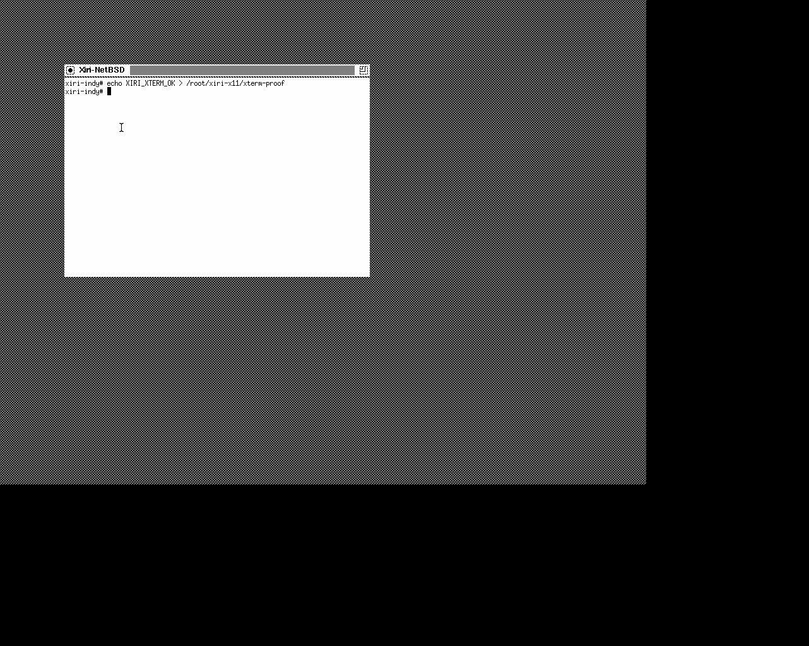

# NetBSD Newport X11 qualification — 2026-10-30

NetBSD's X server displays a usable twm/xterm session on emulated Newport
with software rendering. The qualified profile is R4400, 256 MiB RAM,
NetBSD 11.0, Xorg 1.10.6, 1024×768, and a 24-bit TrueColor screen. An IRIS
keyboard-controller fix was required. XAA acceleration and full framebuffer
geometry remain open; this is a bounded display/input qualification.



## Inputs and source ownership

The signed NetBSD 11.0 manifest now pins `xbase`, `xcomp`, `xetc`, `xfont`, and
`xserver`. The existing fetch script verified the release signature and every
SHA-512 hash. The harness checks those pinned hashes again before making its
virtual CD. Each run installs all five sets on its own disposable disk.

The custom kernel remains `XIRI_INDY_20261030`. No guest source change was
needed. The user's clean `../NetBSD-nixbench` checkout was inspected at
`a852b4a0380` on `trunk`; it is the home for future guest source changes on a
task branch. Its trunk sources are not the release source baseline used by
the running kernel. Newport's Xorg driver lives in the separate NetBSD `xsrc`
repository, so a driver change would also require matching X sources.

The emulator change is committed in the user's IRIS fork on
[`xiri/netbsd-newport`](https://github.com/salvogendut/iris/tree/484452d963d2da4e2a7559e88bcc33da0f2a0c01),
at `484452d963d2da4e2a7559e88bcc33da0f2a0c01`. It retains the earlier NFS MOUNT
and snapshot RAM-map fixes. The locked release build used the same Rust
toolchain and default features as the preceding qualification, through
`IRIS_SOURCE_DIR=../iris`. All 14 `dev::ps2::tests` passed.

| Artifact | SHA-256 |
| --- | --- |
| Tested emulator | `cc6561d0bdfec6ce30d656caf4a6eaee6ffbf622e5348c3b77b73810d5293f56` |
| `iris-ci` | `c0492793d79caeb488c93b2e74f9ba0d5877e7935d3526f6794f3d4d58029159` |
| Source checkpoint disk | `269038c7b77660c83d3835208fc0b2702c93110c14b3c55a42416f51672cee2a` |
| Source checkpoint NVRAM | `ee883474d52f09278287b2044f7aeca61d2e7bc39c0bb8fd85c983ab64063d15` |
| Kernel | `2428f60fbf6f830dcddd031b8540d0d52cbb458ee6a0166b257b0bae9941ed6c` |
| Xlib probe source | `14d01cb14cfdafc23ef88e4bf35892732d9344f4c0b48b32ac8ac50d86f2dfd8` |
| Xorg configuration | `5b1a1355ac8776e5c7517618c832d9680de080cd50ca084d3a1386df158e4ed6` |

## Keyboard failure and fix

Before the fix, Xorg started and loaded both input drivers, but typing
`Xiri_123` delivered unrelated keys and lost releases, causing autorepeat.
`ps2 status` reported scan-code Set 2 and controller configuration `0x47`.
NetBSD had enabled bit 6, requesting 8042 translation to XT/Set 1 codes.
IRIS retained the bit but sent raw Set 2 codes.

The controller now uses its Set 1 event encoder when Set 2 and translation
are selected. It preserves the keyboard's selected set and command replies,
and leaves untranslated Set 2 and Set 3 behavior available. MACE/IOC3 direct
device ports bypass this translation. Unit tests cover make/break codes,
Shift, an extended arrow, translation disabled, direct device ports, and
the existing state/repeat tests. Live O2 and Octane behavior is not qualified
by these tests.

The guest probe now receives:

```text
KEY_DOWN Shift_L
KEY_DOWN X
KEY_UP X
KEY_UP Shift_L
...
KEY_DOWN Return
TEXT_PASS
KEY_UP Return
```

## Accelerated-color finding

The exploratory run `.work/netbsd-x/explore-2ybly29u/` used the previous
emulator pin `b6d6f5c` and the release driver's default XAA acceleration.
The Xlib probe observed:

```text
READY depth=24 size=1024x768 window=0x200001
PIXEL_FAIL color=0 expected=fe fill=92492 copy=92492 upload=fe
```

The composed screenshot also shows wrong solid-fill colors. Screen copies
preserve the error, while the uploaded four-color image is correct.
Disabling acceleration makes both readback and composed color checks pass.

Inspection of
[NetBSD's release Newport acceleration code](https://github.com/NetBSD/xsrc/blob/netbsd-11/external/mit/xf86-video-newport/dist/src/newport_accel.c)
shows that its fast-clear path converts RGB bits to a physical-plane ordering
before writing COLORVRAM. For red pixel `0xfe`, that conversion yields
`0x092492`. IRIS's 24-bit fast-clear path uses COLORVRAM directly in its BGR
pixel storage. This identifies an interface mismatch; it does not establish
which implementation should change without checking hardware and the other
depth/plane combinations. WRMASK uses the same driver conversion and needs
to be considered with any eventual fix.

The accepted [configuration](../../lab/indy-netbsd/x11/xorg.conf) therefore
sets `Option "NoAccel" "true"`. The harness's `--accelerated` option retains
the failing path as an investigation workload. The exploratory guest halted
cleanly; its screenshots and full serial log remain under the path above.

## Acceptance workload and runs

Run the [harness](../../scripts/qualify-netbsd-x11.py) using the
[lab instructions](../../lab/indy-netbsd/README.md#newport-x11-qualification).
It allocates wsdisplay screen 0 while retaining the serial control console,
starts Xorg without a TCP listener, and builds the Xlib probe inside NetBSD.

The probe draws four solid colors, copies them, applies XOR twice, and uploads
a small four-color image. XGetImage checks the resulting pixels. Because
NoAccel can satisfy readback from the software shadow buffer, the host also
checks twelve pixels in the composed Newport frame. All must match the
release's allocated `0xfe` RGB components. Screenshots retain text and cursor
appearance for inspection.

Input passes through IRIS's PS/2 `key` and `ptr` controls. The probe requires
the exact mixed-case/punctuation text `Xiri_123` plus Return, key release,
mouse motion, and press/release events for buttons 1, 2, and 3. It then exits;
twm manages an xterm, and typing
`echo XIRI_XTERM_OK > /root/xiri-x11/xterm-proof` through that terminal must
create the expected file. X clients and the server stop before NetBSD halts.

| Mode and artifact directory under `.work/netbsd-x/` | Result | Wall time |
| --- | --- | --- |
| `ordinary-acyrdpbe` (initial capture implementation) | 8 guest checks and 12 composed-pixel checks passed; clean halt | 310.875 s |
| `ordinary-7kcq_m3n` (corrected capture) | 8 guest checks and 12 composed-pixel checks passed; clean halt | 315.638 s |
| `ci-rm0dkvm8` (corrected capture) | 8 guest checks and 12 composed-pixel checks passed; clean halt | 310.803 s |

Each directory retains result metadata and hashes, serial/emulator/monitor
logs, Xorg's log, `xdpyinfo`, the input event log, and drawing/desktop PNGs.
Both modes use independent disposable disk copies with `overlay = false`, so
their stopped `disk.raw` files include X11. The harness can also retain CI
overlays if the configuration is later changed to enable COW.
Ordinary execution keeps Newport enabled in a host Xvfb window. CI uses the
same guest display and input path without that window.

The initial CI run `ci-fm_bseek` passed the drawing/input checks but failed
while capturing its event log, before the xterm check. A multiline serial
command exposed marker text in terminal echo; one attempt executed `bae64`
instead of `base64`, and the trailing `printf` masked its failure status.
The corrected harness uses a single command line, checks each command's
status, and captures between output-only markers. This initial run is excluded
from acceptance. Its guest halted cleanly and its logs and disk are retained;
the event log was subsequently recovered as `probe-recovered.log` for diagnosis.

Both corrected-capture runs used harness SHA-256
`89917abb20ff201aeaa7070b26d3aacca66469e9c24bb08b8e0466e327b2a097`.
The original custom-kernel disk and NVRAM retained the hashes listed above.

## Display capabilities and limits

`xdpyinfo` reports Xorg release `11006000`, MSB-first images, a 1024×768 root
window at depth 24, and native RGB masks `0xff`, `0xff00`, `0xff0000`. It
advertises 120 TrueColor and 120 DirectColor visuals at depth 24, plus one
TrueColor visual at depth 32. No PseudoColor visual is advertised in this
configuration. Other listed depths are pixmap formats, not proof of an
8-bit screen or legacy-client compatibility.

The server advertises 28 extensions, including SHAPE, MIT-SHM, RENDER,
Composite, DAMAGE, XTEST, GLX, and SGI-GLX. Xorg reports software GL support;
extension advertisement does not establish working GLX/3D or the requirements
of original IRIX clients. Those still need reference media and client tests.

`screen info` reports a 1282×1024 composed framebuffer, while Xorg uses
1024×768; the extra area is black. Xorg cannot estimate virtual size, and
allocating the non-console wsdisplay screen emits a rasops stride warning.
Full-size mode programming and that kernel warning remain open. The default
visual, keyboard, three mouse buttons, text, and the tested rendering paths
work within the smaller desktop.

This does not qualify acceleration, performance, 8-bit X screens, physical
Newport, host-window key capture, active-X snapshots, or the IRIX desktop.
The next source-only step is the historical `COMPAT_IRIX` audit and a minimal
execution experiment plan; original desktop dependency tests remain gated on
an IRIX reference installation. The earlier NFS fragmentation and installer
HTTP findings remain open.
