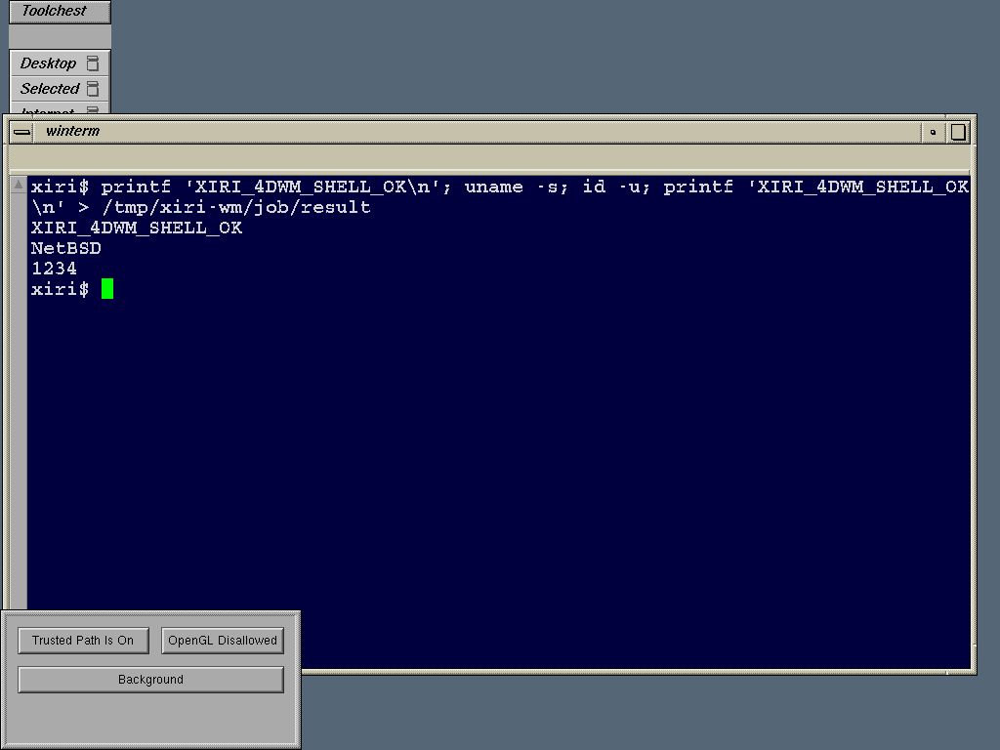

# Original 4Dwm managing a winterm shell on NetBSD

The unchanged original 4Dwm now manages windows on native Xvfb alongside
Toolchest and winterm. The first combined run passes native-window reparenting,
pointer-driven focus, real key delivery and a 50-by-30-pixel drag. Inside the
original winterm/xwsh, a typed command prints the success marker, `NetBSD` and
UID1234, then creates a UID1234-owned result file. This is an initial working
window-manager session, not the complete IRIX desktop.

The kernel is the [qualified PRDA build](2026-11-01-irix-prda.md), code
`348bd3c8e79` on `xiri/irix-prda`, with documentation through `6761f8e2887`.
IRIS remains at `9df1df14334838a989253efefe26f0547e6da592`. The original
application/library bytes are unchanged. The [4Dwm lab](../../lab/irix-4dwm/README.md)
retains the harnesses, native interaction helper and staging requirements.

The [PNG capture](images/2026-11-01-irix-4dwm-shell.png) comes from the successful
ordinary-mode run. Its decoded RGBA pixels match the original 1024-by-768 XWD.

## What made the session work

The earlier subpage mapper, fixed/local mmap adapter and measured PRDA page
clear the original runtime, GL and libc startup faults. Readable original
resources then expose another boundary: session-saving initialization attempts
unsupported file operations and fails to manage new windows within the bound.
Explicit `SG_manageSession: false` and `SG_autoSave: false` resources isolate
working window management. The trace repeatedly visits HOME/.xroomsrc, HOME/.xroomsrc.tmp and
HOME/.desktop-127.0.0.1, including failed mkdir, unlink, fsync and rename calls.
A later temporary path becomes `(null).tmp`. These are generated per-user
session files, not missing assets to copy from the image.
Session saving/restoration is still unsupported;
this does not replace those services with successful no-op calls.

Four original files need mode 0444 after copying: `app-defaults/4DWm`,
`system.4Dwmrc`, `system.4Dwmdesks` and `system.backgrounds`. Existing destination
modes had left them unreadable despite correct hashes. The session has a private
UID1234-owned HOME. Its original XKeysymDB/rgb resources are also explicitly
installed readably, eliminating the Toolchest keysym warnings observed with the
shell-only seed. Numeric SGI colors reproduce the measured original rgb entries;
the plain blue-gray root background is a native presentation choice.

The native check creates two windows and requires real reparenting, then uses
XTest pointer/key/button events. It does not assign focus. The first standalone
isolation run exposed a helper error: PointerRoot is a legitimate X focus policy,
not a resource ID for XQueryTree. The corrected helper resolves the deepest
window under the real pointer and checks actual KeyPress delivery. The original
helper remains frozen with its earlier evidence. The combined terminal typing
helper separately retains its established explicit focus request.

## Verification and capture

The first combined run, `desktop-sessionless-ci-8t6uorae`, passes all four
window-manager checks and the typed shell command. Native ABI controls before
and after pass; eight native controlling-terminal controls pass; the supervisor
confirms all reserved-UID descendants are absent and the guest halts cleanly.
The original gettxt warning remains the same as the accepted winterm baseline.

The readiness-aware helper passes standalone CI and ordinary runs
(`windowready-ci-5a8k9gfu`, `windowready-ordinary-oxrzw7ig`). It waits for both
clients to be IsViewable, resolving the earlier reparent-before-map failure.
The initial ordinary combined run passed window management but caught winterm
at a three-row geometry and failed shell input; that run is excluded. The
final session harness finishes its drag check before releasing client startup,
then requires a native handoff and a viewable terminal large enough for its
input coordinates. It does not resize the terminal to manufacture that state. The reordered
ordinary run (`session-ordinary-tr7z_ql2`) passes with a 983-by-504 terminal.
Its first CI attempt (`session-ci-snc1fk1_`) passes every native window check
but has a live xwsh with no mapped terminal or native handoff before cleanup.
That startup failure is retained and excluded from successful-session evidence;
startup repeatability remains an explicit open issue. The independent qualifier checks source/kernel hashes, original staged
bytes, interaction records, shell handoff identities, the command-created marker,
native controls, cleanup and clean shutdown. The PNG is exported directly from the captured XWD; the qualification also
requires its decoded RGBA pixels to match exactly.

The [bring-up history](2026-11-01-irix-4dwm-attempts.json) binds all eight
intermediate attempts, including the two earlier successful CI sessions and
the failed geometry/startup observations. It is separate from the final bounded
interaction matrix; failures are not discarded.

The unchanged final CI repeat (`session-ci-xb3cj1si`) passes with the same
983-by-504 terminal as ordinary mode. The [accepted interaction matrix](2026-11-01-irix-4dwm.json)
contains these four cleanly halted runs, eight native ABI controls and sixteen
native controlling-terminal controls:

| Workload | CI run | Ordinary run | Result |
| --- | --- | --- | --- |
| Native windows under original 4Dwm | `windowready-ci-5a8k9gfu` | `windowready-ordinary-oxrzw7ig` | Viewability, reparenting, pointer focus, key delivery and drag pass |
| 4Dwm, Toolchest and winterm shell | `session-ci-xb3cj1si` | `session-ordinary-tr7z_ql2` | Same window checks, native handoff and UID1234-owned command marker pass |

Each standalone job runs for 30 seconds and each combined job for 90 seconds.
The reserved-UID supervisor verifies complete descendant cleanup; native X and
ABI controls pass after the jobs. All IRIS processes were stopped after testing.
These are bounded successful observations, not a startup-reliability claim.

## Remaining scope

The original window manager creates a Trusted Path Manager panel and requests
the unavailable SGI-AccessControl X extension. Its feature-detection path needs
separate investigation; the panel is visible in the real capture. Session file
operations, desks/restoration, minimize/maximize, menus, native-window resize,
logout and the remaining desktop services are separate acceptance checks. This
run does not demonstrate the file manager, desktop icons or a complete IRIX
login session. Use [SGI's desktop guidelines, Chapter 3](https://techpubs.jurassic.nl/library/manuals/2000/007-2167-006/sgi_html/ch03.html)
for those behavioral gates.

The shell uses the established native PTY handoff and NetBSD `/bin/sh`.
Foreign signal handlers, terminal resize, normal application exit and gettxt
remain open. This result uses native Xvfb inside an emulated R4400 Indy; it does
not qualify Newport output or physical SGI hardware. xclock timekeeping remains
deferred behind the desktop work unless a desktop path needs those interfaces.
