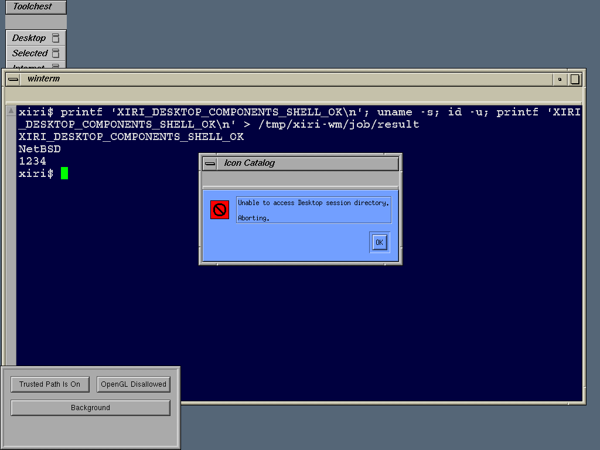

# Desktop clients after pthread initialization

Original bgicons, fm and Icon Catalog now pass `prctl(PR_INIT_THREADS=20)`
using the [measured adapter](2026-11-01-irix-init-threads.md). They advance to
session-directory setup. The full desktop remains blocked: `mkdir` returns
ENOSYS, Icon Catalog displays a fatal session-directory dialog, and fm also
encounters an unsupported `waitsys` option combination.

The [machine-readable qualification](2026-11-01-irix-desktop-init-threads.json)
binds the kernel, emulator, unchanged vendor closure/resources, harnesses,
traces and screenshot. The kernel source is NetBSD `xiri` commit
`a9e715bb082a755881799234dfdb54abca5a04c1`; the emulator remains the qualified
`9df1df14334838a989253efefe26f0547e6da592` build. Tests use native Xvfb on the
emulated R4400, reserved UID1234 and bounded descendant cleanup. Session
saving remains disabled.

## Original client observations

| Client | Observed progress and remaining failure |
| --- | --- |
| `bgicons -overlay` | Initialization returns zero; `mkdir` trap1080, mode0755 returns IRIX ENOSYS89; exits1 with `Function not implemented` |
| `fm -b` and `fm $HOME` | Initialization returns zero; X/resource activity and directory attempts follow; `mkdir` returns ENOSYS; the parent forks, then `waitsys` trap1170 with options3 returns EINVAL22; exits255 |
| `iconcatalog` | Initialization returns zero; directory attempts fail; renders “Unable to access Desktop session directory. Aborting.” and remains at that dialog until bounded cleanup |

The observed lookup is `$HOME/.desktop-xiri-indy`, with HOME set to
`/tmp/xiri-home`. This is generated native user state, not an IRIX account
directory to import. No artwork, catalog pages or other image assets were
added: the staged closure remains 38 ELF paths and 16 resources. Missing
message catalogs and color palettes remain recorded resource candidates.

Per-PID captures contain the first and last 4000 lines; short captures overlap,
and longer captures can cut a record. The qualifier pairs ordered complete
call/return records, records truncated boundaries and makes no event-count
claim. It does not infer a complete child-process failure chain from a parent
trace. These observations justify implementing directory operations first and
measuring the additional wait options, then tracing the next actual behavior.

## Interaction results and limits

The CI run `ci-4ydcb5h0` passes reparenting, focus, real key delivery and dragging
under 4Dwm. The existing winterm/native-shell handoff accepts a typed command
and creates its UID1234-owned marker. Native execution and native X checks
pass before/after the bounded session, and the guest halts cleanly.

The ordinary run `ordinary-7prxld2f` passes the window-manager checks and native
shell handoff, but winterm remains at 983x72 pixels. The keyboard helper fails
its usable-geometry gate (`TYPE_STATUS=5`), and no command marker is produced.
That is retained as a failed interaction check. It is not treated as a passing
shell session merely because a native shell process exists. Startup
repeatability was already open; this run does not establish the cause of the
geometry failure. Its native controls, descendant cleanup and halt pass.

The unchanged ordinary repeat `ordinary-fnvguh2o` passes both 4Dwm interaction
and typed shell execution, reproduces all four later client failures, and
halts cleanly. The report includes all three runs: shell checks pass/fail/pass,
window-manager checks pass in all three. The successful repeat does not erase
the failed geometry gate or establish startup reliability.



This PNG is a pixel-for-pixel conversion of the CI guest's captured XWD. It
shows a fatal dialog, not a successfully running Icon Catalog. The original
4Dwm decorations, Toolchest, terminal command output and unexpected Trusted
Path Manager panel remain visible. The panel/feature queries, normal exit,
foreign signal handlers, file navigation, services, artwork and session
restoration remain unqualified.

## Reproduce

```sh
PYTHONDONTWRITEBYTECODE=1 python3 scripts/probe-irix-desktop-init-threads.py
PYTHONDONTWRITEBYTECODE=1 python3 scripts/probe-irix-desktop-init-threads.py --mode ordinary
PYTHONDONTWRITEBYTECODE=1 python3 scripts/qualify-irix-desktop-init-threads.py \
  .work/irix-desktop-init-threads/runs/ci-4ydcb5h0 \
  .work/irix-desktop-init-threads/runs/ordinary-7prxld2f \
  .work/irix-desktop-init-threads/runs/ordinary-fnvguh2o \
  --png docs/results/images/2026-11-01-irix-iconcatalog-diagnostic.png \
  --output docs/results/2026-11-01-irix-desktop-init-threads.json
```

The qualifier validates the recorded progress and failures; its status is
`initialization-cleared-session-directory-boundary`, with
`desktop_success:false`. It is not a full desktop acceptance gate.

The following [mkdir checkpoint](2026-11-01-irix-mkdir.md) clears directory
creation. Its [desktop retry](2026-11-01-irix-desktop-mkdir.md) reaches Icon
Catalog's main window; this report preserves the earlier fatal-dialog boundary.
