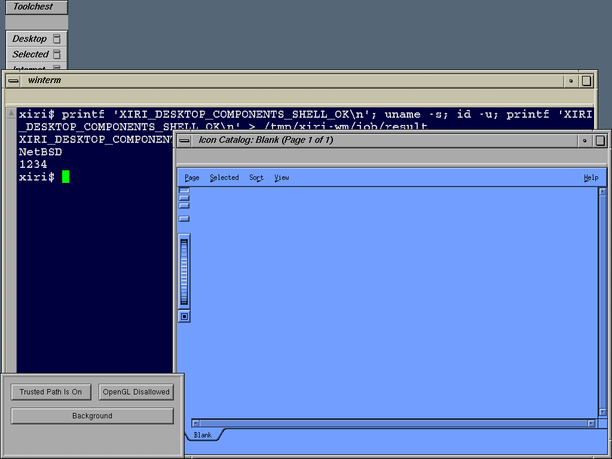

# Desktop after measured directory creation

The [qualified mkdir adapter](2026-11-01-irix-mkdir.md) clears the desktop
session-directory failure. Original `bgicons -overlay` now exits zero, and
Icon Catalog opens its main window titled **Icon Catalog: Blank (Page 1 of 1)**
in both CI and ordinary IRIS modes. The fatal session-directory dialog is gone.
The [independent report](2026-11-01-irix-desktop-mkdir.json) binds both captures,
the kernel pin, staged files, source hashes and native controls.



The PNG comes from the CI guest's native X.org XWD capture; the qualifier
checks all 1024x768 RGBA pixels after conversion. This demonstrates initial
rendering. Catalog actions, application launching and desktop icons have not
been qualified.

## Interpreting the empty catalog

The staged original IconCatalog defaults explicitly name the dummy page
`Blank`. System catalog data under `/usr/lib/desktop/iconcatalog/pages` has
been located in the image but is not staged. The observed empty page is
consistent with this minimal installation; emptiness alone is not evidence
of a compatibility defect. The captured lookup paths include generated
`$HOME/.desktop-xiri-indy/iconcatalog/pages/Blank`, `iconcatalog/layouts/Blank`
and `layouts/Default`. The bounded traces do not prove successful system-page
discovery. A later content test should install a small pinned page with a
known installed application and check its action.

No additional image assets were added in this cycle. The original 38-path ELF
closure and 16 selected resources are unchanged. `bgicons` successfully creates
session state, including `$HOME/.desktophost/xiri-indy/Icons`, through the new
adapter. This is generated per-user state, not data to copy from an old IRIX
account. Exit zero does not establish icon discovery or display.

## Remaining file-manager failure

Both `fm -b` and `fm "$HOME"` now exit 139 with SIGSEGV, in both modes.
Their final complete syscall pairs are `pipe` (trap1042) and `sgikopt`
(trap1083), both returning IRIX ENOSYS89. The public historical NetBSD IRIX
syscall table identifies those calls; the supplied libc symbol table also
places `pipe` at 0xfa601c8 and `sgikopt` at 0xfafd0f0, matching the captured
trap PCs plus four bytes. The sequence identifies the next investigation;
it does not prove either call is the sole crash cause.

The next kernel experiment should measure original IRIX pipe semantics and
translate them through native descriptors, then retry the clients and capture
the remaining fault. Do not substitute a fake successful `sgikopt` result.
The earlier `waitsys(options=3)` failure remains outside the qualified subset;
these new captures do not establish its resolution. FAM/service lookup paths
and other unsupported calls are also present, but not every failed optional
query is a startup prerequisite.

## Controls and retained failures

| Check | CI `ci-nvx2k_dt` | Ordinary `ordinary-vty941tv` |
| --- | --- | --- |
| 4Dwm reparenting, pointer focus, key delivery, drag | Pass | Pass |
| Native shell through original winterm/xwsh | Pass; marker owned by UID1234 | Fail; TYPE_STATUS=3, no terminal window, handoff or marker |
| bgicons | Exit 0 | Exit 0 |
| Icon Catalog | Empty main window, alive until guarded cleanup | Same window in tree; alive until guarded cleanup |
| fm background/home | Both SIGSEGV after pipe/sgikopt ENOSYS | Same |
| XWD frame | Valid; published PNG | BadDrawable during X_GetImage; unpublished |
| Native execution before/after, native X11 after | Pass | Pass |
| Descendant cleanup and guest halt | Pass | Pass |

The ordinary run's frame acquisition overlaps bounded cleanup: its tree still
contains client windows, X_GetImage reports BadDrawable, and the later process
snapshot has no session clients. Retain this as a failed capture, not a second
qualified screenshot. The terminal failure predates that capture and needs
separate diagnosis. Earlier terminal geometry failures also remain in the
record; successful CI execution does not establish repeatable startup.

Each session is bounded by a 120-second native guard, which verifies descendant
removal. Per-client traces contain the first and last 4,000 lines and can
overlap or truncate records. The qualifier decodes ordered call/return pairs
and retains truncated-record locations; observations are not total event
counts. Both guests halt cleanly, and no IRIS instances remain running.
Session saving stays disabled. The SGI-AccessControl/Trusted Path panel,
gettxt warning, filetype rules, artwork, fmserv, catalog actions and complete
session services remain open.

```sh
PYTHONDONTWRITEBYTECODE=1 python3 scripts/qualify-irix-desktop-mkdir.py \
  .work/irix-desktop-mkdir/runs/ci-nvx2k_dt \
  .work/irix-desktop-mkdir/runs/ordinary-vty941tv \
  --output docs/results/2026-11-01-irix-desktop-mkdir.json \
  --png docs/results/images/2026-11-01-irix-iconcatalog-blank.png
```

The [resource ledger](../../lab/irix-desktop/resource-ledger.json) records the
new generated-state paths and the distinction between empty fallback rendering
and populated-catalog qualification. Kernel source is NetBSD `xiri`
`1690de11a095134b6eee4d7f85a8b046b1a86c47`; IRIS upstream and retained emulator
pins are recorded in the [mkdir result](2026-11-01-irix-mkdir.md#upstream-and-scope).
