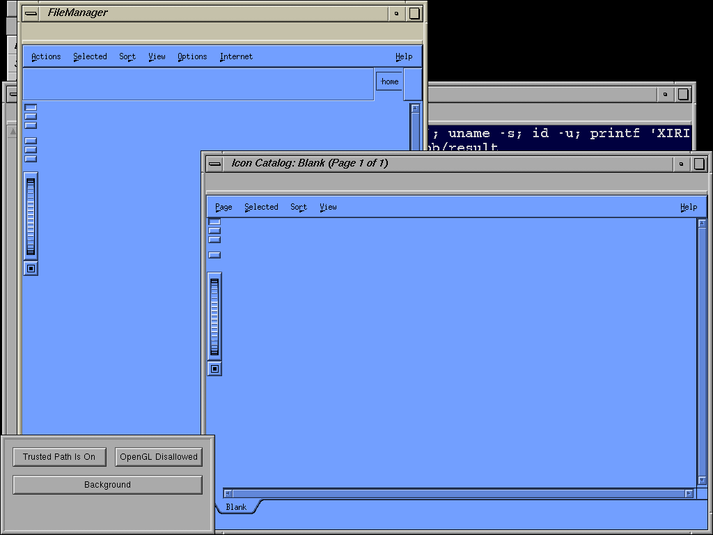

# File Manager after native pipe support

The [qualified pipe adapter](2026-11-01-irix-pipe.md) advances the ordinary-mode
desktop beyond the previous file-manager crashes. Original `fm -b` remains
alive until guarded cleanup, a **FileManager** main window renders, and the
separate home-folder invocation exits zero. `bgicons` also exits zero; Icon
Catalog retains its empty main window. The
[independent observation report](2026-11-01-irix-desktop-pipe.json) records the
successful ordinary capture and the failed CI attempt separately.



The PNG is a pixel-verified conversion of the ordinary guest's 1024x768 XWD.
4Dwm reparenting, pointer focus, key delivery and dragging pass, as does typed
native shell execution through original winterm/xwsh. The new browser view
is empty and file browsing/actions are not qualified.

## Application observations

`ordinary-cg_e3vdl` uses unchanged vendor binaries and selected resources,
NetBSD source `039ac3ab33386392c178031ad4997b0cd86fb53c`, and the retained
qualified emulator. No additional image assets were staged.

| Component | Observed result |
| --- | --- |
| bgicons | Exit0 after creating per-user desktop state |
| fm background | Main window renders; no SIGSEGV in its capture; remains until SIGKILL from the native session guard |
| fm home-folder invocation | Exit0 with no stderr; successful pipe call recorded |
| Icon Catalog | Empty `Blank` main window; successful pipe call recorded; remains until guarded cleanup |
| Native controls | Before/after native execution and native X11 pass; all reserved-UID descendants removed |

File Manager repeatedly reports `Warning: Select failed; error code 22`.
Its captured select calls use `nfds=5` and return EINVAL. The report records
the full stderr byte count/hash, repeated-line count and final partial line
without copying hundreds of kilobytes of repeated warnings into the public
report. The bounded parent trace does not include its pipe call, which lies
between the first/last capture windows. Pipe success is directly present in
the home-launcher and Icon Catalog traces, and separately qualified by the
complete syscall matrix.

The window tree contains `Communication Is Blocked` dialog titles, but those
dialogs are not visible in the published frame. Their mere presence in the
widget tree does not establish a displayed error or its cause. The concrete
runtime boundary is the repeated select EINVAL. A process snapshot includes
children named fmserv and fm, but their service behavior is not qualified.

Icon Catalog's empty fallback remains consistent with unstaged system catalog
pages. The [user-supplied original desktop reference](../IRIX-DESKTOP-REFERENCE.md)
now records the appearance/content target, including populated pages,
icon/toolbar artwork, desktop icons, SGI colors and a patterned background.

## CI failure and capture limits

The same observer's CI run `ci-2dgz6f37` passes its native startup control but
records TYPE_STATUS=5 for the terminal geometry check. The following desktop
capture command times out after240 seconds. Its cleanup cannot regain the
serial prompt, so the emulator is stopped without a clean guest halt. This
run provides no qualified frame, component outcome, after-control or native
cleanup result. Its disposable disk remains diagnostic evidence and is not
used as a seed. No panic is captured, and the failure is not assigned to the
kernel or emulator without further evidence.

The passing ordinary run does not establish reliable startup or CI desktop
support. Its guard runs for180 seconds, verifies removal of all reserved-UID
descendants, and the guest halts cleanly. Earlier guard-configuration and
control-path failures are preserved in the
[harness diagnostic record](2026-11-01-irix-pipe-diagnostics.json).

Per-parent ktrace captures contain the first and last4,000 lines, can overlap,
and may truncate records; decoded lists are observations rather than total
event counts. They do not qualify the complete child-process/service chain.
Session saving remains disabled. Wider wait/IPC semantics, folder contents,
file operations, monitoring, artwork and catalog actions remain open.

```sh
PYTHONDONTWRITEBYTECODE=1 python3 scripts/qualify-irix-desktop-pipe.py \
  .work/irix-desktop-pipe/runs/ordinary-cg_e3vdl \
  --failed-ci .work/irix-desktop-pipe/runs/ci-2dgz6f37 \
  --output docs/results/2026-11-01-irix-desktop-pipe.json \
  --png docs/results/images/2026-11-01-irix-filemanager-pipe.png
```

## Focused select follow-up

The isolated `fm -b` breakpoint experiment does not reproduce the full
session's EINVAL. One attempt stops on SIGCHLD before the boundary. A second
allows SIGCHLD forwarding, records successful select calls and gettimeofday
returning IRIX ENOSYS (89), then reaches its 30-second stop deadline in select
with a NULL timeout. Its trace is recovered read-only from the cleanly halted
FFS partition; after-controls were not reached. Both attempts remain
[diagnostic evidence](2026-11-01-irix-pipe-diagnostics.json).

The missing time query is a candidate for further measurement. These captures
do not establish an invalid timeval or prove the cause of EINVAL in the full
session. Reproduce that session's failure before changing select validation.
The observer now retrieves failure logs even when the tracer returns nonzero;
this logging-only adjustment has syntax validation, not another guest run.
