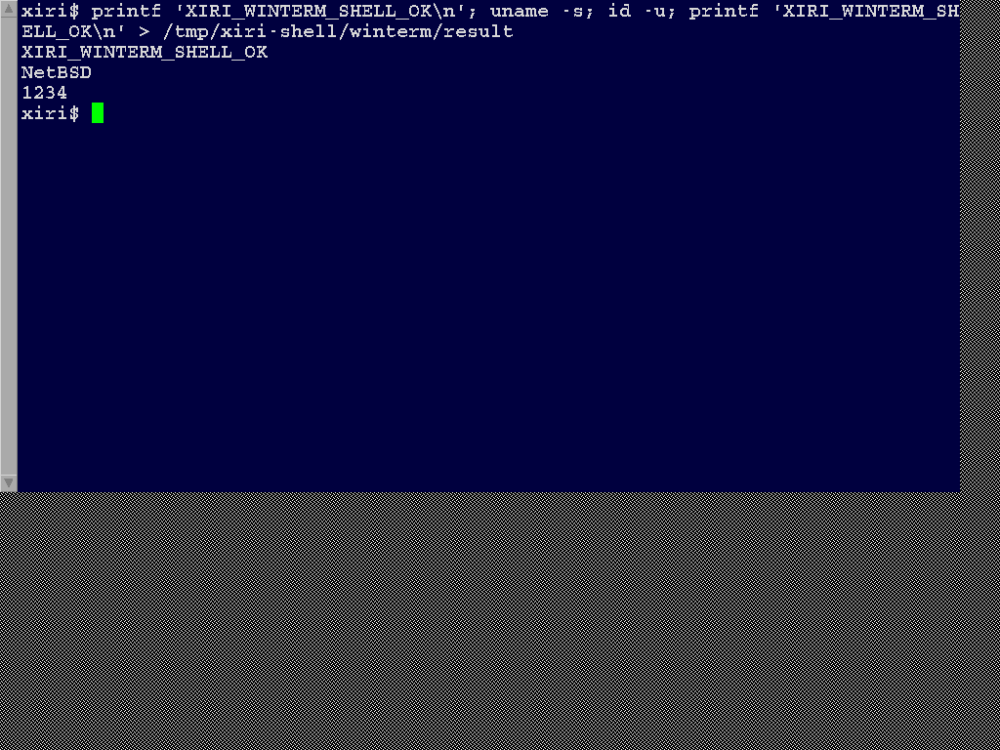

# Original winterm runs a native shell

Original `winterm` now launches unmodified IRIX xwsh with NetBSD `/bin/sh -i`.
Real XTest keyboard events run a command that prints a marker, invokes native
`uname -s` and `id -u`, and writes a marker file owned by UID1234. The shell
returns to its prompt. The native helper and supervisor also complete teardown
without the kernel panic found during bring-up.

This is an 80x24 terminal on native Xvfb, 1024x768, inside the emulated Indy.
The unchanged launcher runs under native `/bin/sh` with explicit WINTERM, PATH,
HOME, DISPLAY and C locale. The terminal retains its original libraries,
XWsh defaults and SGI Screen fonts. The shell and handoff helper are native.
The launcher still reports that its original `gettxt` helper cannot execute;
explicit WINTERM lets the terminal start despite that message.

## Compatibility interfaces

The clean NetBSD implementation is pinned at `98f7de3f343` on `xiri/irix-shell`,
following the process checkpoint. Both kernels use the unchanged IRIS build
`9df1df14334838a989253efefe26f0547e6da592`.

| Interface | Qualified behavior |
| --- | --- |
| `dup` 1041 | Native descriptor duplication, holes and EBADF |
| `syssgi(SGI_FDHI)` 109 | One beyond the highest currently open descriptor |
| `ulimit` 1063, selector 4 | Native soft descriptor limit, clamped to INT32_MAX; other selectors EINVAL |
| `syssgi(SGI_SETSID)` 20 | Native session creation and repeated-call EPERM |
| `execve` 1059 | Explicit signed four-byte argv/envp elements for o32 and n32; native lookup, permissions, limits and executable-personality transition |

Original IRIX supplies 152 reference executions: 19 variants across both ABIs,
direct/indirect traps and root/UID1234. The NetBSD matrix has 380 executions:
152 in each LP64 emulator mode, plus 76 on the o32 kernel. Of those, 340 match
the normalized reference and 40 check explicit native policy. The reference
limit is 200 descriptors; these native jobs inherit 128. A null argv returns
native EINVAL; the reference `/bin/sh` instead terminates with shell status 139.
Misaligned pointer vectors and invalid/page-boundary pointers return measured
EFAULT. Normal argv preserves spaces, an empty argument, argv0 and environment;
a null environment succeeds with the variable absent.

| Capture | Interface cases | Interactive cases |
| --- | ---: | --- |
| Original IRIX `ci-wxmdrkn_` | 152 reference | None |
| LP64 CI `lp64-ci-1fjbm6rb` | 152 | Native xterm, original xwsh, original winterm |
| LP64 ordinary `lp64-ordinary-g6g5ohv2` | 152 | Native xterm, original xwsh, original winterm |
| o32 CI `o32-ci-6orv7kae` | 76 | None |

All four captures shut down cleanly. The native runs also pass 30 startup and
descendant-cleanup controls and 16 native controlling-terminal hangup controls.
The interface-only o32 capture predates app-only harness/helper corrections;
its unchanged interface inputs and exact observations are checked separately.

The [machine-readable qualification](2026-11-01-irix-shell.json) binds exact
runs, source/runtime/kernel hashes, input/output evidence and the PNG. All
record bytes are compared after explicit PID and descriptor-limit
normalization. Successful exec invokes native `/bin/sh`, validating the
foreign-to-native dispatch transition rather than merely admitting an ELF.

## Native terminal handoff and cleanup

`/usr/libexec/xiri-shell` verifies that stdin, stdout and stderr name the same
PTY character device, reopens its native `/dev/pts/N` pathname, checks the device
identity and replaces the inherited descriptors. It then acquires the
controlling terminal, sets the foreground process group and fixed 80x24 size,
records native state, and execs `/bin/sh -i`. The observed shell PID, SID,
process group and foreground group agree, with real/effective UID/GID1234 and
no supplementary groups.

Acquiring the controlling terminal directly through the nullfs compatibility
view initially worked for input but panicked on shell teardown. The captured
stack is `exit1 -> VOP_REVOKE -> layer_revoke -> vrelel`. DDB showed a reclaimed
character vnode with usecount 1 and writecount 1. Reopening the same native PTY
before acquisition avoids this path. A simple native alias test alone did not
reproduce the original application failure; this report does not claim a
general nullfs fix. The diagnostic trace and pre-cleanup screenshot remain
under ignored `.work/irix-shell/runs/debug-ageyuuka`.

The native guard verifies that reserved UID1234 is unused, drops all IDs and
supplementary groups before fork, and follows that identity through native
process snapshots. It continues after the winterm launcher exits and catches
children that create a new session. Its bounded unprivileged cleanup verifies
that all owned descendants are gone. A detached-session control, native tty
hangup controls, native o32/vendor startup controls and interactive native
xterm controls bracket or accompany the original application runs.

The original launcher returns zero while xwsh remains alive; the supervisor
therefore does not mistake launcher exit for terminal completion. The live
tests intentionally end after 30 seconds and clean up the terminal and shell.
Full traces remain on stopped guest disks; compact raw-kdump views and hashes
are retained on the host. The installed o32 kdump cannot format some native
LP64 records, so only its raw output is used.

## Scope and next work

Basic shell startup, keyboard commands, displayed output and bounded cleanup
are demonstrated. Foreign caught-signal frames, general termios, resize,
normal application exit, Ctrl-C/job-control workflows, production account
setup and gettxt remain unqualified. No additional IRIX image resources were
needed for this checkpoint; the [resource ledger](../IRIX-RESOURCES.md) records
the native handoff and retained image assets.

Next evaluate original 4Dwm while preserving this working terminal baseline.
Its 4 KiB library boundaries, artwork and desktop/session services remain
separate work. Physical SGI qualification and a complete desktop are still
pending. Reproduction commands and native helper sources are in the
[shell lab](../../lab/irix-shell/README.md).
