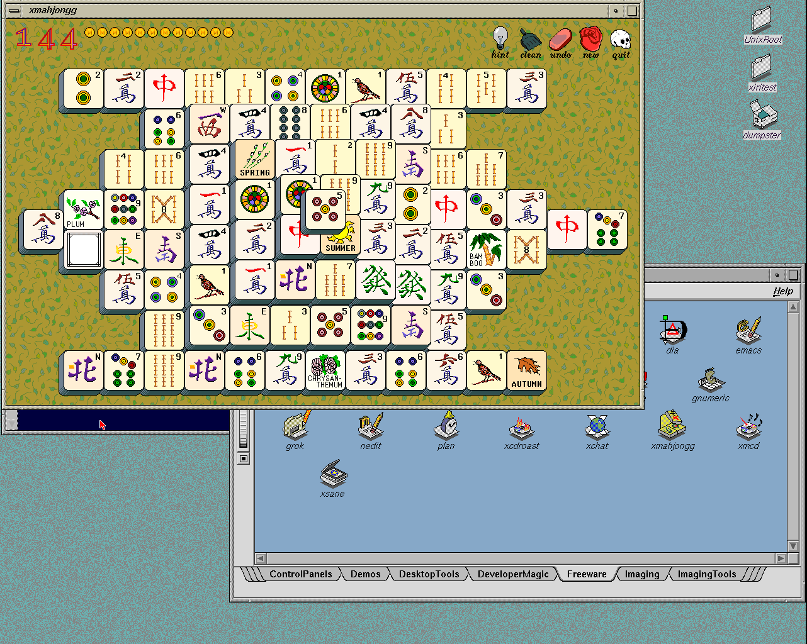

# Manual image with desktop behavior fixes

The new local bundle is `.work/images/xiri-netbsd-desktop-20261102-behavior/`.
It retains the same Indy IP24/R4400/Newport configuration and the existing
8497554 NetBSD kernel. The previous `20261102-shell` bundle remains intact.
Use the included `iris.toml` or `prismatic.cfg`; [manual instructions](../XIRI-IMAGE.md)
cover boot, login, shutdown and returning to the IRIX image.

Root starts native services. The desktop and its terminal shells run as
**xiritest, UID 1234, HOME `/usr/people/xiritest`**. The user chose to retain
this arrangement; the console message, terminal prompt and README now label
it explicitly. Direct xiritest login and xdm remain later work. A future
actual IRIX root desktop should use HOME `/`, without changing NetBSD root.

## Included changes

The [desktop behavior qualification](2026-11-02-irix-desktop-behavior.md)
adds native FAM execution notifications, the original granite backdrop and
filesystem/home/Dumpster desktop icons. The source-disk test compares the
xmahjongg icon before launch, while running and after exit: the final closed
pixels match exactly. Filesystem and Dumpster double-clicks open directory
views. The only new vendor resource is the granite bitmap; its separate
ledger is included in the bundle. Existing filetype artwork is unchanged.

The [graphical image check](2026-11-02-desktop-behavior-image-usability.json),
`.work/desktop-usability/ordinary-ca59snip`, verifies graphical root login,
two desktop sessions, typed user/HOME/cwd commands and both logout routes.
Toolchest and right-click logout return to the graphical shell with clients
and owned services removed. Native controls, installed hashes and the
rpcbind warning-count check pass; the guest halts cleanly.

An earlier graphical diagnostic typed before xwsh had started its native
shell. The window already existed, but part of the input was lost. The
corrected checks wait for the native handoff and actual shell process, then
submit short commands. Both final sessions report `xiritest` and
`/usr/people/xiritest`. Wait for the labeled prompt before typing manually.

## Image verification

The CHD passes chdman verification and an exact 8 GiB raw extraction/hash
comparison. Its compressed size is 480,653,409 bytes (about 458 MiB).

- CHD SHA-256: `2d18cd7c2c3b940a41c790e7d7710cf56834e7319f1be7bcc0c4717649c5467b`.
- Raw SHA-256: `259709c2e67d02c6752ea26d61e3b2d1c40e9f7e0caedd82232f4c4bda589c57`.

The final [direct-CHD result](2026-11-02-desktop-behavior-image.json) comes
from `.work/xiri-image/runs/chd-sxgrcjpu`. It boots a disposable CHD copy
directly from disk, verifies the kernel and installed resources, accepts
typed `pwd` in winterm, and launches a new xmahjongg through the Freeware
catalog entry. FAM reports execution; the granite pixmap and all three home
links are present. Xorg/Newport runs at 1280×1024, both native controls pass,
and no new rpcbind bind warning appears. Logout removes the clients and
owned services. The guest halts cleanly and the base CHD remains unchanged.

The PNG is byte-identical to the emulator's composed Newport capture,
including the two PROM overscan columns. This cycle tests the pinned
standalone IRIS executable; the supplied Prismatic profile is for manual
testing and was not separately requalified here.

The qualified bundle is promoted in `lab/irix-installed-desktop/image.json`.
The reusable raw seed is `.work/xiri-image/prepared-seed-20261102-behavior/`;
routine runs can clone it without reimporting the original files.
The final host process check finds no remaining IRIS or Xvfb instances;
the temporary resource server is also stopped.

## Remaining limits

Gameplay, transient launch animation, Dumpster empty/recovery operations,
preferences and session restoration remain separate qualifications. GIMP's
signal-registration blocker and xosview's statistics requirements are
unchanged. Winterm uses NetBSD sh; full interactive IRIX sh remains unqualified.
The previously recorded intermittent xwsh startup/exit behavior remains open.
The first direct-CHD run, `chd-qg4u0kbi`, also produced a 983×72 winterm
window, with a two-pixel vertical increment in its `WM_NORMAL_HINTS`.
The native shell was alive; explicitly resizing the window restored the
input helper. That diagnostic run is retained as a failure, rather than
counted as an unassisted desktop pass. Initial terminal sizing/font metrics
need a follow-up alongside the existing xwsh startup issues.
The fresh `chd-sxgrcjpu` boot starts winterm at 983×504 and accepts the typed
`pwd` command without resizing or other intervention.

Vendor binaries and images stay local in ignored `.work`; Git contains only
source, manifests, documentation and screenshots. This cycle changes no
NetBSD kernel source. IRIS upstream received the documented e049373
maintenance merge; the qualified emulator binary remains pinned at 9df1df1.
