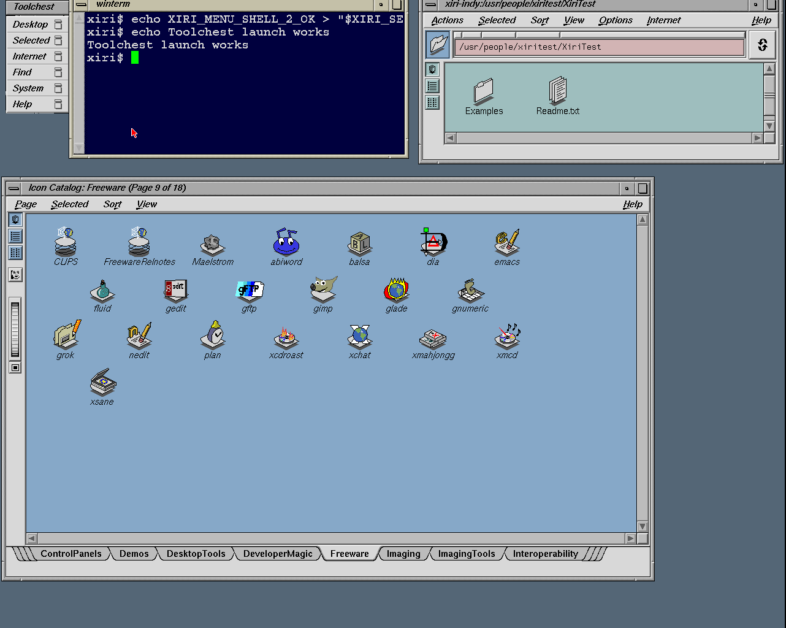

# Icon Catalog and FileManager artwork

Original IRIX 6.5.22m Icon Catalog now renders application-specific Freeware
icons, including xmahjongg, on NetBSD and native Xorg. FileManager renders
folder and document icons in the native home. The vendor clients, compiled
filetype tables, icon resources and executable tags remain unchanged.
No additional files from the IRIX disk were needed for this repair.

## Three independent failures

1. `libimdFtrDB` could open `desktop.otr`, but its `F_SETBSDLKW` call failed.
   The [record-lock adapter](2026-11-02-irix-filelocks.md) supplies measured
   o32/n32 layouts and process-owned native locks. It passes 1,248 records,
   12 native/foreign interoperability executions and 20 controls. This first
   restored generic catalog and FileManager folder/document artwork.
2. Missing syscall 1019 prevented correct reads at executable tag offsets.
   The [seek qualification](2026-11-02-irix-lseek.json) covers direct/indirect
   o32/n32 calls, both credentials, native o32 and LP64 kernels, and n32
   offsets beyond 4 GiB. NetBSD source `57430add71d` on `xiri` includes the
   lock commit `3e154cdc37c`. The vendor classifier now returns the same
   application/file classes as the original system.
3. Native FAM watched `/usr/freeware/bin/xmahjongg` outside the import root.
   Its false `Deleted` event caused Icon Catalog to replace a correct
   application type with `DanglingReference`. A temporary filesystem alias
   proved the cause. The permanent fix gives the session-owned daemon an
   optional `XIRI_FAM_ROOT=/emul/irix` view, preserving logical event names
   and falling back to native home paths. The alias and diagnostic interposer
   are absent from the final session.

Native FAM's path mapper passes 15 host and 15 guest namespace assertions,
including import/native collisions and absolute/relative links. Its existing
tree-iterator regression also passes. Original clients receive `Exists` and
`EndExist` for imported executable targets; native-home Created/Deleted
events still arrive. Mapping is selected when each watch is created; adding
a shadowing import later does not dynamically rebind an existing watch.

## Evidence and scope

The exact source/kernel pins are in `lab/irix-filetypes`. Original-system
reference records and diagnostic harness hashes are in
`lab/irix-lseek/reference.json`. The live permanent-fix diagnostic is retained
at `.work/desktop-icons/seek-f2h4cequ`, including `service-icons.png`, logical
FAM events and the native namespace test. That guest halted cleanly.

The dedicated [graphical qualification](2026-11-02-desktop-icons.json),
`.work/desktop-icons/ordinary-250peiym`, passes original menu launches,
typed native shell commands, 18 catalog pages, Freeware target notifications,
native FileManager, native controls and all 1,749 imported-file hashes.
The reserved-user clients and managed services are removed; the guest halts
cleanly and the input seed is unchanged. Both native FAM regressions pass.



The published PNG is byte-identical to `menu-desktop.png`, captured from the
IRIS software-composed Newport framebuffer. All 21 Freeware icons are visible.
An earlier capture during resize repaint is retained as diagnostic evidence,
but is not the qualified screenshot. No artwork was drawn into the capture.

The paired seek qualifier passes **12 executions / 348 raw syscall records**
and the original n32 libc wide-offset probe. Eight executions use the clean
LP64 artifact from `57430add71d`; four use the native o32 artifact, whose hash
is unchanged by the final source commit. Both guests halt cleanly. Separate
original/native invalid-whence diagnostics both deliver SIGSYS. The raw
records compare every byte; filetype API comparisons explicitly compare class
names rather than differing native metadata or stale errno after success.

The first graphical repeat, `.work/desktop-usability/ordinary-uv6bf__b`,
passed console login and Toolchest logout, then its second session lost
xwsh before a terminal window appeared. Its preserved native core identifies
signal 8 (SIGFPE), PID 2675, UID/GID 1234, SHA-256
`5b843e33a3186ec05db4e20acf79ed2538b6efad6e3530e096d82289ca9a505d`.
The core is `/var/tmp/xiri-desktop/session.Kfghye/xwsh.core` in that run's
retained disk. The original winterm script nevertheless recorded exit 0.
This failed run is not used as the image seed; startup reliability remains
an explicit limitation, alongside the previously observed geometry problems.
The unchanged graphical harness is repeated from the preserved icon seed.

The unchanged repeat, `.work/desktop-usability/ordinary-uhrj0d1h`,
[passes graphical console login and both logout routes](2026-11-02-desktop-icons-usability.json).
Each session accepts typed native shell commands, returns to the graphical
launching shell and removes owned clients/FAM/rpcbind. No new duplicate-bind
warning appears. Native controls and installed helper hashes pass, and the
guest halts cleanly. This successful run is the replacement image seed;
it does not establish that the intermittent startup failure is fixed.

The new local bundle is `.work/images/xiri-netbsd-desktop-20261102-icons/`.
Its 480,456,062-byte CHD expands to the exact 8 GiB source disk:

- CHD SHA-256: `2c700a5cec553d283a076f86769ecffcba929186e2af6252baafe3614e8cbe93`.
- Raw SHA-256: `57e01f0e7a419bf9abb57f7270ad629cf990ee4aca1f26cc2a0574b3d26b9d5c`.
- Source seed: `.work/desktop-usability/ordinary-uhrj0d1h`.
- Graphical manual NVRAM, serial diagnostic NVRAM and Prismatic configuration
  are included. Vendor files remain local, outside Git.

The [cold-boot qualification](2026-11-02-desktop-icons-image.json),
`.work/xiri-image/runs/chd-27mvlqp5`, passes direct CHD boot, persistent helper
hashes, native Xorg/Newport, visible xmahjongg, native controls and complete
session cleanup. No new rpcbind warning appears. The guest halts cleanly,
the original CHD is unchanged, and the framebuffer PNG is preserved exactly.
The promoted image pointer is `lab/irix-installed-desktop/image.json`.
The frozen raw automation seed is
`.work/xiri-image/prepared-seed-20261102-icons`.

The previous qualified graphical bundle remains preserved. See the
[manual image guide](../XIRI-IMAGE.md) for boot and application checks.
Both NetBSD commits are on the pushed `xiri` branch; this cycle did not
change IRIS source or move any pinned lab worktree.

## Reproduce the final image

Build the kernel using `lab/irix-filetypes/XIRI_IRIX_ICONS`, and build native
FAM with `scripts/build-native-fam.py`. The source/emulator/artifact hashes
must match the recorded pins. Then run:

```sh
PYTHONDONTWRITEBYTECODE=1 python3 scripts/probe-xiri-desktop-icons.py
# Use that halted run and its recorded raw hash as the next prepared seed.
PYTHONDONTWRITEBYTECODE=1 python3 scripts/probe-xiri-desktop-usability.py \
  --seed .work/desktop-icons/ordinary-250peiym \
  --kernel-build .work/netbsd-irix-icons-build \
  --baseline lab/irix-filetypes/baseline.json
PYTHONDONTWRITEBYTECODE=1 python3 scripts/probe-xiri-image.py \
  .work/images/xiri-netbsd-desktop-20261102-icons
```

The image build, extraction round trip, separate boot qualification and
promotion commands are described in the image guide. The initial failed
Toolbox invocation `.work/desktop-icons/ordinary-chsrap0v` never launched a
guest: the ISO creation tool is on the host, so these probe scripts run there.

Artwork does not certify every catalog application's runtime behavior.
Catalog launch actions, general FileManager operations, background/device
icons, session restoration, and automatic xwsh closure after shell exit remain
separate work. Xorg remains in use at 1280×1024 with acceleration disabled
pending the [Newport correctness/performance investigation](../NEWPORT.md).
No Xsgi change is included.
