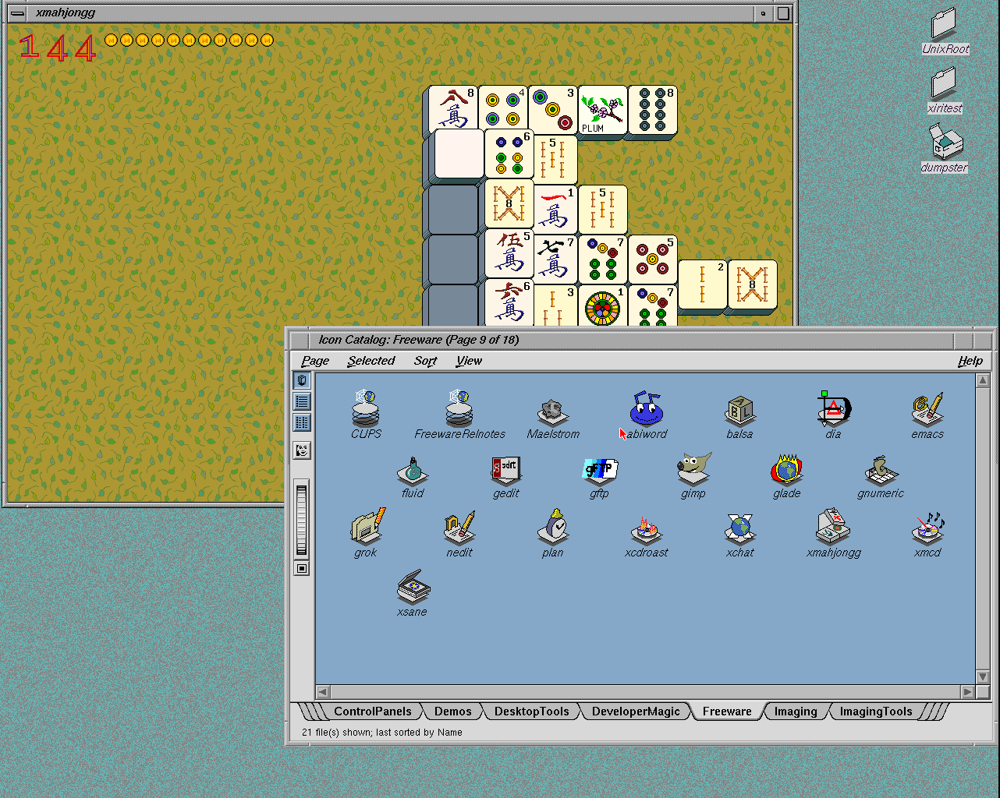

# Running icons, granite and desktop icons

The user requested desktop behavior before xdm integration. The roadmap now
explicitly defers native xdm login, while retaining that later goal.

The user also confirmed the current image should retain root as the service
launcher and clearly label the desktop as xiritest. Root starts Xorg/FAM;
the client session drops to UID/GID 1234 and uses `/usr/people/xiritest`.
This is not a root desktop with an inconsistent HOME. Direct xiritest login
would require changing the reserved-UID cleanup supervisor first. Future
IRIX root sessions should use `/`, without changing NetBSD root's account.

## Findings and changes

The original xmahjongg filetype rule already contains separate opened and
closed artwork. The missing input was execution state: our native FAM used
`IMonNone`, whose file polling did not generate FAMExecuting/FAMExited.
The supplied IRIX 6.5.22m system reports event 3 on the first executable
instance and event 4 after its last instance exits. A new subscription while
it is running also receives event 3. Monitoring a symlink itself does not
report execution of its target. The measured phases are retained in the
[reference fixture](../../lab/native-fam/exec-events-reference.json).

The native daemon now snapshots NetBSD process executable paths once per
poll and matches device/inode identities. It preserves existing file-change
polling and event pathnames. `XIRI_FAM_EXEC=1` enables the backend; the desktop
launcher supplies it alongside `XIRI_FAM_ROOT=/emul/irix`. Catalog launches
need the foreign pathname resolver because KERN_PROC_PATHNAME can retain
`/usr/lib/desktop/iconcatalog/pages/C/Freeware/xmahjongg`; its final symlink
must also be followed inside the imported tree. No kernel change is needed.

The old launcher selected a solid root color and never started `fm -b`.
The new launcher enables 4Dwm backgrounds and starts the original background
file manager after the window manager publishes its backdrop pixmap. A new
user Desktop receives filesystem, home and Dumpster links. Its Dumpster
directory contains the original `.dumpster` marker. Existing Desktop content
is preserved rather than regenerated each session. `bgicons -overlay` follows
the original Xsession.dt startup ordering.

The only additional vendor resource is
`/usr/include/X11/bitmaps/granite`, copied to
`/emul/irix/usr/include/X11/bitmaps/granite`, mode 0444. The
[supplementary ledger](../../lab/irix-desktop-behavior/resources.json) records
its checksum, size, provenance and generated home paths. The rendered pattern
uses the gray/teal pair from the user's IRIX reference capture. No original
root home or saved session is copied. Xorg remains the X server.

## Qualification

The [reproduction procedure](../../lab/irix-desktop-behavior/README.md) uses a
clone of the preserved shell seed, the same 8497554 kernel and the same
9df1df1 emulator. The final [result](2026-11-02-irix-desktop-behavior.json) comes from
`.work/desktop-behavior/qualified-dabc1tie`. Native FAM BTree/path checks pass,
as do all four event sequences (regular executable, hard link, symlink and
ordinary-user subscription). Real catalog double-click launches xmahjongg.
Its opened pixels differ from the closed icon; after exit the 64×64 icon
region matches the original closed pixels exactly. FAM records two start
and two final-exit transitions across the direct and catalog launches.
Filesystem and Dumpster double-clicks open their directory views. Logout
removes session clients and services; native controls pass before/after,
the guest halts cleanly and the original seed remains unchanged.

[Closed icon](images/2026-11-02-desktop-behavior-catalog-closed.png) and
[desktop directory views](images/2026-11-02-desktop-behavior-desktop-icons.png)
are unmodified PNG captures from the composed Newport framebuffer. They
retain the PROM timing’s two overscan columns (1282×1024).

Exploratory runs established the missing events and resources. They also
caught two implementation defects before qualification: the pixmap readiness
check initially expected `=` instead of `pixmap id #`, and executable lookup
initially retained the final catalog symlink. A first automated attempt
omitted execute permission on native test binaries; this was a harness error.
The penultimate run passed the icon state cycle but clicked the new home
icon instead of Dumpster; the final run corrects that test coordinate.
These earlier runs are not accepted as the final qualification.

## Scope and remaining work

Polling can miss executions shorter than its interval and does not retain
executable vnode identity across rename/unlink/replacement. The tested
ordinary-user desktop gets the expected running state for xmahjongg; this
does not qualify every catalog application or every icon animation.

Filesystem and Dumpster opening are separate from drag/drop, recovery and
emptying. An exploratory `telldesktop 'empty dumpster'` request returned
without deleting a disposable test file. That helper remains an extracted
candidate and is not part of the minimal imported resource set. Investigate
the workspace command protocol and its real menu action next. The original
`launcheffect` and `waitmap` helpers likewise remain uninstalled candidates
for transient launch feedback. Full preferences and saved-session restoration
remain open; SG_manageSession and SG_autoSave remain disabled.

Graphical image testing also exposed an automation timing issue: xwsh can
map its window before its PTY/native shell is ready, so an early typed command
can lose its beginning. The image probes now wait for the native handoff and
the actual `sh` process, then submit short commands. A diagnostic retry
confirmed `id -un`, HOME and cwd all identify xiritest correctly.

The previous `20261102-shell` CHD is preserved. A
[new manual image](2026-11-02-desktop-behavior-image.md) packages these fixes
with explicit root-launcher/xiritest-session labels. This work does not alter
GIMP's signal-registration blocker or xosview's statistics requirements.

## Fork maintenance

IRIS upstream was fetched and reviewed through
`2eb811f43a69a9dec7f0ceb50cb439b7e088845c`. Its only new change adds an Octane
halt-request investigation and an index link. It was merged and pushed on
IRIS `xiri` as `e0493739955391c1a344655fd0361d4997e51372`. Diff whitespace and
the new documentation link passed; no executable code changed, so no emulator
rebuild or repin was needed. Concurrent Newport work in the shared NetBSD
checkout was left untouched.
