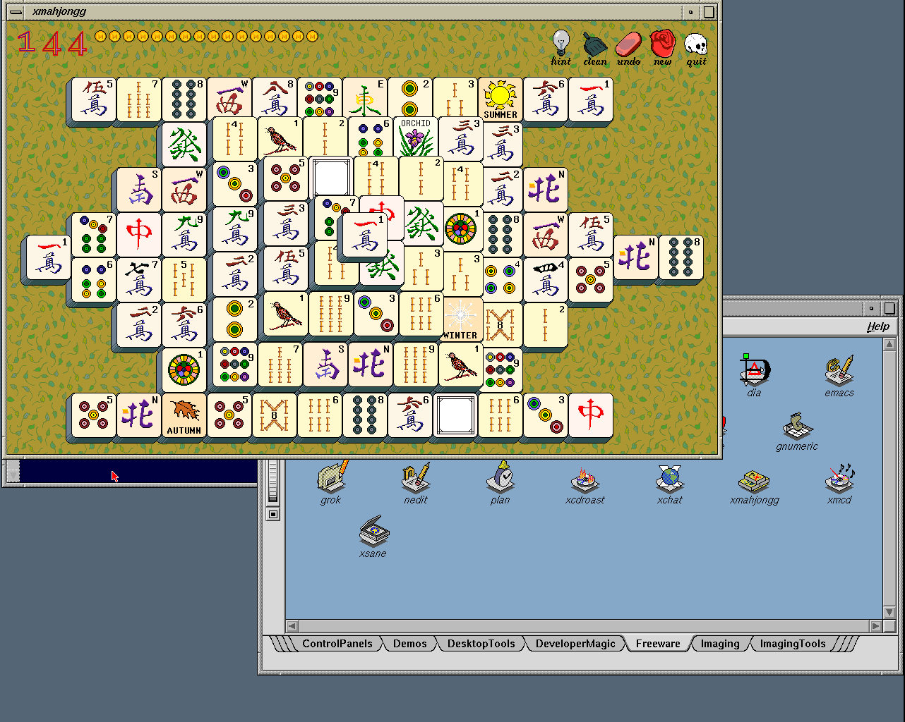

# Reusable image with original IRIX shell support

The new local manual bundle is
`.work/images/xiri-netbsd-desktop-20261102-shell/`. It packages the
[original-shell checkpoint](2026-11-02-irix-vendor-shell.md), high-address
ELFMAP fix, native null-device setup and winterm home-directory fix. The
older `20261102-icons` CHD and its prepared seed remain unchanged.

Use the included `iris.toml` or `prismatic.cfg` with an Indy IP24, R4400,
Newport, 256 MiB RAM and the CHD at SCSI ID 1. The manual NVRAM selects
graphical automatic boot. Log in as root and run `xiri-desktop`.
[Full manual instructions](../XIRI-IMAGE.md) include Prismatic startup,
PROM settings, shutdown and restoring IRIX boot.

## Contents and provenance

The clean NetBSD kernel comes from `xiri` commit
`849755450135c6734bb61c4973d687d0c8060739`, built in
`.work/netbsd-irix-vendor-shell-clean-build` from the isolated
`.work/netbsd-vendor-shell-src` checkout. The concurrent Newport work in
the shared fork checkout is excluded. The existing compatibility result
covers 772 checks; this packaging cycle exercises disk and desktop behavior.

The IRIX 6.5.22m vendor payload, copy ledger and permissions are unchanged.
The new `setup-pty.sh` creates `/emul/irix/dev/null` using NetBSD's device
numbers. `manual-session.sh` changes to HOME while retaining absolute log
paths. Winterm's default remains NetBSD sh; its `pwd` now reports
`/usr/people/xiritest`. Original IRIX `/bin/sh` supplies the catalog command
path. No `launcheffect` or `waitmap` bytes were added.

IRIS upstream was fetched again on 2026-11-02 and remains at
`4c1c87f5161c13b323d9b5d57a93779d355729b5`, already integrated through
`f38cfa1c5e62def9fbefa5244e07adf285f02d3b`. No additional merge was needed.
The tests retain the qualified ordinary emulator at
`9df1df14334838a989253efefe26f0547e6da592`; no emulator pin was changed.

## Verification

The [graphical seed check](2026-11-02-irix-shell-image-usability.json),
`.work/desktop-usability/ordinary-j7806wah`, boots the new disk kernel,
logs into the graphical console through emulated PS/2 input and runs two
desktop sessions. Typed winterm commands verify HOME. Original IRIX sh
executes an unprivileged command with null redirection. Both Toolchest and
right-click logout return to the graphical shell and remove clients and
owned FAM/rpcbind services. No new duplicate-bind warning appears. Native
controls and installed helper hashes pass, and the guest halts cleanly.

The builder verifies the CHD and extracts all 8 GiB, requiring the decoded
disk's SHA-256 to match the halted source disk exactly. The
[CHD qualification](2026-11-02-irix-shell-image.json) records image size,
hashes, source pins, native controls, installed-resource verification and
the direct disk boot. It closes the initially started xmahjongg, then
double-clicks its original Freeware entry and observes a new process and
window. It also checks winterm HOME and the native null-device binding.
The guest and its services stop cleanly; the base CHD remains unchanged.
The successful run is `.work/xiri-image/runs/chd-xdzzvq8p`: startup PID 198
exits and the catalog creates PID 341. It checks 65 native/helper and support
file hashes; the inherited vendor payload retains its qualified seed and
ledger provenance.

The [first CHD run](2026-11-02-irix-shell-image-diagnostic.json),
`.work/xiri-image/runs/chd-wy6f_2w1`, failed a basename-only process check.
The catalog had actually launched xmahjongg as PID 4379 through
`/usr/lib/desktop/iconcatalog/pages/C/Freeware/xmahjongg`; its window was
visible and the original PID 199 had exited. The corrected check matches
that full launcher path. This diagnostic run was cleaned up and halted,
and a fresh CHD run supplies the promoted qualification.

- Compressed size: 480,480,764 bytes (about 458 MiB).
- CHD SHA-256: `c98f88ee9709f721ddbc54fbec8067aea7b9b66433ad14ab737c47280fb3ad64`.
- Raw SHA-256: `dbe72c2b3162c6d5c4b2ca2f7559799d1ecaab2d9bcfefea5973c17f1fcbd83c`.

The PNG is copied byte-for-byte from the IRIS software-composed Newport
framebuffer. It contains the two PROM overscan columns (1282×1024 for a
1280×1024 X screen). No artwork is added to the capture. The reusable raw
seed is `.work/xiri-image/prepared-seed-20261102-shell/`; use the prepared
image for subsequent tests rather than reimporting vendor files.

## Remaining limits

This qualifies xmahjongg launch, not every catalog entry or gameplay.
Opened-icon shape feedback, interactive original-shell job control and
desktop-session restoration remain unqualified. GIMP still fails signal
registration after passing its former library mapping failure; xosview
needs IRIX statistics interfaces. The previously recorded intermittent
xwsh startup failure and window retention after shell exit remain open.
Prismatic uses the supplied profile but was not retested in this cycle;
the new image checks use the pinned standalone IRIS build.

Vendor binaries and the CHD remain private local artifacts. Git contains
the test source, documentation, hashes and screenshot only. The final host
audit finds no remaining IRIS, Prismatic or test Xvfb processes.
