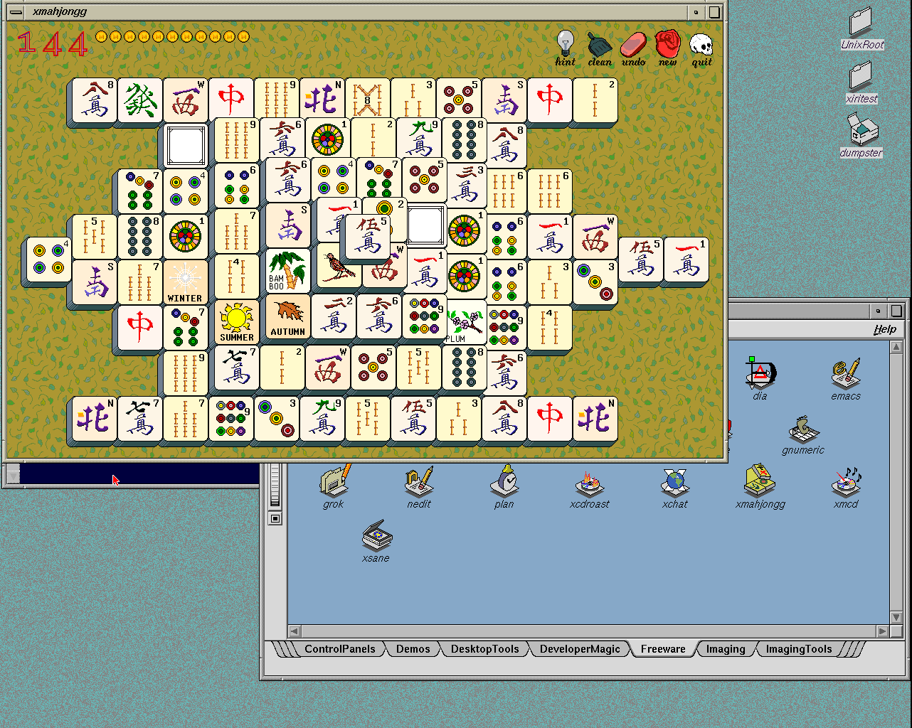

# Session cleanup image

Preparation, the complete CHD/raw-disk comparison and the
[cold desktop qualification](2026-11-05-cleanup-image.json) pass. The separate
96 MiB pressure gate fails, including a native sleep timeout reproduced on
the preceding image. This candidate is **not promoted**; `./xiri run` still
opens the native-wait image. Its ordinary desktop qualification remains valid,
but the new pressure observation applies to that image too.



The candidate bundle is
`.work/images/xiri-netbsd-desktop-20261105-cleanup/`.
Its 8 GiB disk compresses to **496,158,462 bytes**. CHD SHA256:

```text
f05c3ac69dcc3edde811528c7f4fe9668b13b28e28117dda3f8ff218e15aaa7a
```

The [deadline correction](2026-11-05-cleanup-deadline.md) adds a final
nonblocking event/reap check to the native session guard. It avoids declaring
failure while already-queued child exits remain unread. A genuinely live
child still fails cleanup; the grace period is unchanged. The original
compview failure and other historical stalls remain unexplained.

The [installed-file comparison](2026-11-05-cleanup-inventory.json) preserves
all 1,283 tracked paths. Only `/usr/local/libexec/xiri/session-guard` changes,
and its binary is identical to the candidate that passed the deliberate-delay
tests. Kernel, boot kernel and IRIX module remain source-equivalent to NetBSD
`xiri` commit `e9ff76a58affee773b767d334f98075bf86daf7e`; the
[native-wait build ledger](../../lab/native-wait/build.json) and
[source-equivalence record](../../lab/native-wait/source-equivalence.json)
retain the exact build provenance. The bundled IRIS backend remains
`819c6825504d40ad9f9aa00554249affd2da9446`.

Fonts, Newport/XAA, Xorg scheduling, imported application resources, xdm
configuration and account layout are retained. xiritest uses 4Dwm and
`/usr/people/xiritest`; netbsdtest uses native ctwm, `/home/netbsdtest` and
wheel membership. Public development passwords remain the respective user
names. The injection library and deadline fixtures are not installed here.

Preparation verifies the original payload, compiles the runtime natively,
checks installed hashes, then cold-boots from disk to full-screen xdm with
the module loaded at securelevel 1. Native execution and clean unmount/halt
pass. The [packaging record](2026-11-05-cleanup-packaging.json) retains the
independent decode and complete 8 GiB hash comparison. Temporary memory
storage accommodates that decode; the retained raw cache is a verified
reflink of the identical halted preparation disk. Previous qualified images,
manual overlays/NVRAM and pinned worktrees are preserved.

## Cold desktop result

Run `.work/irix-xdm/runs/ordinary-gpxglz5q` passes the full 1280×1024 XAA
display, rejected incorrect login, three IRIX logins, native netbsdtest ctwm
and wheel membership, correct homes, 345 native text comparisons, three
winterm starts/resizes, and both shells' foreground, stop/resume,
background-read and wait checks. Normal terminal exit, logout with running
and stopped jobs, both logout menus, failed-session recovery and catalog
xmahjongg double-click launch pass. Services and an independent same-user
process survive logout. The source CHD is unchanged and the guest unmounts
and halts cleanly.

The PNG above and the retained greeter/native/winterm/job captures come from
this cold run. Visual inspection confirms readable desktop text, expected
colors and full-screen layout. All owned test emulators are stopped.

## Pressure observations and promotion hold

The [complete pressure evidence index](2026-11-05-cleanup-pressure.json)
retains all four failed runs, their exact harness/media/binary hashes,
partial results, native signal contexts and limits. Each requests two IRIX
sessions, 100 input rounds per transport, 20 child-control pairs per phase,
a 96 MiB dirty native allocation and shutdown with an active desktop.
Every run passes 158 CD9660 checks and the greeter's eight supervisor cases.
All four leave their source CHDs unchanged and unmount/halt cleanly after
failure. None reaches the full pressure gate's later sessions.

| Run | Image | Completed input rounds | Failure |
| --- | --- | ---: | --- |
| `boot-1xdrdili` | Cleanup candidate | 376 | First IRIX session, TCP round 77, watchdog after motion sync |
| `boot-lsv96cfd` | Cleanup candidate | 234 | First IRIX session, Unix round 35, watchdog during native sleep |
| `boot-r2cygbks` | Cleanup candidate | 400 | First IRIX session, adversarial test's post-cleanup assertion |
| `boot-a8zs9zn5` | Previous native-wait image | 201 | First IRIX session, Unix round 2, watchdog during native sleep |

The [first pressure run](2026-11-05-cleanup-pressure-failure.json) is retained
as a failure. It passes 300 complete native input round trips, 40 native
child launches and eight supervisor scenarios. During the first IRIX session,
TCP input completes another 76 rounds, then its ten-second watchdog fires in
round 77 after `motion-sync END` and before `button-sync BEGIN`. This differs
from the earlier ready-button scheduling symptom; the interrupted instruction
was not captured, so it does not establish a sleep, paging or Xorg cause.
The guest records a clean unmount/halt and leaves the source CHD unchanged.

The diagnostic replay explicitly brackets the unchanged `usleep(200000)`.
The candidate and previous-image timeouts both capture native PC
`0x782d1fb4` and return address `0x784535e4`. The previous-image replay also
records runtime symbol addresses and the live native o32 stack request:
**zero seconds and 200,000,000 nanoseconds**, with the padding word ignored.
Its installed libc hash matches the candidate and the original NetBSD set.
The matching binary disassembly places the PC immediately after
`__nanosleep50`'s syscall, and the return address inside `usleep`.

The two final runs use identical native input source and ELF, harness, media,
workload parameters, kernel, module, pinned emulator, Xorg and libc. Their
installed session guards differ as intended. The old-image reproduction
establishes that the native sleep symptom predates this guard change. It
does not establish a timer, paging, scheduling or emulator cause. The handler
samples the clock after writing its warning, so that timestamp is not an
exact signal-entry time or a measurement of time in one kernel function.
The first two attempts retain their earlier diagnostic source versions.

`boot-r2cygbks` additionally completes 80 native child-control launches.
Its installed guard reports valid cleanup for hold, escape and the complete
25-process live burst, with zero remaining descendants. The enclosing shell
test then returns 1 before its next ownership-count check. The recorded
25 PID entries and later process snapshot do not identify the failed
assertion: a PID reuse/disappearance race or sentinel check remains a
hypothesis. This is a failed test, not evidence of a remaining descendant
and not an accepted adversarial pass. A follow-up must trace that check
without relaxing its assertions.

The pressure runner's initial greeter/failure PNGs are entirely black and
are excluded from visual qualification. Their capture path differs from the
cold probe; the cause is unresolved. The independently qualified cold images
above are the usable display evidence.

Next investigate native sleep/wakeup and the exact shell postcheck under
load, collecting process/VM/callout state at failure. Keep the ten-second
watchdog, actual input checks and precise descendant assertions. Do not
promote based on retries or reduce pressure to turn these failures into a
pass. Multi-user FAM deployment follows this system investigation.

## Manual candidate

The candidate can be inspected separately, with the pressure limitations
above, without changing the selected bundle:

```sh
/var/home/salvogendut/Dev/xiri/.work/images/xiri-netbsd-desktop-20261105-cleanup/run-iris.sh
```

Use `xiritest` / `xiritest` for 4Dwm or `netbsdtest` / `netbsdtest` for native
ctwm. Its manual NVRAM and overlays are separate from the preceding image.
The frozen bundle records the cold desktop pass and the separate pressure
failure index. No diagnostic interposer or input fixture is installed in it.

## Cold qualification commands

```sh
python3 scripts/probe-xiri-xdm.py \
  --bundle .work/images/xiri-netbsd-desktop-20261105-cleanup \
  --winterm --fonts --jobs
python3 scripts/probe-system-stability.py \
  --bundle .work/images/xiri-netbsd-desktop-20261105-cleanup \
  --runs 1 --sessions 2 --input-iterations 100 --child-iterations 20 \
  --pressure-mib 96 --halt-active --require-cd9660
```

The old-image comparison uses the same pressure command with
`--bundle .work/images/xiri-netbsd-desktop-20261105-wait`.
