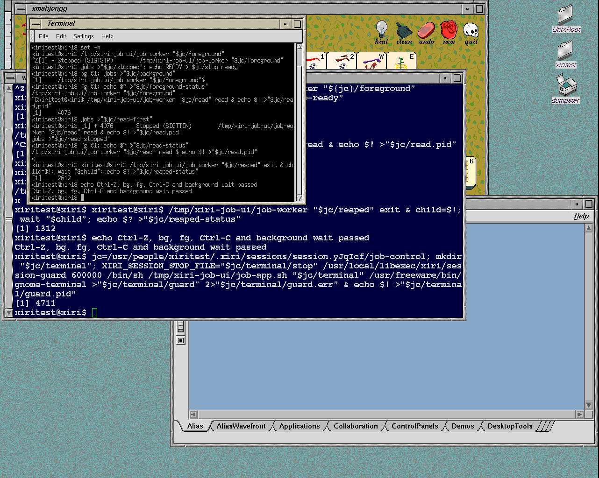

# IRIX sleep, child state and shell job control

Work order: IRIX sleep/child notifications, real terminal jobs, then the
retained native child-control and shutdown observations. The reference is the
user-supplied IRIX 6.5.22m installation. Measurements use installed public
headers, the original libc and independent raw syscall fixtures.

## Compatibility changes

The loadable personality now implements `nanosleep` (1077), including
indirect dispatch, IRIX interruption/restart rules and eight-byte o32/n32
timespecs. It validates nanoseconds, treats negative seconds as elapsed,
limits long requests to `INT32_MAX` 100 Hz ticks, and leaves remaining-time
storage untouched on successful completion. Interrupted output is rounded
to 10 ms; a fault can preserve a written prefix and takes precedence over
EINTR/ERESTART. Native NetBSD's 100 Hz timer remains coarser than original
IRIX for sub-10 ms requests.

`waitsys` selects individual children, process groups or all children and
reports exits, stops, traced stops and continuations. WNOWAIT leaves the event
available. IRIX `SA_NOCLDSTOP` suppresses both stop and continue notices;
the new generic `EMUL_NOCLDSTOP_CONT` personality flag applies that policy
before the core queues SIGCHLD. Native NetBSD's policy stays unchanged.
This requires the matching core and module; the translation remains in the
module and the added core behavior is opt-in.

One policy difference is explicit: original P_PGID/id=0 sees stopped and
continued children but returns ECHILD for their exit. Xiri retains native
successful exit selection/reaping. The comparison reports all 32 affected
cases instead of claiming exact parity.
Empty event selection remains a second limit: original WNOHANG|WNOWAIT with
no state flags returns success/no event; Xiri retains native EINVAL. The
additional option matrix explicitly records 24 differences for this case.

Real shell testing then exposed missing `syssgi` group operations. Startup
ktrace records `SGI_GETPGID` (64) returning foreign ENOSYS/89. The original
shell had monitor mode off and left a foreground worker in its own group
even after `set -m`. `SGI_GETPGID` and `SGI_SETPGID` (21) now use native
process ownership and session checks with measured IRIX range validation.
The [public IRIX sh manual](https://www.typewritten.org/Manual/SGI/IRIX/6.5.3f/man1/sh.html)
documents the Korn-shell implementation and monitor mode; this was a missing
interface, not evidence that the supplied shell lacks job control.

The group reference distinguishes ESRCH for missing targets, EACCES for a
child that executed a new image, EPERM for another session or a missing
destination group, and EINVAL for invalid groups. Getter and setter differ
at `0x7ffffff0`. Raw `SGI_SYSCONF/6` returns EINVAL even though libc's
`sysconf(_SC_JOB_CONTROL)` returns 1, so no speculative sysconf implementation
was added.

## Independent checks

The [fixtures and reproduction commands](../../lab/irix-job-control/README.md)
cover both ABIs, direct/indirect calls and root/UID 1234. The compact
[evidence index](2026-11-05-irix-job-control.json) retains input and result hashes:

| Check | Coverage |
| --- | --- |
| Sleep records | 264 comparisons: duration, invalid/unaligned/aliased pointers, partial faults, signals and restart |
| Child-state contracts | 256 comparisons, including the 32 explicit P_PGID/0 exit differences |
| Native child notifications | Four before/after controls, both identities and both SIGCHLD policies |
| Original libc | Eight sleep/usleep/timing controls using the same original binaries |
| Process groups | 24 records, 888 operations, children before/after exec and in a new session |
| Wait flag combinations | 360 matching nonempty selections for SIGSTOP/SIGTSTP/SIGTTIN; 24 explicit empty-selection differences |
| Existing regressions | 48 signal, 48 sproc and 144 process/wait cases |
| Native multi-child wait follow-up | Four new-case failures before the fix; eight passes on the fixed core using the same ELF |
| Qualifier negative controls | Four corruptions each for sleep/child, process groups, wait flags and native wait records are rejected |

Records verify readiness, ownership, child exit/reaping and absent groups.
Group-test children have an owner-only pipe writer; losing the parent releases
the child even after it changes process group/session. Original ELF hashes,
candidate guest digests, current source hashes and matching manifests are
checked. Duplicate archive members and missing/duplicate cases are rejected.
Undefined original siginfo padding/accounting is excluded from comparison;
unused candidate fields must be zero.

## Real terminal qualification

The [terminal record](2026-11-05-irix-terminal-jobs.json) passes the complete
sequence in winterm's native shell and the unchanged original IRIX shell in
GNOME Terminal. Both start interactive with monitor mode enabled as UID 1234,
with HOME and cwd `/usr/people/xiritest`.

Each shell gives its foreground worker a separate process group, handles
Ctrl-Z, reports the stop, resumes with `bg`, returns with `fg`, and delivers
Ctrl-C with the expected exit status 42. A background terminal read stops on
SIGTTIN, resumes in the foreground, reads input and exits zero. Explicit
waiting reaps a separate background child with status 37. The original
terminal closes on `exit`, and its descendant guard reports no survivors.

Toolchest logout then removes a running worker, a stopped worker and their
shell; the desktop guard reports `absent=1 valid=1 remaining=0`. The separate
netbsdtest account reaches standard ctwm with its own home and returns to a
full-size xdm greeter. These are real XTest input and native process checks,
not synthetic successful syscall return values.

The [native winterm capture](images/2026-11-05-native-terminal-jobs.png) and
guest logs remain available. The new image's cold-boot check repeats these
jobs alongside fonts, rendering, login/recovery and catalog launching before
promotion. A qualified image records this capability so `./xiri check` keeps
requesting `--jobs`; promotion rejects incomplete jobs or cleanup evidence.

## Retained catalog workload

The [replay record](2026-11-05-irix-catalog-replay.json) repeats the original
22 targets on the November 3 GIMP image, the v3 job-control image, and the
final native-wait image. Each run first executes five native child/timeout
pairs: 30 native launches and 66 bounded application observations in total.
All native controls have
the expected exit/timeout result, all application guards report absent owned
descendants, and all three guests unmount and halt cleanly. The native control and
application-observer source bytes match the retained failing batch.

These passes do not resolve the old bootstrap or shutdown failures. The
old/new images include cumulative changes, and five control repetitions
change timing relative to the historical single pair. Application windows
and errors are retained as startup observations, not new application support
claims. The maintained probe captures CPU registers, stack, kernel messages
and a PNG before teardown if an operation or shutdown fails.

The v3 replay had a delayed shutdown and one kernel timecounter-backwards
warning in swapctl; it subsequently unmounted and halted. Its ring and serial
logs are retained. A requested live snapshot found the emulator had already
stopped, so it supplies no additional kernel-state evidence. Neither the
warning nor that delay is attributed to the separate wait-accounting fix.

## Diagnostic exclusions

The first module build omitted the 1077 dispatcher case. It passed child-state
checks but still returned ENOSYS for sleep. That run and its manifest remain
separate from the corrected sleep qualification.

The first original reference guest was damaged after collecting its initial
records by a malformed diagnostic guardian invocation: an omitted log argument
made the old helper open `/bin/sh` as its output file inside the disposable
clone. The supplied source disk was untouched. The helper now reserves a
fresh log with O_EXCL before fork and rejects malformed options. All 520
sleep/child reference records were repeated on a fresh original guest, along
with timeout and argument/file-collision controls. Only the replacement
reference archives are accepted. The damaged guest could not cleanly halt;
its run remains an explicit exclusion.

An initial sproc regression replay used the wrong working directory for its
relative exec helper. The corrected replay passes the complete regression
set. Early terminal runs preserve the missing-process-group failure. A later
terminal setup failed before login testing because reboot had removed `/tmp`
helpers; the replay now transfers and compiles them on each cold guest.

A subsequent background-read test incorrectly combined `jobs` and `fg` on
one input line. Monitor inspection showed the correct SIGTTIN siginfo, libc
wait status `0x1a7f` and shell job record. Both the original and candidate
shell request SA_NOCLDSTOP and poll children between input lines: raw input
on IRIX produces Running on the first `jobs`, then Stopped (SIGTTIN) on the
next. A separate `fg` resumes the original worker, which reads its input and
exits zero. The reference command helper's extra status-marker command had
initially hidden this distinction. The maintained test now uses separate
prompt interactions and requires the confirmed stopped state before `fg`.
No signal-policy patch was added for this fixture failure.

## Provenance and limits

The [build ledger](../../lab/irix-job-control/build.json) records the actual
pre-commit build inputs. The native core contains no built-in IRIX personality.
Module imports and MIPS relocations are checked against that core. Qualified
artifacts and detached worktrees from earlier cycles are preserved.

The final v3 module passes the full 264 sleep and 256 child-state matrix,
plus 48 signal, 48 sproc and 144 process regressions. NetBSD commit
`ded40d74024a79922c33f56c4b7c342cc39aa9f9` contains these changes and is pushed
to `xiri`. The separate source-equivalence ledger verifies the committed
file bytes without rewriting the recorded pre-commit build inputs.

Follow-up native testing reproduced a shared wait-accounting defect under
both identities: after a consumed continuation, P_ALL could miss another
stopped child. The [native wait lab](../../lab/native-wait/README.md) isolates
that fix and its multi-child tests from the qualified IRIX build. The
[paired record](2026-11-05-native-wait.json) shows both new tests fail under
both identities before the fix while the older single-child controls pass.
The same native test binary passes all eight runs on the fixed core. Its
full 264/256 IRIX ABI replay and all 240 signal/sproc/process regressions pass,
and the test guest halts cleanly. NetBSD `xiri` commit
`e9ff76a58affee773b767d334f98075bf86daf7e` contains the native fix and tests
and is pushed. The module binary is unchanged from v3. The
[final image](2026-11-05-native-wait-image.md) also passes cold desktop,
font, shell-job and catalog checks and is selected for manual use. This does
not establish the cause of the retained catalog stalls.

IRIS upstream was checked and integrated into fork commit
`4c53dfc303c48570d136002e1308e52e9128d3f1`; release compilation, 354 Odyssey
tests (four ignored) and 54 configuration tests passed. This cycle's guest
qualification deliberately keeps the previously pinned Indy emulator
`819c6825504d40ad9f9aa00554249affd2da9446`. See [fork development](../FORKS.md).

These checks do not establish general multi-LWP behavior, arbitrary nested
shell pipelines, general layered-TTY revoke, or the cause of an earlier
unexplained native stall. Per-application repairs remain a later pass.

All owned test IRIS instances are stopped. Host syntax checks and 48 unit
tests pass; `./xiri doctor` verifies the selected image and its host prerequisites.
