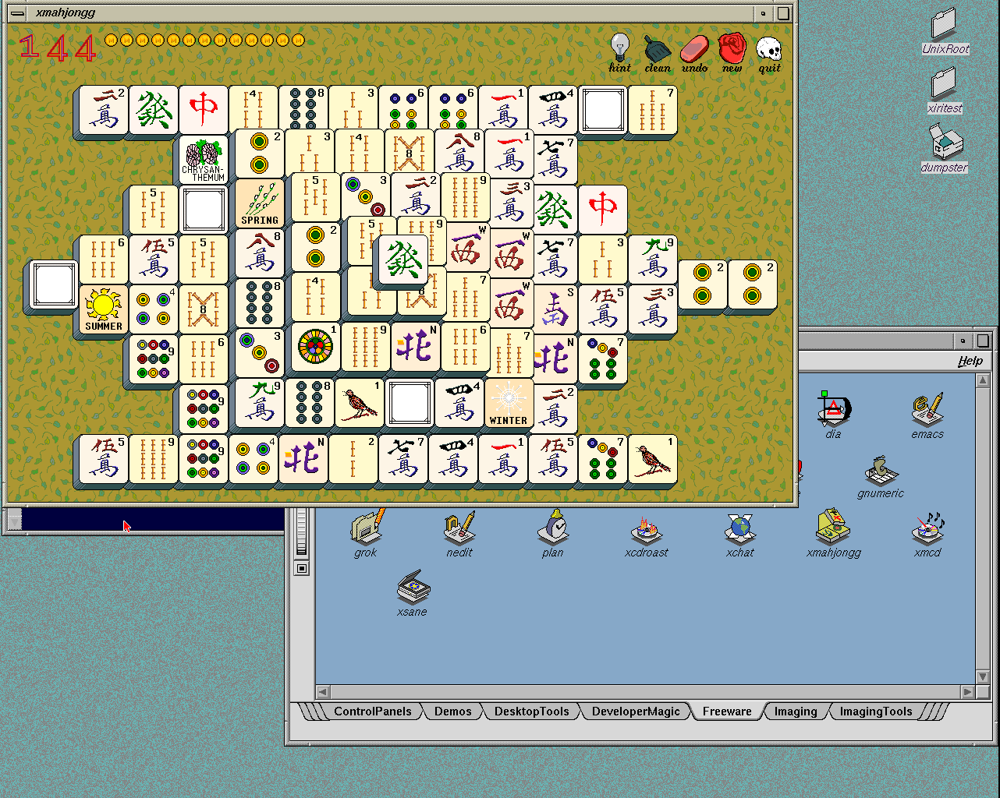

# Job control and native wait image

The image is qualified and selected for manual testing. The exact CHD/raw-disk
round trip, [cold desktop checks](2026-11-05-native-wait-image.json), and
[22-target catalog replay](2026-11-05-irix-catalog-replay.json) pass.
Run it from the repository with `./xiri run`.



The bundle is `.work/images/xiri-netbsd-desktop-20261105-wait/`.
Its 8 GiB disk compresses to **496,151,497 bytes**. CHD SHA256:

```text
90ca82ecdfbe184a96990515938f7856eb6983f77719d487fb7c6b34ba73eece
```

The image includes the [IRIX sleep/child-state/process-group work](2026-11-05-irix-job-control.md)
and the independently reproduced [native multi-child wait fix](2026-11-05-native-wait.json).
NetBSD `xiri` commits `ded40d74024a79922c33f56c4b7c342cc39aa9f9` and
`e9ff76a58affee773b767d334f98075bf86daf7e` contain the changes and tests.
The [build](../../lab/native-wait/build.json) and
[source-equivalence ledger](../../lab/native-wait/source-equivalence.json)
preserve the actual pre-commit build inputs and verify their committed bytes.
The pinned IRIS backend remains `819c6825504d40ad9f9aa00554249affd2da9446`.

Compared with the Type1 image, the installed-file inventory changes only
`/netbsd`, `/netbsd.boot`, and the boot-loaded `compat_irix_o32.kmod`.
All 1,283 inventory paths are retained. Compared with the intermediate
[qualified job-control image](2026-11-05-irix-job-control-image.json), only
the two native kernel files change; the module is byte-identical.

Fonts, imported application resources, XAA/Newport, xdm configuration and
accounts are retained. xiritest uses `/usr/people/xiritest` and 4Dwm;
netbsdtest uses `/home/netbsdtest`, standard ctwm and wheel membership.
Preparation verifies imported payloads, full-screen graphical autoboot,
module loading at securelevel 1, native execution and clean halt before CHD
packaging. The older bundles, their manual overlays/NVRAM and detached lab
worktrees are preserved.

The two new native regression cases fail on the old core and pass on the
fixed core under both identities. Existing native controls, the full IRIX ABI
matrix and signal/sproc/process regressions pass on the fixed core too. The
historical catalog stalls remain unexplained. Bounded application launches
and observed windows do not establish complete application support.

The cold run verifies full 1280×1024 XAA display, rejected incorrect login,
both user desktops and homes, 345 native text comparisons, three winterm
starts/resizes, both shells' stop/resume/background-read/wait behavior,
terminal exit, logout with running/stopped jobs, both logout menus, failed
session recovery, catalog xmahjongg launch/execution feedback, unchanged
source CHD and clean halt. The separate catalog batch repeats five native
control pairs and all 22 targets with verified descendant cleanup.

The PNG above comes directly from the qualified image's ordinary IRIS
scanout. The qualifier also retains terminal-job, native ctwm, greeter and
untouched-winterm captures. All owned test instances were stopped after their
runs. Older manual NVRAM and overlays were not modified.
