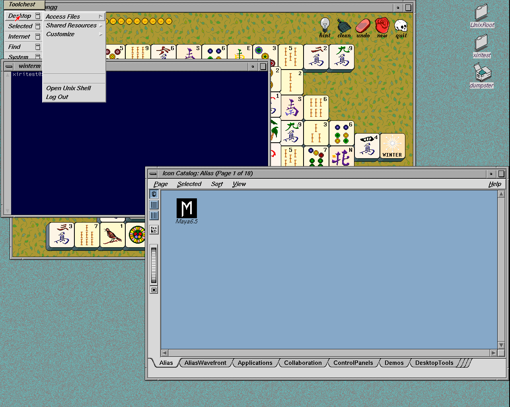
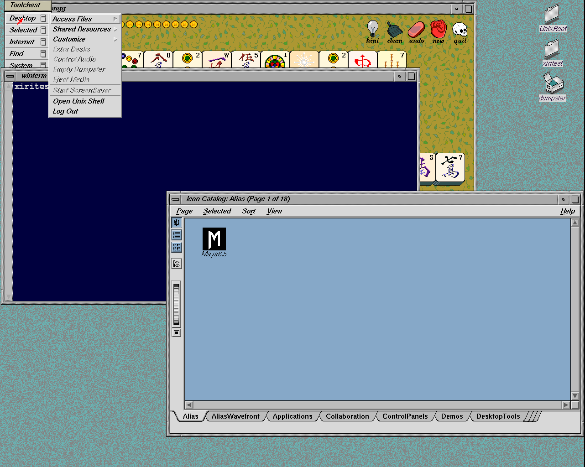

# Newport text fallbacks and desktop fonts

The blank Toolchest rows are reproducible native X11 drawing failures.
The corrected userspace Newport driver displays the disabled labels and
Xft/Render glyphs while keeping XAA enabled. An explicit bitmap Courier
selection restores larger winterm text. Native controls, cold-image acceptance
and menu review pass. `./xiri run` now selects the new fonts CHD; the earlier
scheduler image and manual state remain intact.

| Before | Candidate |
| --- | --- |
|  |  |

## Cause and correction

The baseline is the qualified scheduler CHD
`b6e5c89ef897f441e0c8cfbb5f174a23f082383414c8fb64105500c971992d36`,
NetBSD `xiri` source `0cd56e7a286c4cd3d67ab7cc971b233a83ac1655`,
the unchanged IRIX module and pinned IRIS `819c682` emulator. The ordinary
graphical run is `.work/fonts-menus/ordinary-s6m03a12`, using a private disk
overlay and NVRAM. The original bundle remains unchanged; this exploratory
guest halted cleanly after its controls.

Toolchest's imported `system.chestrc` and app-defaults match the supplied
IRIX 6.5.22m installation byte for byte. Desktop, Selected and System show
large blank groups where disabled labels belong. Core XDrawString controls
reproduce the missing pixels with `FillStippled` and `FillOpaqueStippled`;
solid text passes. Native Xft similarly produces no window pixels with
Render enabled, despite correctly rendering into a pixmap. Font matching is
successful and turning antialiasing off does not repair the missing text.

The driver allocates `ShadowPtr` for fb software rendering, but installed
refresh callbacks only in `NoAccel` mode. XAA falls back to software for
these requests, leaving the result in shadow memory. The
[source patch](../../lab/newport-text/shadow-fallback.patch) installs
`ShadowFBInit2` underneath XAA and synchronizes each affected rectangle
before/after the software operation. Accelerated requests retain their
existing path. Readback and upload use the driver's existing operations,
preserving its REX3 register cache and restoring clipping.

This is an Xorg driver change in NetBSD **xsrc**, maintained as a pinned
patch in this repository. Neither the NetBSD compatibility module/kernel nor
IRIS changes. The build/source provenance is in
[lab/newport-text](../../lab/newport-text/README.md). IRIS upstream was fetched
at the start of the cycle and remains integrated, as recorded in
[FORKS](../FORKS.md).

## Native controls

[Raw controls and provenance](2026-11-05-newport-text-controls.json) retain
the failures as well as the passing controls. Each state starts a fresh Xorg
server in the same disposable guest and records the driver hash/configuration.

| Server/driver | Core text | Xft text | Existing texture regression |
| --- | --- | --- | --- |
| Previous accelerated module `ce4f780…` | fails | fails with Render | passes |
| Previous module, `NoAccel=true` | passes | passes | passes |
| Candidate accelerated module `0fcd56d…` | passes | passes | passes |

Core text covers three fonts × five drawing styles × three clipping cases:
45 comparisons. Xft adds 24 comparisons across Render on/off, antialiasing,
color and clipping. All 1,242,000 pixels match their pixmap controls with the
candidate; all cases require visible ink. The existing 12-case ARGB/A8 test
also passes, with 8,536 pixels and zero mismatches. Font tests compile natively
with warnings treated as errors. The 40 host tests pass, including rejection
of the reproduced failures, incomplete pixel evidence and collapsed metrics.

The separate [menu replay](2026-11-05-newport-menus.json) on the new CHD
shows all six top menus and four cascades: 93 readable labels, including
41 disabled labels. Original static menu labels match the supplied resource
file; Selected and the catalog page entries are dynamic. The restored grey
text reflects Toolchest's existing enabled/disabled state. This does not
qualify each menu action or enable unavailable applications.

| Menu | Labels / disabled | Capture |
| --- | --- | --- |
| Desktop | 10 / 5 | [PNG](images/2026-11-05-newport-menu-desktop.png) |
| Selected | 13 / 9 | [PNG](images/2026-11-05-newport-menu-selected.png) |
| Internet | 5 / 2 | [PNG](images/2026-11-05-newport-menu-internet.png) |
| Find | 23 / 4 | [PNG](images/2026-11-05-newport-menu-find.png) |
| System | 11 / 5 | [PNG](images/2026-11-05-newport-menu-system.png) |
| Help | 7 / 4 | [PNG](images/2026-11-05-newport-menu-help.png) |
| Access Files | 4 / 3 | [PNG](images/2026-11-05-newport-menu-access-files.png) |
| Shared Resources | 2 / 2 | [PNG](images/2026-11-05-newport-menu-shared-resources.png) |
| Customize | 14 / 3 | [PNG](images/2026-11-05-newport-menu-customize.png) |
| Utilities | 4 / 4 | [PNG](images/2026-11-05-newport-menu-utilities.png) |

Menu run `.work/fonts-menus/ordinary-8eb62sxl` verifies the candidate driver,
uses click navigation and waits for redraw before capture. It halted cleanly
and left the CHD unchanged. The earlier obscured Help, unopened hover cascades
and two premature click captures are retained locally and excluded. The
cold-session harness used the hover helper; its exact source is preserved in
the menu record. The replacement navigation helper is tested by this replay;
the native pixel/metric checks are unchanged.

The [greeter capture](images/2026-11-05-newport-text-greeter.png) uses NetBSD's
normal Xft selection without `Xft.render:false`.

## Winterm font selection

IRIX's XWsh defaults request
`-*-courier-bold-r-normal--20-*-*-*-m-110-iso8859-1`. NetBSD's default font
path searches Type1 before the 100dpi bitmap directory and resolves that
wildcard to scalable IBM Courier. Its earlier 12×2 metric collapse was
observed by both native and original Xlib; the fresh baseline in this cycle
instead reports healthy 12×21 metrics. The intermittent scaler problem is
not claimed fixed.

Both installations provide the 100dpi Adobe Courier bitmap matching the
original request. `/etc/xiri/Xresources` now selects its exact XLFD:
`-adobe-courier-bold-r-normal--20-140-100-100-m-110-iso8859-1`.
The native font file is already installed in the NetBSD X font set. Native
and original IRIX Xlib measure stable widths and bounds; untouched winterm
starts at 903×480 with 11×20 resize increments and a 24×80 shell. See the
[Courier capture](images/2026-11-05-newport-text-courier.png).

The original font was read from the supplied image with a read-only,
`ro,norecovery` mount for comparison only. Of its 191 glyphs, 188 have identical
metrics and bitmap bytes in NetBSD. Apostrophe, hyphen and grave accent differ;
NetBSD has one additional glyph. The two font files are not byte-identical,
and the pixel comparison does not claim otherwise. No additional vendor font
is imported. The existing SGI Screen face remains available for user overrides.

The resource override preserves existing display preferences and normal
installation preserves administrator files. Image preparation explicitly
adopts the new resources together with the pinned corrected driver.

## Image preparation

The selected scheduler CHD was materialized as a separate raw seed at
`.work/xiri-image/prepared-seed-20261105-fonts`. Preparation run
`.work/xdm-image/prepare/ordinary-fgsm3ijt` verified its existing payload,
stopped xdm/Xorg, installed the pinned Newport module and explicitly refreshed
the terminal/greeter resources. Both accounts and their passwords were preserved.
The prepared disk rebooted through graphical PROM AutoLoad into 1280×1024 xdm
with normal Xft text, then halted cleanly. The input raw seed is unchanged.

```sh
python3 scripts/prepare-xiri-xdm-image.py \
  --seed .work/xiri-image/prepared-seed-20261105-fonts \
  --kernel-build .work/netbsd-stability-build --keep-accounts \
  --newport-driver .work/fonts-menus/ordinary-s6m03a12/newport_drv.so \
  --refresh-font-resources
python3 scripts/build-xiri-image.py \
  --seed-run .work/xdm-image/prepare/ordinary-fgsm3ijt \
  --output-directory .work/images/xiri-netbsd-desktop-20261105-fonts \
  --baseline lab/system-stability/baseline.json \
  --kernel .work/netbsd-stability-build/tftp/netbsd-XIRI_INDY \
  --iris-bin-dir .work/images/xiri-netbsd-desktop-20261104-scheduler/emulator
python3 scripts/probe-xiri-xdm.py \
  --bundle .work/images/xiri-netbsd-desktop-20261105-fonts --winterm --fonts
```

The new CHD passes `chdman verify` and exact extraction back to the 8 GiB
prepared raw disk. It is 496,147,337 bytes, SHA256
`f8572195a17a2cb6f67e7d77d9b5334226a1f0900a0f2159a2c8a8805f2ae4d5`.
The raw-disk SHA256 is
`04c53515507a69b0641d334d47014f3e5041cd4b0a638927e18a74c3b7f8c054`.
The driver SHA256 is
`0fcd56d2ce8785a4c702afa58bf8921862d8307b737e293430c95b9113f7a08f`.
The kernel, module, Xorg server, emulator, imported application payload and
account credentials retain the scheduler image's pins.

## Cold-image acceptance

[Qualification](2026-11-05-newport-text-image.json) uses the separate run
`.work/irix-xdm/runs/ordinary-8ujqud_p`. It boots from the CHD's own kernel
and graphical AutoLoad profile, without a TFTP kernel or runtime reinstall.
It verifies the payload and matching driver/font resources, then passes:

- Full 1280×1024 xdm, normal Xft greeter text and rejected-password handling.
- Three IRIX logins with untouched 903×480 winterm windows, 11×20 cells,
  foreground resize notifications and an extra terminal's normal shell exit.
- Both IRIX logout routes, failed-startup recovery and survival of services
  and an independent login shell.
- Native `netbsdtest`/ctwm, its home directory and effective wheel membership,
  followed by return to xdm and a final IRIX login.
- 69 native text cases in each of five contexts: 345 comparisons,
  6,210,000 pixels, zero mismatches; six Courier metric cycles per context.
- The existing 8,536-pixel texture regression in each IRIX login, catalog
  double-click launching xmahjongg, granite and home/Filesystem/Dumpster links.
- Clean guest halt, complete owned-emulator teardown and an unchanged base CHD.

The separate menu-only guest also halted cleanly. All owned test instances
are stopped. The maintained capture helper now uses the click/redraw sequence
qualified by that menu replay; its native text/metric code is unchanged from
the cold-image run, whose exact earlier helper is retained in the menu record.

PNGs show [4Dwm and catalog](images/2026-11-05-newport-text-image.png),
[untouched winterm](images/2026-11-05-newport-text-image-winterm.png),
[native ctwm](images/2026-11-05-newport-text-image-native.png) and the
[greeter](images/2026-11-05-newport-text-image-greeter.png).

The underlying Type1 scaler, arbitrary Render operations, exhaustive menu
action support and physical hardware remain separate work.
