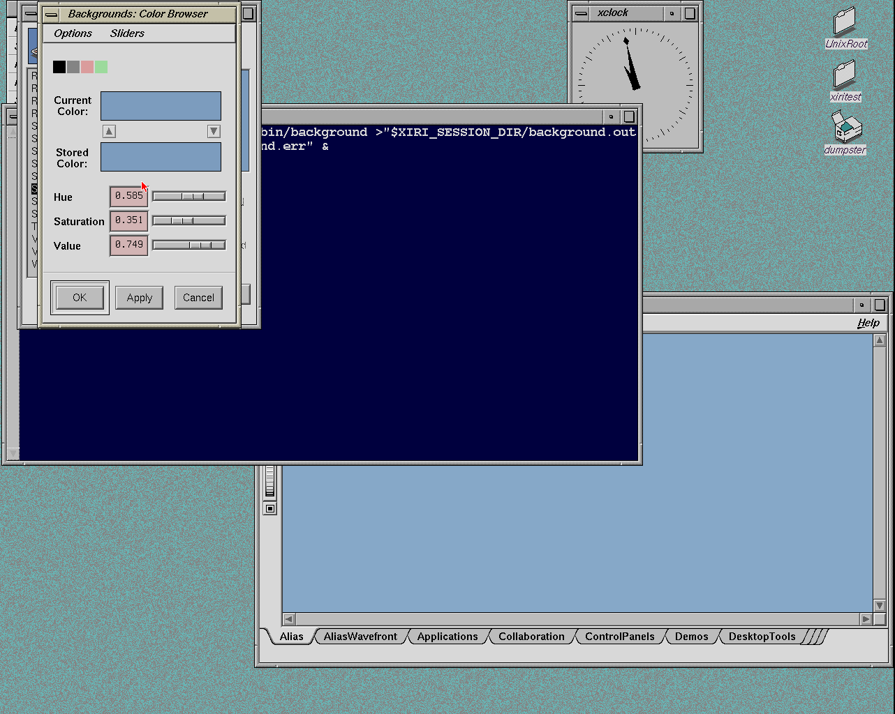
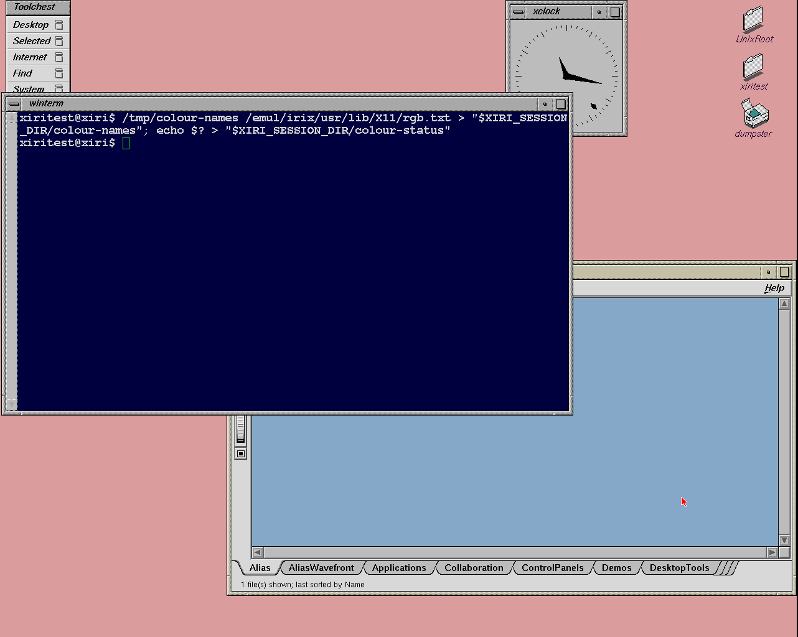
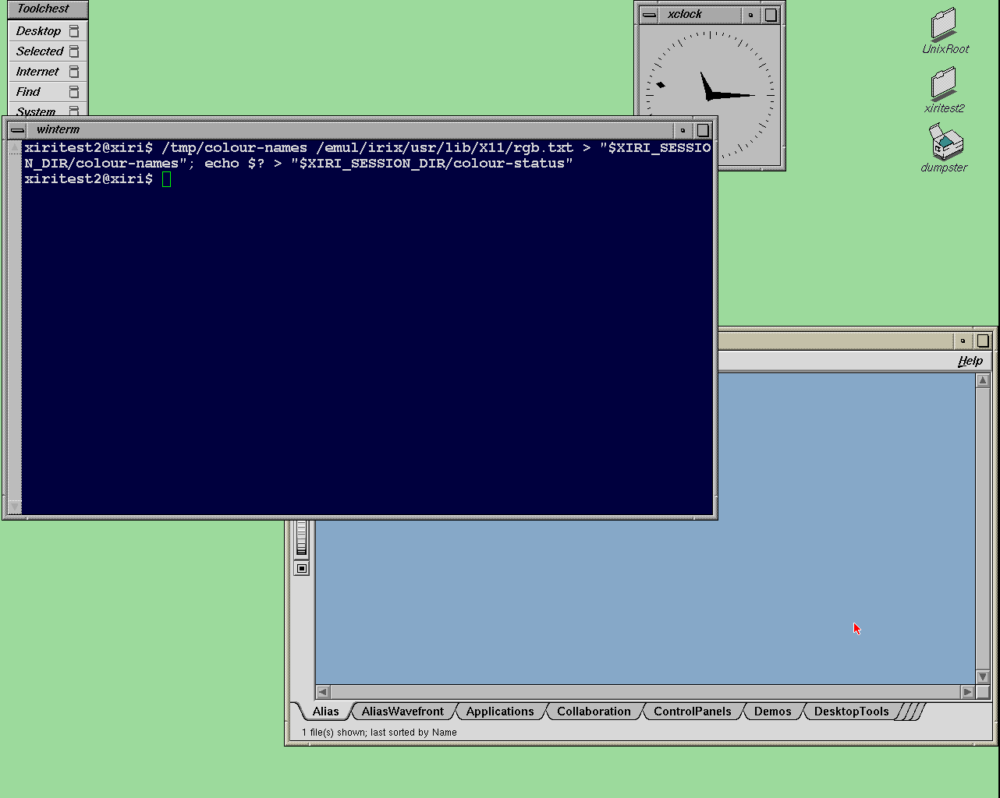
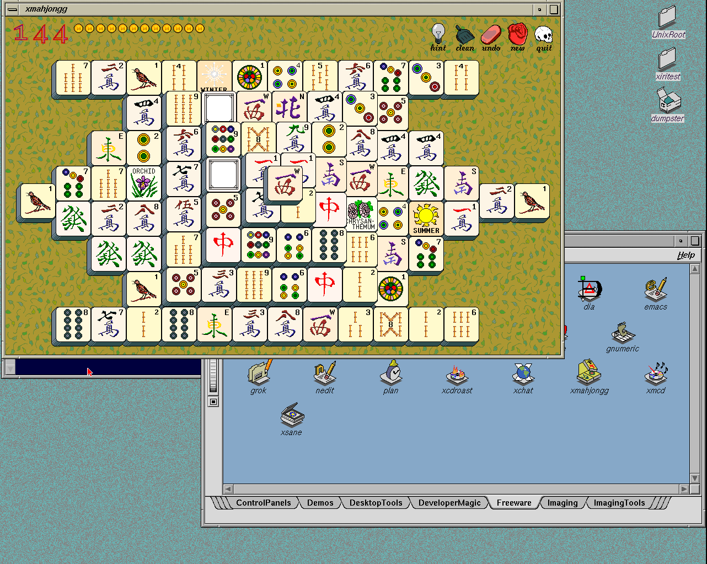

# Original Solid backdrop colours on NetBSD/Xorg

The original IRIX Background panel now displays `sgiLightBlue`, opens its
colour browser and saves separate solid colours for two native users. Both
choices survive logout/login and a guest reboot with matching saved files
and framebuffer pixels. The reopened panel retains its preview and controls.
The [machine-readable evidence](2026-11-06-desktop-colours.json) separates the
initial failure from the successful X11 picker path.

## Cause and change

Xorg 1.10.6 uses a compiled colour table. The imported `rgb.txt` therefore did
not make SGI names available to its core colour requests. A native observer
confirmed that `sgiLightBlue`, its spaced alias and `SGIDarkGray` failed, while
standard `white` and a numeric blue succeeded.

Both native Xlib and the supplied IRIX Xlib support `XCMSDB`. The session now
converts the SGI-prefixed entries from the existing imported RGB file to a
private Xcms database: 142 aliases reduce to 71 case/space-normalized names.
The conversion expands each eight-bit channel to all sixteen bits, rejects
conflicting aliases/out-of-range values and leaves standard names to Xorg.
No new vendor files are imported. An explicitly supplied `XCMSDB` is preserved.
Toolchest no longer needs its numeric SGIDarkGray decal override.

This fixes the blue preview and the previously malformed reopened Solid panel.
Opening the colour browser then exposed a separate GL path failure: Xorg
aborted with a stack through its GLX code and `swrast_dri.so`. The original
`libSgm` widget provides `useGl`; setting `Background*useGl: False` opens its
ordinary X11 palette and sliders. That scoped default is installed in
`/usr/local/share/xiri/desktop-Xresources` and loaded below administrator,
existing display and user resources. It does not disable GLX globally.
The server, kernel, IRIX module, Newport driver and vendor binaries are unchanged.



The pinned public [Xorg colour lookup](https://github.com/NetBSD/xsrc/blob/b2f7e3892002986f53e61cb0540e281fcbfab335/external/mit/xorg-server.old/dist/os/oscolor.c)
and [Xlib database loader](https://github.com/NetBSD/xsrc/blob/b2f7e3892002986f53e61cb0540e281fcbfab335/external/mit/libX11/dist/src/xcms/cmsColNm.c)
explain the two lookup paths. Local source SHA256 values are respectively
`2e6cf204bdc892f1a77fd861eea7df5c5f5861a5e54721c40e0b47cc9e03998b`
and `1e9da33b74e797b5f0db2d8f5b253146c5cdbee429f105710138310ae1a0cb81`.
The original RGB resource has SHA256
`233c6af69e8242286fe6ef11cd8c729916e1209aa689a01d2aa3b6138e7e494f`.

## Verification

The native `colour-names.c` observer reads expected values directly from the
original RGB file, independently of the generated database. Every one of the
142 aliases passes parse, lookup, exact-value comparison and allocation
against its numeric control. Standard white and an unknown name remain
correct. The same observer runs from the authenticated winterm environment
for both users after logout/login and reboot.

Applying the default Solid publishes `-solid sgiLightBlue` and pixel
`0xbe9c7c`; a fresh login restores it. The two further choices were made by
clicking the original palette, pressing OK and then the parent's Apply:

| User | Saved Solid | Visible RGB after relogin and reboot |
| --- | --- | --- |
| `xiritest` | `#db9d9d` | `#da9c9c` |
| `xiritest2` | `#9ddb9d` | `#9cda9c` |

Both `.Sgiresources` files retain their contents, native owner/group and mode
0600. The observed colours differ between users and match exactly across the
two lifecycle checks. The original picker also reopens on a saved custom
Solid after reboot. Moving the hue slider changes the current-colour preview;
Cancel leaves the saved colour and root backdrop unchanged. These checks cover
persistent user choices, not application-session restoration.





The host suite passes 57 tests. `./xiri check` now adds `--colours` for images
with this support, and promotion requires the corresponding named-colour
results. The checks do not require a proprietary compiler or changed vendor
libraries. Both fork worktrees remain clean on `xiri`; the
[upstream check](../FORKS.md#iris-upstream-updates) finds no new IRIS commits.

## Limits and use

Select **Desktop → Customize → Background → Solid**, click the colour square
under the preview, choose a colour, press **OK**, then **Apply** in Background.
See the [preference guide](../IRIX-SOFTWARE.md#desktop-preferences) for paths,
resource precedence and profile backups.

The GL chooser remains unsupported. Only Background receives the X11-mode
default; other editors and every slider combination are not qualified by
these checks. Reopened chooser swatches start from the Solid template blue in
the capture even while the desktop retains its saved pink; compare that
initialization with original IRIX before changing it. The browser's **Stored
Color** is a reference swatch set with its arrow, as described in SGI's
[desktop guide](https://techpubs.jurassic.nl/library/manuals/1000/007-1342-150/pdf/007-1342-150.pdf).
The native allocation/display path already quantizes numeric
RGBs as well as named colours, so exact requested-to-visible RGB fidelity is
not claimed. Saved application sessions, other control panels and physical
hardware remain separate work.

## Manual image

The selected bundle is `.work/images/xiri-netbsd-desktop-20261106-colours/`.
Its 8 GiB disk compresses to 496,280,482 bytes, with CHD SHA256
`aec2fbdb39bb732a62fa92775e7303855993dd6ec8ab246a1b5d6d34b7b9acb5`.
Create, verify and full raw round-trip checks pass. The initial backdrop and
fresh user choices remain unchanged; the pink/green diagnostic profiles above
are not seeded into the manual image.

```sh
/var/home/salvogendut/Dev/xiri/.work/images/xiri-netbsd-desktop-20261106-colours/run-iris.sh
```

Log in as `xiritest` / `xiritest` or `xiritest2` / `xiritest2` for IRIX;
`netbsdtest` / `netbsdtest` keeps native ctwm. The [image guide](../XIRI-IMAGE.md)
documents Prismatic, console access and shutdown.

The [cold CHD qualification](2026-11-06-desktop-colours-image.json) passes
three primary-user logins, the second IRIX account, native ctwm, private-home
and FAM group checks, untouched winterm startup/resize/exit, 345 native text
comparisons, menu captures, rendering, catalog launch, both logout routes,
failed-startup recovery and clean halt. Each of the four IRIX sessions passes
all 142 SGI aliases from its real winterm environment. The unchanged
kernel/module retain the preceding shell-job qualification; those separate
sequences were not repeated in this cycle.



The [build and cleanup ledger](2026-11-06-desktop-colours-build.json) records
the image hashes, installed-file comparison and upstream check. Only the
session launcher, client launcher, new colour converter and new desktop
resource file change in the installed inventory. Kernel, module, fonts,
emulator and original vendor payload remain identical to preferences-v2.
All owned test guests are stopped. Verified extraction and duplicate run-disk
caches were removed; qualified images, manual overlays/NVRAM and diagnostic
evidence remain available.
