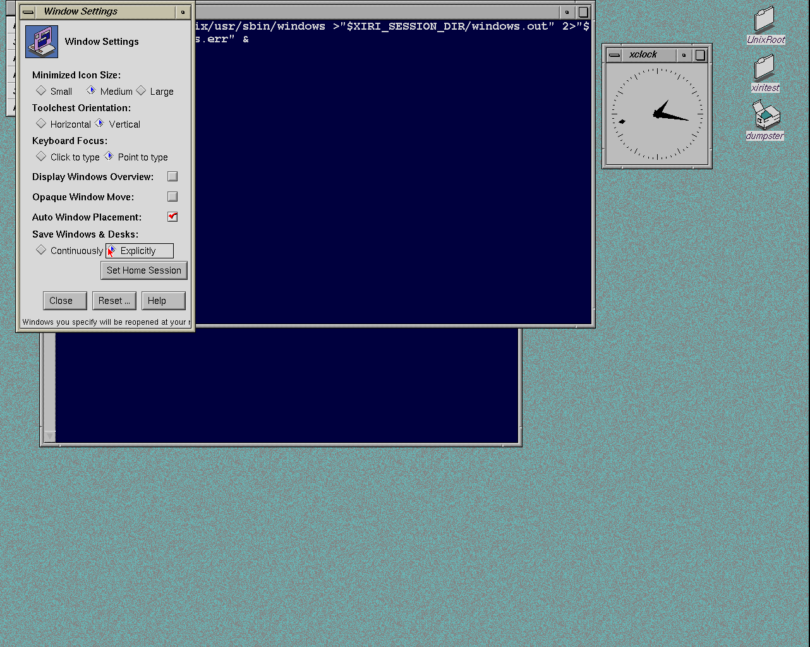
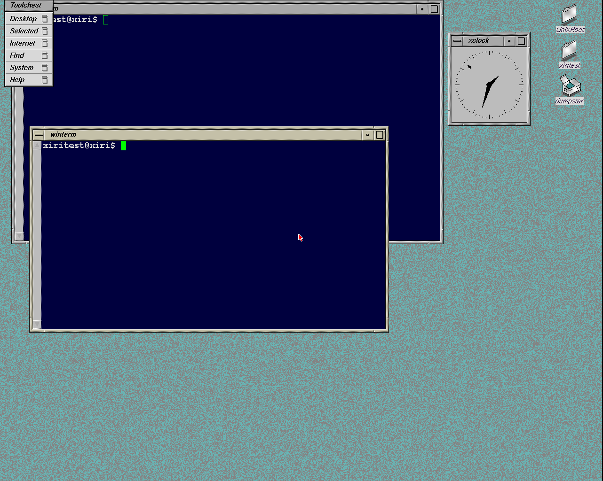
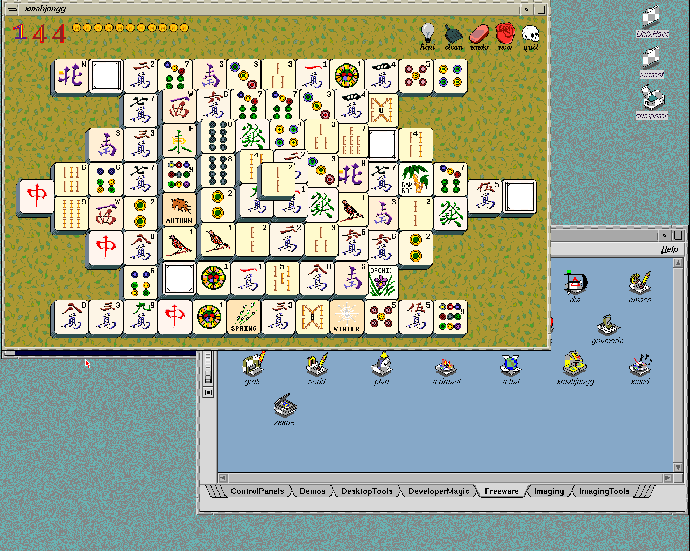

# Original IRIX saved desktop sessions on NetBSD

The original **Save Windows & Desks** controls now save and restore a bounded
set of desktop applications through 4Dwm. Continuous and explicit modes,
multiple winterms, xclock, Icon Catalog, window geometry and separate native
users' profiles are covered. **Log out before rebooting or shutting down**:
an active xdm shutdown can close X before the save finishes.

The [user guide](../IRIX-SOFTWARE.md#saved-desktop-sessions) describes the
controls, saved files, backups and reset procedure. The machine-readable
[evidence](2026-11-06-desktop-sessions.json) retains the focused observations
and the direct-reboot limitation separately.

## Runtime changes

`desktop-clients.sh` starts the unmodified `4Dwm -launch` and no longer forces
`SG_manageSession` and `SG_autoSave` off. When a managed saved session exists,
it leaves application launches to 4Dwm. Toolchest and `fm -b` still start as
desktop services, following the original Xsession policy. The default terminal,
clock and Catalog are only seeded for a session without a saved application list.

The old terminal restart command contained an already-used
`~/.xiri/sessions/session.*/handoff` pathname. Restoring it could not create a
fresh handoff report. The default command now invokes `xiri-shell` without
that argument. Each terminal creates its own private report in the current
session and opens a new native shell. The first completed report also provides
`handoff` for readiness checks. Explicit report arguments remain supported for
older standalone probes. The session PATH includes the installed Xiri commands.

Before normal logout cleanup, the native supervisor runs `save-session`.
It sets `_SGI_SESSION_PROPERTY`, invokes original `tellwm end_session`, and
waits for 4Dwm to delete the property. This preserves the manager's chosen
save mode rather than forcing an explicit save at every logout. A 12-second
helper alarm and 15-second supervisor deadline bound failures. The existing
cleanup then removes only tracked descendants. The save hook is consumed by
the desktop supervisor; nested application supervisors cannot inherit it.

Only one additional vendor executable is imported: original IRIX 6.5.22m
`/usr/bin/X11/tellwm`, 22,848 bytes, installed below `/emul/irix`. Its libraries
are already present. The [ledger](../../lab/irix-session/resources.json) records
source, destination, modes and hashes. No original user's session files are
copied. The kernel/module, Newport driver, emulator and vendor binaries are
not modified by this cycle.

## Original behavior and focused checks

The supplied original IRIX 6.5.22m installation confirms the end-session
property handshake. In explicit mode, closing the clock and ending the
session leaves the explicitly saved command list unchanged. Continuous mode
writes the remaining terminal and removes the closed clock. This matches the
public SGI [desktop session protocol](https://techpubs.jurassic.nl/library/manuals/2000/007-2006-100/sgi_html/ch05.html)
and [endsession/reaper convention](https://techpubs.jurassic.nl/manpages_0530/cat1/X11/endsession.html).
The reference comparison qualifies saving and acknowledgment; a separate
manual root-manager restart did not relaunch its clients and is retained as
an inconclusive reference experiment, not a restore pass.

Under NetBSD/Xorg, the default three application windows return once each,
and a restored winterm accepts a command with the correct native identity and
HOME. After opening a second winterm, resizing/moving the windows and closing
the Catalog, continuous-mode logout restores exactly this layout:

| Application | Client size | Root position |
| --- | --- | --- |
| First winterm | 749 × 400 | 70, 300 |
| Second winterm | 903 × 480 | 32, 32 |
| xclock | 160 × 160 | 960, 100 |

The closed Catalog stays closed. The terminal devices report 20 × 66 and
24 × 80 cells after restoration. The original **Explicitly → Set Home
Session** controls preserve both `4Dwmsession` and `4Dwmdesks` byte for byte
after the clock is subsequently closed and the user logs out. The next login
restores the saved clock and the two terminals.



After a normal logout and reboot, `xiritest` retains that same layout.
`xiritest2` separately restores a 639 × 300 terminal at 430, 520 and its Catalog,
with its clock intentionally absent. The first user's three saved files keep
identical SHA256 values across the second user's activity and both reboot
experiments. The profiles have their respective native owners, mode 0600,
and private mode-0700 homes; cross-user reads are denied.



## Supervisor and regression checks

The final guard passes its native ownership suite, including escaped/double-
forked clients, live and exited process bursts, failed exec/leader cases,
normal logout and signal cleanup. The added cases verify saving while clients
are still alive, cleanup after a stalled save, and hook isolation in a nested
supervisor. An unrelated shell of the same user survives every case. A real
restored desktop then confirms that clients do not inherit the hook and that
normal logout still receives 4Dwm's acknowledgment with no descendants left.

All 58 host tests pass, along with Python and shell syntax checks. The host
image builder and `doctor` use the shared resource-package registry, so the
new session ledger is included and its hash is verified. The focused
lifecycle observations precede the final hook-isolation adjustment; the
[evidence record](2026-11-06-desktop-sessions.json) identifies both source
variants and the final guard/session checks. The main NetBSD diagnostic guest
and both original-IRIX reference attempts are stopped; their reference media
remain unchanged.

## Limits

A direct reboot with an active second-user desktop reproduced a deterministic
ordering limit: the native helper returned status 2 as xdm closed X, and the
last explicitly saved snapshot survived instead of the most recent change.
After closing the clock and logging out normally, its absence survives a
subsequent reboot. Coordinating system shutdown before the X server closes
is recorded as follow-up work; it is not hidden by retrying the failed case.

This restores application restart commands, window sizes/positions and the
single desk used in these tests. It does not resume process memory, shell
jobs or unsaved documents. Additional desks, arbitrary catalog applications,
remote displays and physical hardware need their own qualification. The
File Manager/Dumpster operations cycle remains separate.

## Manual image

The selected bundle is `.work/images/xiri-netbsd-desktop-20261106-sessions/`:

```sh
./xiri run
```

It boots to full-screen xdm. Log in as `xiritest` / `xiritest`, or use
`xiritest2` / `xiritest2` for a separate IRIX profile. `netbsdtest` / `netbsdtest`
still opens standard NetBSD ctwm. The initial profiles are fresh; saved
layouts used in qualification stay in disposable test disks.

Move or resize windows, close an application, then log out normally and log
back in. For a fixed starting layout, use **Explicitly → Set Home Session**.
Log out before rebooting. See the [user guide](../IRIX-SOFTWARE.md#saved-desktop-sessions)
for backup/reset instructions and the [image guide](../XIRI-IMAGE.md) for
Prismatic and PROM settings.

The [cold-image qualification](2026-11-06-desktop-sessions-image.json) passes
three first-user logins, a second IRIX user, native ctwm, both logout menus,
failed-startup recovery, catalog launching, fonts, colour aliases, rendering
and clean halt. Restored logins have no duplicate default applications and
every normal logout receives 4Dwm's save acknowledgment. The
[build ledger](2026-11-06-desktop-sessions-build.json) records the seven
installed-file changes and retained kernel/module, emulator and driver pins.



The CHD is 496,286,081 bytes. SHA256:
`3abb7d0813577dfba369579a8f18da7577239b0ec10c28967c8145b74133cbd6`. The preceding colours image and its manual
NVRAM/overlay remain available. All test guests from this cycle are stopped.
