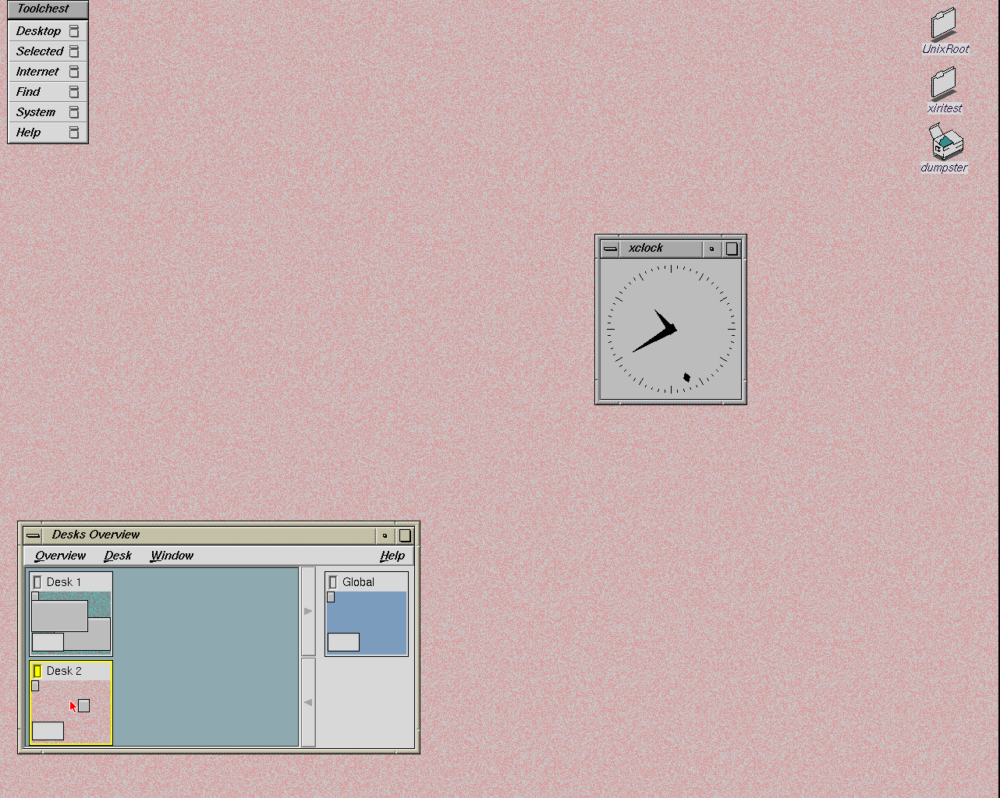

# Original 4Dwm windows and desks

Work began on November 13; final image qualification completed on November 14, 2026.

The original **Desks Overview** executable was missing from the imported
desktop. Toolchest already had its **Desktop → Extra Desks** entry, and the
Overview resources and libraries were present. The resource package now
installs IRIX 6.5.22m `/usr/sbin/ov` at `/emul/irix/usr/sbin/ov` with mode 0555
and native root ownership. No kernel, emulator or production session-runtime
change is needed.

The [import ledger](../../lab/irix-desks/resources.json) records its source,
212,216 bytes, dependencies and SHA256
`c830e5332562b610c611625d07b793b19c184ea74c1e02564d683decfe1d3207`.
The source XFS image is read-only with recovery disabled. Vendor bytes and
generated disk images remain outside Git.

The [installed-file comparison](2026-11-13-desks-file-delta.json) has one
addition, `ov`, with no changed or removed existing inventory entries.

## Observed behavior

The [diagnostic record](2026-11-13-desks-diagnostic.json) covers a disposable
copy of the preceding qualified CHD with the verified `ov` binary added:

- Winterm minimizes through its title bar and Alt+F9, restores from its icon,
  maximizes through its title bar and Alt+F10, and returns to its exact normal
  geometry with Alt+F5.
- The window menu accepts keyboard move/resize commands and cancels a move
  without changing geometry. Alt+F3 lowers and Alt+F1 raises the window.
- The default pointer-focus policy leaves Alt+Tab inactive. Selecting
  **Click to type** through the original Windows panel, cancelling its
  immediate-restart prompt, and logging out/in enables forward and reverse
  focus navigation. The observer does not force focus during these keys.
- Toolchest's original Extra Desks entry launches `ov` as UID 1234. Ctrl+N
  creates Desk 2; dragging the clock thumbnail moves the clock to it.
  Double-clicking each desk hides/reveals its assigned windows. Toolchest and
  Overview remain visible on both desks.
- Logout/login restores Desk 2 and the clock. Selecting Desk 1 restores
  winterm's saved 914×500 size at (11,181). Saved session/desk files belong
  to the desktop user with mode 0600 inside its private native home.



An inactive Catalog initially has the title `Icon Catalog`, without its page
suffix. Inactive windows receive their per-desk geometry when that desk is
selected. The probe now accounts for both behaviors. Overview rounds its own
width by one pixel at startup; exact layout assertions cover winterm and
xclock. These are recorded test adjustments, not kernel fixes.

The first cold run's [saved-profile assertion](2026-11-13-desks-test-adjustment.json)
expected one space after `room`; the original file uses aligned columns.
Its Desk 2 block was present. The reader now accepts that spacing, and this
failed attempt is excluded from final acceptance. It halted cleanly and left
the base CHD unchanged.

## Validation and scope

All 63 host regression tests pass with loopback sockets enabled; the first
sandboxed run could not create sockets for four transfer-test cases. Python
syntax checks and the native helper's warning-clean C syntax check pass.
The diagnostic guest halted cleanly and left the source CHD unchanged.
Its disposable media and the first interrupted image preparation's media
were removed after evidence was saved. That interrupted preparation was
halted cleanly and is excluded from image acceptance.

The [fresh-CHD windows/desks check](2026-11-13-desks-cold.json) passes all
window controls, separate users, logout/login, orderly reboot with Desk 2
active, and restored click-to-focus navigation. The second user's desk setup
leaves the first user's saved files byte-for-byte unchanged. Clock and
winterm geometry match after selecting their desks. The guest halts cleanly
and the base CHD stays unchanged. The maintained
[probe](../../scripts/probe-xiri-desks.py) and
[reboot screenshot](images/2026-11-13-desks-desks-after-reboot.png) retain the
reproduction and visible result. The separate
[full image gate](2026-11-13-desks-image.json) also passes: graphical boot,
both IRIX accounts, both logout menus, startup recovery, native ctwm, catalog
launch, 345 native text comparisons, three winterm checks and clean shutdown.
This CHD is selected for manual testing.
`./xiri doctor` verifies its 20 immutable artifacts; `./xiri status` and
`./xiri run --dry-run` select this bundle. Changed JSON, documentation links
and `git diff --check` pass. Both fork worktrees are clean on `xiri`.

The [upstream ledger](2026-11-13-desks-upstream.json) records IRIS upstream
`9605704c`, already included in fork `xiri` at `84125cac`. No incoming merge
or emulator rebuild was needed. NetBSD `xiri` stays at `8bf86afce2af`.

Rename/delete desk operations, arbitrary application restoration, additional
window-control edge cases, multiple displays and physical Newport hardware
remain outside this bounded check. The existing explicit-session snapshot
qualification is separate; this desk check uses continuous saving.
See the [window and desk guide](../IRIX-WINDOWS.md) for normal use.


## Manual image

From the repository, run:

```sh
./xiri run
```

Log in as `xiritest` / `xiritest` or `xiritest2` / `xiritest2`, then choose
**Toolchest → Desktop → Extra Desks**. Native ctwm remains available through
`netbsdtest` / `netbsdtest`, including its wheel membership.

The selected bundle is `.work/images/xiri-netbsd-desktop-20261113-desks/`.
Its CHD SHA256 is `a07487e5b02db4c2ba9b657d81feb46b659c1b9ffa10e5da1410b2f8f733e084`.
Previous qualified images and their manual state remain available.

## Cleanup

The [cleanup ledger](2026-11-13-desks-cleanup.json) records stopped guest
groups and the removed disposable disks, overlays, ISOs and redundant raw
seed. One verified raw seed remains for the selected CHD. Source, build pins,
logs, screenshots and interrupted/failed-attempt evidence are retained.
Allocated file sizes include shared reflink extents; the ledger keeps the
filesystem free-space measurements separate.
