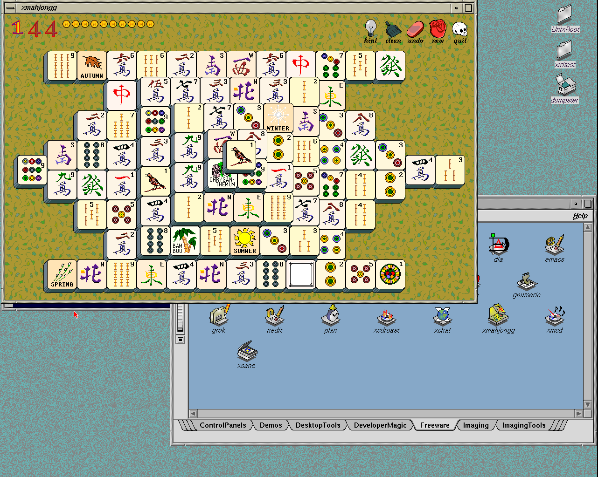

# Save desktop sessions before system shutdown

The maintained runtime now saves an active original 4Dwm desktop before
NetBSD stops xdm. Both continuous and explicit-save modes survive an orderly
shutdown, with separate saved state for each native user. This changes
userspace only; the qualified NetBSD kernel and IRIX module are unchanged.

Use `shutdown -r now` to reboot or `shutdown -h now` to halt from an
administrative terminal. `shutdown -p now` also invokes NetBSD's shutdown
hooks. Direct `reboot`, `halt` and `poweroff` bypass `/etc/rc.shutdown` and
do not provide this ordering. Emulator termination and power loss cannot
save an active desktop. See the [session guide](../IRIX-SOFTWARE.md#saved-desktop-sessions).

## Ordering and ownership

Previously, xdm could close X before the session supervisor received 4Dwm's
save acknowledgment. A persistent background preference did not establish
that the latest open applications and window positions had been saved.

The new `xiri_sessions` rc.d service requires xdm and FAM in startup order.
NetBSD reverses that order at shutdown, allowing this service to finish
before either dependency stops. The native `stop-sessions` helper discovers
marked desktop supervisors through libkvm, verifies process start time and
UID, sends TERM, and waits for their exits through kqueue. It reads no
user-controlled PID files and executes no user commands as root. Each
existing supervisor invokes its save helper with the desktop user's own
credentials, then cleans up its descendants.

The desktop marker excludes generic and nested application supervisors.
A single 30-second deadline bounds the controller; the per-user supervisor
already limits saving to 15 seconds before its bounded cleanup. Failures
are logged and shutdown can continue. The controller's successful exit means
that the selected guards ended; the guard logs separately report whether
4Dwm acknowledged saving.

`install.sh --enable-services` and `--enable-xdm` enable the new service.
An existing administrator configuration is preserved. No new resident root
daemon is introduced.

## Qualified behavior

Tests used disposable copies of the November 6 saved-session CHD, its pinned
emulator and original IRIX 6.5.22 desktop resources. Both test guests halted
cleanly and the base CHD hash stayed unchanged.

- Native controller tests selected desktop guards for two different UIDs.
  Each save hook saw its live clients and recorded the correct username.
  An unrelated generic guard survived. An empty desktop set returned
  successfully; an unprivileged invocation was refused.
- A stalled save reached the existing supervisor timeout and completed
  cleanup in 17 seconds. The generic guard still survived. The existing
  ownership suite also passed, including escaped descendants, fork bursts,
  save failures and nested-hook isolation.
- The actual reverse rc order was `xiri_sessions`, `xdm`, then `xiri_famd`.
- In continuous mode, `xiritest` opened a second winterm, moved and resized
  a terminal and xclock, and closed Icon Catalog. Without logging out,
  `shutdown -r now` received the save acknowledgment before xdm stopped.
  Login restored both terminals and xclock at their saved positions, with
  Catalog still closed. A restored terminal reported `xiritest` and
  `/usr/people/xiritest`.
- For `xiritest2`, an explicit home session included a terminal, xclock and
  Catalog. Closing xclock and running `shutdown -h now` preserved the saved
  session files byte-for-byte. A cold boot restored xclock and the saved
  geometry. The first user's saved-session hashes were unchanged.

The native fixture and reproduction procedure are in
[the session lab](../../lab/irix-session/README.md). Local evidence is retained
under `.work/shutdown-sessions/ordinary-a2ly6d92/` and
`.work/shutdown-sessions/ordinary-79gmn0_6/`. Host validation passed all
58 tests. These runs used the provisioned Distrobox directly through local
`toolbox`/`genisoimage` adapters; `mkisofs` supplied the installation CD.

Saving retains supported applications' restart commands and window layout.
It opens fresh processes; it does not recover shell jobs, unsaved documents
or arbitrary process memory. Additional desks and untested applications
remain separate qualification work.

## Manual image

The selected bundle is `.work/images/xiri-netbsd-desktop-20261113-shutdown/`. Start it with:

```sh
./xiri run
```

Use `xiritest` / `xiritest` or `xiritest2` / `xiritest2` for separate IRIX
desktops. `netbsdtest` / `netbsdtest` still opens NetBSD ctwm and belongs to
wheel. The initial profiles are fresh; qualification layouts remain in the
test evidence. Move windows or close an application, then run
`shutdown -r now` from an administrative terminal without logging out.
After boot, the continuous session should restore those changes. Explicit
mode continues to restore the chosen home session.

The [cold-image qualification](2026-11-13-shutdown-sessions-image.json)
passes repeated 4Dwm logins, the second IRIX account, native ctwm, both logout
menus, failed-startup recovery, catalog launch, fonts, named colours, rendering
and clean halt. The [build ledger](2026-11-13-shutdown-sessions-build.json)
records the five changed installed paths. The kernel/module, Newport driver,
Xorg configuration, FAM and bundled `819c682` emulator are unchanged.

The separately [integrated IRIS core](2026-11-13-iris-upstream.json) also
passes an active-desktop reboot and restores two winterms and xclock at their
saved geometry, with the correct native user and home. Its qualified binaries
and the rebuilt Prismatic/Instigator pair are retained under
`.work/upstream-qualified/`, with exact build metadata.



The CHD is 496,311,538 bytes. SHA256:
`8c7ebd8f62808ad55fe59066bcc3dbe5037dd0de04b74eeafe4bd7b42e565122`. Earlier manual CHDs, NVRAM and overlays remain intact.
The single reusable raw seed is `.work/xiri-image/seed-8c7ebd8f6280/`; it links to the final
preparation disk, avoiding another 8 GiB extraction.

## Cleanup

The completed cycle removed **37.69 GiB of allocated temporary artifacts**:
Rust build directories and temporary worktrees, the CHD round-trip raw copy,
completed guest disks/overlays/installation CDs, and the superseded reusable
raw seed. The filesystem reports **468.83 GiB available** afterward. The
removed-file total includes shared Btrfs blocks; it is not an exact physical
space recovery measurement. The build ledger records every removal batch.

The qualified CHDs and their manual NVRAM/overlays, pinned lab worktrees,
logs/screenshots and final emulator/frontend binaries remain. One reusable
raw seed is retained for the selected image. The older seed's metadata and
compressed CHD allow reconstruction when needed. No IRIS, IRIS-CI, Prismatic,
Instigator or Xvfb test processes remain running.
