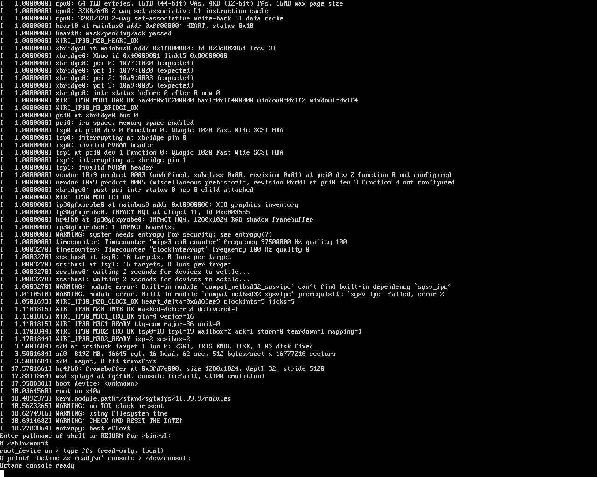

# NetBSD text console on Octane IMPACT



The opt-in IP30 kernel attaches `wsdisplay0` to the first detected HQ4
framebuffer. NetBSD renders a 160×64 VT100 console using the 8×16 VT220
font. The board retains PROM timing at 1280×1024. NetBSD's multicons
support keeps IOC3 serial usable for input and mirrors output there.
With the board removed, IOC3 remains the system console.

The switch happens after device autoconfiguration, before root selection.
NetBSD replays the earlier kernel messages from its message buffer, then
shows new console output live. The serial PROM and initial ARCS64 handoff
still precede graphical output. On an earlier build, handing over while the
QLogic buses were attaching allowed the timed storage check to run before
both SCSI children existed. Deferring the switch preserved that check.

The framebuffer consists of a 32-bit RAM shadow and a copy of the last
submitted pixels. A kernel thread compares rows and sends changed 32-pixel
spans through the HQ4 command FIFO. A uniform span uses a fill command.
The console uses programmed I/O. Local keyboard/mouse input, debugger
display when the scheduler is stopped, framebuffer mmap for Xorg and
physical Octane testing remain open.

## Qualification

Each graphics run boots the same native NetBSD kernel, checks that both
QLogic controllers and buses are ready, mounts the release-line root
read-only and reaches the single-user shell. The host decodes glyphs
from fresh IRIS screenshots using the same NetBSD font. It requires both
`root on sd0a` and the shell prompt in the boot frame. It then sends a
command through IOC3 serial to write `Octane console ready` to
`/dev/console` and checks the reply and the mount output on the screen.
The release numbers identify the disks used for these native tests.

| Emulated board | 6.5.22-line disk | 6.5.30-line disk |
| --- | --- | --- |
| Solid IMPACT | Boot and shell text | Boot and shell text |
| High IMPACT | Boot and shell text | Boot and shell text |

The boardless control checks the serial shell and clean halt on the native
control disk. The test records the input hashes and checks them again
after shutdown. All five runs returned to the PROM. The original
inventory kernel still identified widget 11, and the rectangle kernel
still passed its full-frame pixel comparison after the PIO code was shared.
All 83 host tests passed. [Run evidence](2026-11-23-octane-wsdisplay.json)

IRIS upstream `a05289ef` was already integrated in `xiri` at `08e53ba7`.
The runs used the qualified emulator from the earlier
[rectangle check](2026-11-23-octane-rectangle.md).

## Reproduce

For these historical commands use Xiri lab revision `b367bec` with the
Octane topic revision recorded here. Current NetBSD `xiri` contains the
drivers and kernel configurations in-tree.

Start in Xiri with the NetBSD Octane topic at `8f744b33e95` and the
sgimips cross tools. The shared register header comes from the NetBSD
integration branch. Use an empty build directory.

```sh
repo=$(pwd -P)
tools="$repo/.work/netbsd-octane-build/tools/bin"
build="$repo/.work/ip30-wsdisplay-rebuild"
mkdir -p "$build"
git -C ../NetBSD-xiri show 60dd809ab7a:sys/arch/sgimips/gio/impactreg.h > "$build/impactreg.h"
"$tools/nbconfig" -s "$repo/../NetBSD-xiri/sys" -b "$build" \
    "$repo/lab/ip30-impact/XIRI_IP30_HQ4_WSDISPLAY"
(cd "$build" && "$tools/nbmake-sgimips" -j2 depend netbsd)
```

With Python 3, Pillow, the archived IRIS binaries and Octane firmware
previously saved with `console=d`, run the following on a stopped source
disk. Each run requires a fresh output directory. Select `solidimpact`,
`highimpact` or `none` with the same kernel.

```sh
python3 lab/ip30-impact/check.py --wsdisplay --board highimpact \
    --emulator .work/octane-fill/emulator --kernel "$build/netbsd" \
    --firmware .work/octane-m4a-phys-readonly-20261116 \
    --disk .work/native/xiri-ip28-dma-6.5.22-20261122/netbsd-xiri.chd \
    --output "$build/high-22"
```
