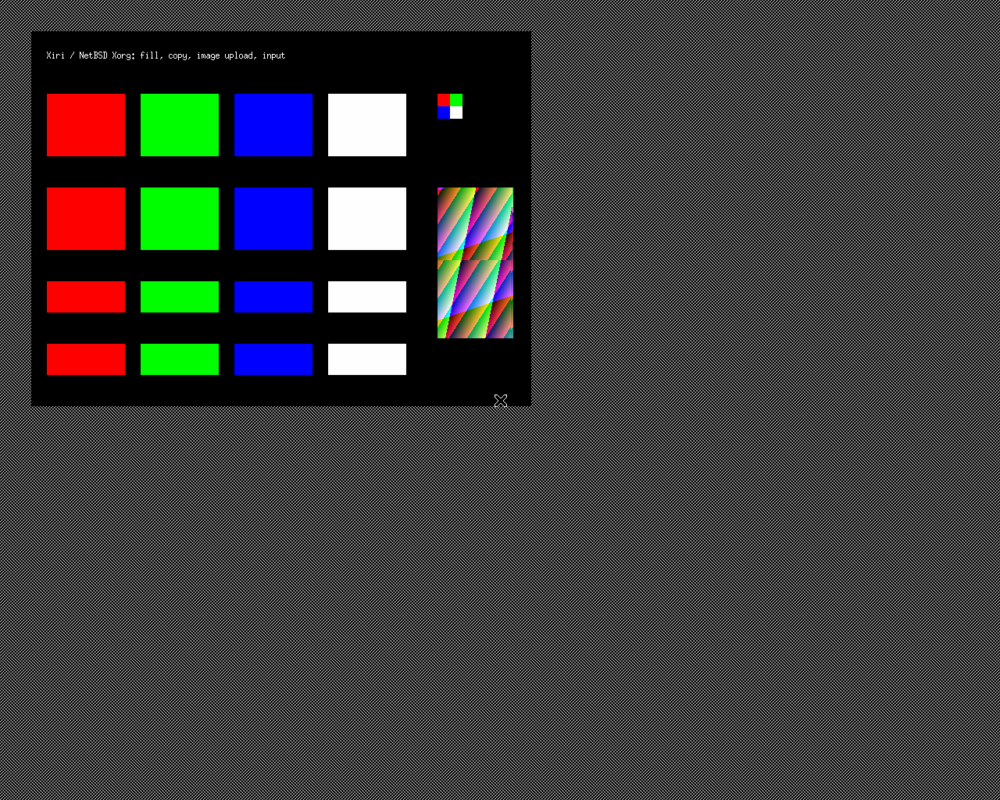

# Local input and full-screen Xorg on the emulated Octane



The native NetBSD Xorg server drives a **1280×1024, depth-24 display** on
both Solid and High IMPACT. The screenshot shows a 640×480 test window on
the full-size X root window. The kernel attaches the onboard IOC3 PS/2
controller to NetBSD's `pckbport`. Its `pckbd` and `pms` children provide
the console keyboard and the Xorg keyboard and pointer through wscons.

IOC3 holds each PS/2 clock after receiving one byte. A kernel callout
drains both ports each tick, with a per-port limit and a separate polled
read for device commands and console operation. The keyboard uses scan
set 1. IOC3 serial retains its SuperIO interrupt and the existing serial
recovery console. Interrupt-driven PS/2 would need shared SuperIO interrupt
dispatch. The [IRIS IOC3 implementation](https://github.com/salvogendut/iris/blob/08e53ba7/src/dev/ioc3_kbc.rs)
models the port registers and clock clamps.

Xorg's `wsfb` driver maps the kernel's RGB shadow in ordinary RAM through
`/dev/ttyE0`. The mapping is bounded to the 5 MiB image. The HQ4 driver
uploads changed spans via programmed I/O. The test verifies the device's
geometry, stride, mapping boundaries and access to the first and last pixel
before starting the server. The earlier [wsdisplay console](2026-11-23-octane-wsdisplay.md)
remains available after Xorg exits.

## Qualification

| Octane board in IRIS | 6.5.22-line root | 6.5.30-line root |
| --- | --- | --- |
| Solid IMPACT | Input and scanout | Input and scanout |
| High IMPACT | Input and scanout | Input and scanout |

Each run first sends an emulated keyboard command to the NetBSD shell.
In Xorg, a native Xlib client checks pixel readback for fills, copies and
image uploads. The host then checks 8,944 pixels on a fresh IRIS screenshot,
including the colour ramps, before sending input to the focused window.
The client must receive the shifted text `Xiri_123`, Return down and up,
relative motion away from its initial pointer position, and down and up
events for X buttons 1, 2 and 3. After Xorg exits, the guest returns to
the shell and shuts down to the PROM. A fifth boot with the graphics board
removed checks the serial recovery path. All 83 host tests passed.

Xorg 1.10.6 logged an unsupported bus-ID ioctl and two unresolved XKB
symbol interpretations. The configured wsfb device and the tested keys
worked. Other keymaps and special keys still need coverage.

The disks identify the two Xiri release lines. These runs exercise native
NetBSD programs. Building a matching Octane IRIX compatibility module and
qualifying the two 4Dwm desktops are separate milestones. Physical hardware,
HQ4 DMA and 3D also remain unqualified. [Run records](2026-11-23-octane-xorg.json)

IRIS upstream was checked at `a05289ef`, already integrated in the tested
`xiri` revision `08e53ba7`. The native board code is the NetBSD fork's Octane
topic at `8f744b33e95`, with the Xiri lab kernel configuration below.

## Reproduction

Build with the [Octane console cross-build instructions](2026-11-23-octane-wsdisplay.md#reproduce),
selecting `lab/ip30-impact/XIRI_IP30_HQ4_XORG` in the `nbconfig` command.
The host needs Python 3, Pillow, `genisoimage`, and the IRIS runtime. Use a
stopped release disk and an Octane firmware directory saved with `console=d`.
The harness makes a private disk copy and overlay. It checks the initial
read-only root, then remounts that disposable root read-write for Xorg and
the compiler. It builds a small
read-only test CD from the repository's existing Xlib probe, Xorg
configuration and framebuffer test. The guest compiles both test programs.

For the retained kernel and archived IRIS binaries, run from the Xiri checkout
and choose a fresh output directory.

```sh
python3 lab/ip30-impact/check.py --xorg --board highimpact \
    --emulator .work/octane-fill/emulator --kernel .work/octane-input/boot/netbsd \
    --firmware .work/octane-m4a-phys-readonly-20261116 \
    --disk .work/native/xiri-ip28-dma-6.5.22-20261122/netbsd-xiri.chd \
    --output .work/octane-xorg-manual-22
```

Use `--board solidimpact` for the other board or the separate 6.5.30 disk
for that release. Each run writes the screenshot to `xorg.png` and the
serial transcript and checks to `serial.log` and `result.json`.
