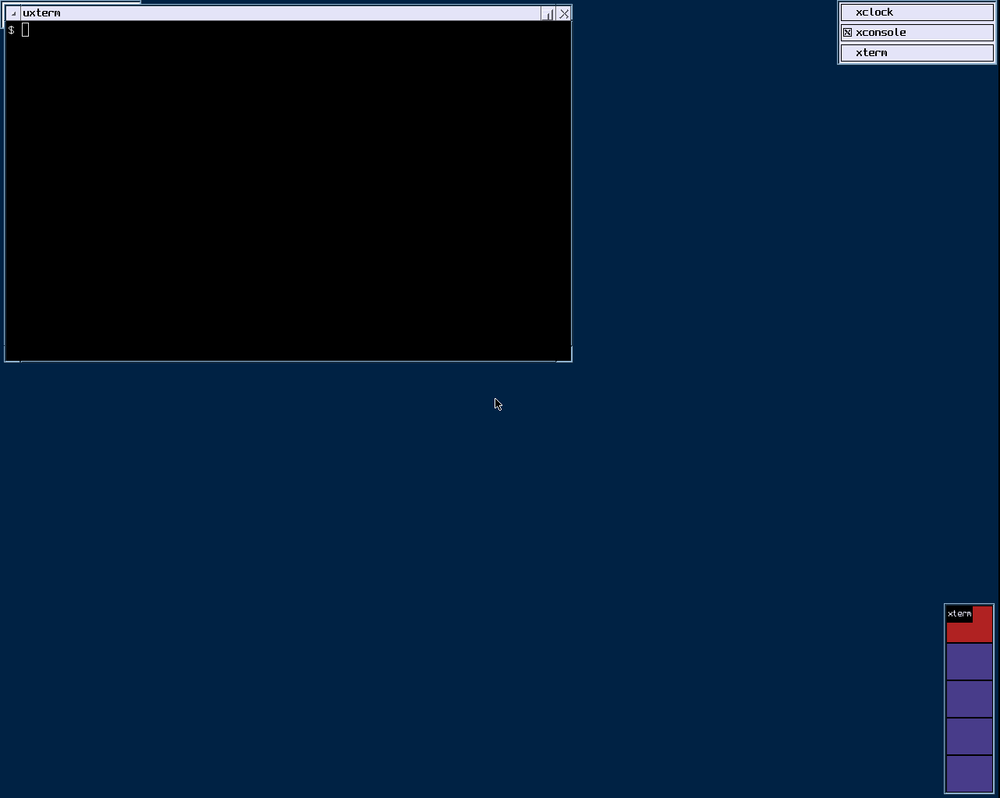

# Native XiriBSD Indy installation CD

The workstation built NetBSD 11.99.11 for sgimips, including the native X
sets, from the November 27 source pins. The default build made its own
mipseb tools for userland and sysinst and mips64eb tools for the installed
kernel and module. The artifact is 354,754,560 bytes. Its SHA256 is
`23e7bea976ac7774b7ddd030dc1850571f0ecfcda9af625f3c9c5d6ccf221055`.
[Build and PROM instructions](../XIRI-INSTALLATION.md#build-the-native-indy-iso) ·
[Source lock](../../lab/native-iso/indy-20261127.json).

The checksum identifies the tested ISO. NetBSD records the build time and
directory in its kernel, so rebuilding from the same locked inputs on another
workstation can produce a different image checksum.

| Input | Revision |
| --- | --- |
| NetBSD src, trunk | `4444b7c45282` |
| NetBSD-xiri, xiri | `058c861ad699` |
| NetBSD xsrc, trunk | `7eb4d684d7dd` |
| Xiri build recipe | `c1897b68aea6` |

Current xsrc adds FIFO waits to Newport accelerated texture writes. The
ported texture-coordinate, colour and shadow-framebuffer fixes preserve
those waits. The old Xorg also received Xiri's SGI screen-saver extension.
NetBSD's release inventory check found two omissions in the fork. Adding
`ip28boot` to the sgimips base list and the `wsdecorctl` HTML manual to the
manual list let the full release pass its own file checks.

## What is on the CD

The SGI volume directory points to the NetBSD boot loaders in the ISO9660
filesystem. Partition zero starts at sector zero. On the Indy a prepended
2 MiB SGI header booted the installer but made the ISO filesystem invisible
to the kernel's CD driver. The shared layout lets both the PROM and sysinst
read one CD. The media builder reads back the two PROM entries, the ISO
directory and every file before publishing the image.

The 15 sets contain 39,418 archive entries. Thirteen sets come directly
from the native release. The Indy kernel set supplies the N64 kernel, its
ELF32 PROM image, a stock recovery kernel, and Xiri's native Xorg and xdm
configuration. The module set contains the matching N64 module and its
boot configuration. An independent archive scan found zero entries in the
IRIX emulation, user, Icon Catalog, Freeware and Nekoware trees. The build
takes no donor or SGI PROM input. IRIS uses its firmware separately for
the boot tests.

## Blank-disk installation results

| Emulated Indy | sysinst from CD | Cold boot with CD removed | xdm login | Shutdown |
| --- | --- | --- | --- | --- |
| R4400, Newport | 15 of 15 sets installed | NetBSD 11.99.11, `compat_irix_o32` loaded | Native user, ctwm at 1280×1024 | Powered off |
| R5000, Newport | 15 of 15 sets installed | NetBSD 11.99.11, `compat_irix_o32` loaded | Native user, ctwm at 1280×1024 | Powered off |

Both installations used the same ISO and separate empty disks. The login
account had UID 1000 and belonged only to `users`. A second graphical boot
of the R5000 disk confirmed that a terminal window was visible under ctwm.
The first boot builds the fontconfig cache before the login screen appears.
Hardware testing is still open.



## Repeating the install check

The test creates a blank 6 GiB disk, boots the CD from the PROM, accepts
sysinst's default partitions, installs the full set selection, enables
xdm and creates an ordinary user outside wheel. It enables a serial getty
on the disposable disk for observation. The second emulator process boots
the disk with the CD detached, checks the module, types the user's login
into xdm, checks the window manager and resolution, saves a PNG and halts.

```sh
python3 lab/native-iso/check-install.py \
    --iso .work/images/xiribsd-indy-native-11.99.11.iso \
    --emulator .work/emulators/iris-xiri-20261122/accelerated \
    --serial-prom .work/indy-netbsd/nvram.bin \
    --cpu r4400 --output .work/native-install-test-r4400
```

Use `--cpu r5000` and a separate output directory for the second Indy.
The test keeps its result, framebuffer and serial logs and releases the disk.
The existing 6.5.22f and 6.5.30f desktop media remain the references for
the subsequent donor import.
